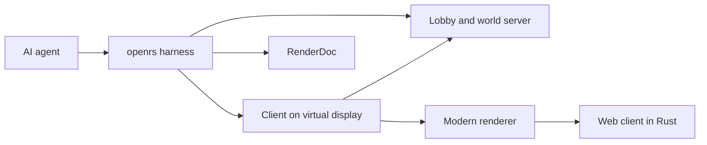
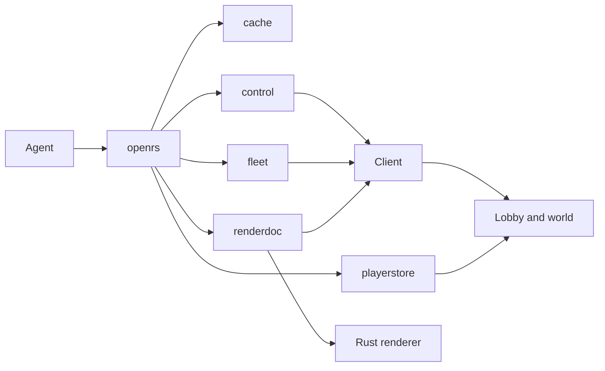

Always read and update this project based on _MARKDOWN-FORMAT.md and _APP-SPECIFICATION.md 

This app is deployed to the web through WebGPU. Development runs locally on Linux with Hyprland only.

# Code Stack

| Part | Location | Language | Role |
| --- | --- | --- | --- |
| Client | `code/client` | Kotlin, Gradle | Native game client, modern OpenGL renderer only |
| Server | `code/server` | Java, Gradle | Lobby and world, unchanged |
| Cache | `assets/cache` | Unpacked JSON and binaries | Game data, unchanged, cloned from `darkanrs/cache-unpacked` |
| Harness | `code/harness` | Rust | AI development harness, `openrs` command line tool |
| Renderer | `code/renderer` | Rust, WebGPU through `wgpu`, WGSL translated by naga | The transpiled modern renderer, native on Vulkan and in the browser as wasm |
| RenderDoc | `code/renderdoc` | Python, C, Rust | Capture, analysis and equivalence diff of the client and the renderer |
| Web | `code/web` | Rust, HTML | Web server and page that host the renderer |

Only the modern renderer is transpiled to Rust for the web. The cache, lobby and server stay as they are.

# Goals

1. Build a seamless and extremely fast AI development harness in Rust.
2. Make the client always use the modern renderer.
3. Move the client to the web through the modern renderer code and nothing else.
4. Keep the harness and the web deployment in Rust.

# Harness

The harness is a Cargo workspace in `code/harness`. Every feature is its own crate in `code/harness/crates/`, and the `openrs` crate is the single command line entry point that wires them together. `src/HARNESS.md` is the index of every command and document.

| Crate | Command | Task |
| --- | --- | --- |
| `openrs` | `openrs` | Command line entry point and process supervision |
| `cache` | `openrs cache` | Builds the packed cache once from `assets/cache` and checks it against the target lobby |
| `control` | `openrs up`, `down`, `do`, `look`, `trail` | Embodies a player through the client's control server, with waits, vision and footprints |
| `display` | `openrs run`, `show`, `hide`, `toggle`, `shot` | Private Xwayland display, null audio and the `/openrs-show` toggle |
| `playerstore` | `openrs player` | Player and interface files saved and loaded without Mongo, and the local lobby and world |
| `fleet` | `openrs fleet` | Up to nine clients in parallel, one per agent |
| `renderdoc` | `openrs capture`, `openrs equiv` | Captures of the client and the renderer, and the equivalence loop |
| `web` | `openrs web` | The web client in an isolated Chromium on the private display, driven over DevTools, with audio on the null sink |
| `twin` | `openrs twin` | The OpenGL client and the browser on one frame, side by side, with the serialized frames compared |
| `doctor` | `openrs doctor` | Checks every prerequisite in parallel and prints a fix for each failure |
| `fresh` | Used by `up` and `fleet up` | Rebuilds the client jar and the packed cache only when they are stale |
| `verify` | `openrs verify` | One scripted live pass over every feature, stopping at the first failure |

## Local Loop

- The default loop runs entirely on this machine: `openrs up` starts the local lobby and world if needed and logs a local account in.
- The client, the local lobby and the local world all read one packed cache, `assets/cache-packed`, so the login CRC check always matches.
- `openrs up shared` targets the shared lobby instead.
- `openrs verify` runs every live check against this loop and writes a report to `code/harness/target/verify/`.
- `openrs resume` restarts the fleet and the client after a crash.

## Fast Cache Load

- The client memory maps `assets/cache-packed`, built once from `assets/cache` with `openrs cache build`.
- Archives are decoded on first use and the JS5 network fetch is skipped.
- Every startup prints one `[load]` line per stage.
- The login packet carries the target lobby's CRC table, read over JS5, so the shared lobby accepts the client although its cache build differs.

## Instant World Entry

- The client enters the world as soon as the cache is ready, with no waits on the title, login or lobby screens.
- `[Milestone]` lines report cache ready, lobby logged in, world selected and first world frame.

## Control Bridge

- The client's control server exposes the bot API over a local socket, so anything a bot script can do, an agent can do.
- Commands are batched over one connection, waits block on game ticks, `look` returns a frame readback and a text description of the world.
- Footprints record every command and every observed state change, so an agent can read back where it has been.
- The bridge never injects input into the real desktop.

## Virtual Display

- The client runs on a private Xwayland display on the real GPU with a null audio sink.
- `/openrs-show` in chat, or `openrs toggle`, moves the client between the hidden workspace and the main display.

## Player Store

- Player files are JSON, saved and loaded without Mongo by the local lobby and world.
- Open interfaces are part of the player file, with gameval names, and edits to the file are applied live.

## Web Client Harness

- `openrs web up` starts the web server and an isolated Chromium on the private display, with WebGPU on the real GPU and audio on the null sink, never the user's browser.
- `openrs web do`, `look`, `trail`, `show`, `hide` and `toggle` mirror the native commands, driven over the DevTools protocol through a `window.openrs` page bridge.
- `openrs capture browser` captures the browser's WebGPU with RenderDoc, and `openrs equiv --target browser` compares it with the OpenGL client on one frame.
- The browser currently replays frames. Game state arrives with the frame stream described in `src/MODERN-RENDERER-WEB-TRANSFER.md`.

## Twin

- `openrs twin` runs the OpenGL client and the browser on the same frame, serializes the frame on both sides, and writes a side by side image, a difference image and a JSON report.
- The verdict needs the serialized frames to be identical, so a pixel difference is known to come from rendering and not from lost data. `--renderdoc` adds the RenderDoc comparison.
- `src/TWIN.md` describes the output and how to read it.

## Fleet

- `openrs fleet` runs up to nine clients, each with its own control socket, footprints and account.
- Every slot has a transpilation role and a start tile where that feature is visible.
- Local accounts are `fleet1` to `fleet9` on the local server. Accounts on the shared lobby are created by the user and named in `code/harness/fleet.toml`, never in the repository.
- The local world allows three sessions per IP address, so local slots are spread over several local lobby and world pairs, three slots per pair. The login limit is not changed.
- The local lobby and world ports are 24594 and 24595 plus 10 per pair, below the kernel's range for outgoing connections, so no unrelated connection can hold one.

## RenderDoc And Equivalence

- RenderDoc is built with OpenGL and Vulkan support and captures both the client, on a GL 4.3 core context, and the Rust renderer.
- Every capture is normalized into one frame summary, and `openrs capture diff` compares two of them draw by draw and pixel by pixel.
- `openrs equiv` captures the client and the renderer on the same scene, diffs them, prints a verdict and keeps a score history.

# Client

## Modern Renderer Only

- The client always uses the modern renderer.
- The legacy toolkits are not selectable.
- The modern renderer runs on an OpenGL 4.3 core profile context with no fixed function calls.
- The context is a GLX core profile context on Linux. There are no other native platforms, the web build reaches them.
- The legacy OpenGL toolkit is deleted. `SafeModeToolkit` remains only for the loading screen, the CPU benchmark and item icons.
- The client code has no comments, following `_MARKDOWN-FORMAT.md`. The server keeps its comments because it stays as it is.
- The client dumps frames in the `.orf` format so the Rust renderer can replay exactly what the client drew.
- The modern renderer code is isolated so it can be transferred to the web as the only transpiled part of the client.

# Web

- `code/web` holds a Rust web server and an HTML page that loads the renderer as wasm.
- The renderer in `code/renderer` uses WebGPU through `wgpu`, with WGSL shaders translated by naga from the client's GLSL.
- Equivalence with the client is measured with `openrs equiv` before a pass is considered transferred.
- Native desktop builds and the web build share the cache, lobby and server unchanged.
- The renderer has the model, ground, sprite, shadow, particle, water and material passes. Planar water reflections and bloom are not ported yet.
- Next: a live frame stream from the client to the browser, with input sent back, described in `src/MODERN-RENDERER-WEB-TRANSFER.md`.

# Rules For Agents

1. Keep changes inside the area named for the task.
2. Never inject input into the user's real desktop.
3. Never edit markdown files that start with `_`, except `_APP-SPECIFICATION.md` when the user asks.
4. Follow `_MARKDOWN-FORMAT.md` for code and markdown.
