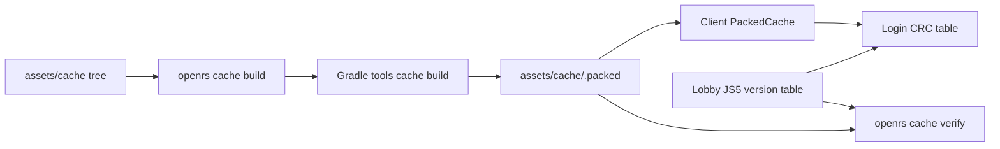

# Cache

The client reads the game from a locally packed cache and the harness keeps that pack in step with `assets/cache`.

# Packed Cache

| Item | Value |
| --- | --- |
| Source | `assets/cache`, an unpacked cache tree |
| Output | `assets/cache/.packed`, a JS5 sector store |
| Builder | `./gradlew :tools:run --args="cache build <tree> <out>"` in `code/server` |
| Stamp | `assets/cache/.packed.stamp`, the manifest hash of the tree at the last build |

- The build is deterministic: two builds of the same tree give identical reference tables.
- The manifest hash is the file count plus an order independent sum of the relative path, size and modified time of every source file outside `.git`, `.packed` and `.packed.stamp`.

# Command

| Command | Effect |
| --- | --- |
| `openrs cache build` | Builds only when the manifest hash differs from the stamp |
| `openrs cache build force` | Builds regardless |
| `openrs cache status` | Prints the manifest hash, whether the pack is fresh and the index count |
| `openrs cache verify` | Compares the pack with the local lobby |
| `openrs cache verify shared` | Compares the pack with the shared lobby |

- The Gradle call runs with `DARKAN_CACHE_SOURCE`, `CACHE_SOURCE_PATH` and `CACHE_BUILD_PATH` set and `JAVA_HOME` taken from `OPENRS_JAVA_HOME` or the first `~/.jdks/jdk-26*`.
- `OPENRS_SHARED_LOBBY` overrides `lobby.devmakerstudio.com:43594` and `OPENRS_JS5_TOKEN` overrides the JS5 token.

# Version Check

`openrs up` fetches the version table of the target lobby through JS5, archive 255 of index 255, and compares every index CRC with the CRC of the same index in the pack.

| Mode | Stale pack | Differing CRC |
| --- | --- | --- |
| Local | Error | Error `cache mismatch: local X vs lobby Y (indices ...), run openrs cache build` |
| Shared | Error | Warning with the same text, login continues |

# Login CRC Table

- The lobby and the world compare the first 32 index CRCs in the login packet with their own cache and answer response 6 on any difference.
- The client sends the CRC table of the lobby it logs in to, fetched through JS5 by `LoginCrcs`, instead of the CRC of its local pack.
- When the lobby cannot be reached the client falls back to the CRC of the local pack.

# Shared Lobby Divergence

The shared lobby serves a different cache build than `assets/cache`.

| Fact | Evidence |
| --- | --- |
| Pack and local lobby agree | All 37 index CRCs equal |
| Shared lobby differs | Indices 2, 3, 5, 7, 8, 12, 16, 17, 18, 19, 22 and 23 |
| Same revision | Both report 727 and the index 8 table has 3 more archives on the shared lobby |

- The old behaviour was to log in with whatever CRCs the lobby served, which is why the client worked before the local pack.
- The packed cache cannot be made identical to the shared lobby without the exact source tree the lobby was built from.

# Single Local Root

- `assets/cache` contains the unpacked source and `assets/cache/.packed` contains its derived sector files.
- The client memory maps that packed directory, and every local lobby and world uses it as `CACHE_BUILD_PATH`. The browser never receives the full cache; game hosts send only the resources needed to render.
- `assets/cache/.packed.stamp` stores the source manifest. Generated packed files are excluded from that manifest so a build never invalidates itself.
- The former `assets/cache-packed` and `code/harness/target/local/cache` copies were compared and removed during consolidation.

# Downloaded Native Cache Persistence

The hosted reference client uses its normal downloaded cache rather than the different supplied pack. Client-side limits previously wrote overflow markers and deleted those files at next open. The data file was observed at 524288001 bytes and the maps index at 1048577 bytes, exactly one byte over the old limits.

- Client file handling now preserves oversized files and reports capacity errors without deleting them or appending overflow markers.
- Native downloaded data is bounded to 4 GiB, each sparse index to 96 MiB and archive payloads to the format's 24-bit length field. Tests exercise an archive above 1.5 MiB and an index slot beyond the old 1 MiB boundary.
- The client now supplies its reference-table disk store to the network workers. A live run persisted 37 index entries instead of leaving `idx255` at one byte.
- This changes client persistence behavior, not the supplied cache assets or hosted cache content.
- Latest hosted restart reached first world frame in 8.3 seconds; one separate warm run spent roughly 100 seconds in `discard_unpacked`. That intermittent stall is not claimed fixed.
