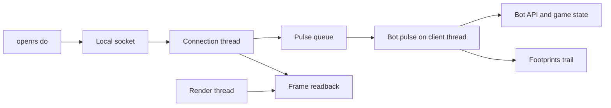
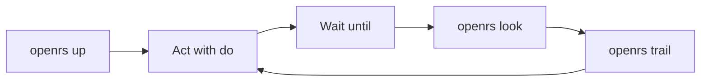

# Control Protocol

The control bridge lets the harness read and drive the client the same way a bot script does. It never touches the real desktop: every command runs inside the client process.



# One Command Start

`openrs up` does everything in one go and `openrs down` undoes it.

| Command | Effect |
| --- | --- |
| `openrs up` | Local server mode: ensures the packed cache, starts the local lobby and world when they are down, creates the `claudeqa` account and player file, starts the client on the virtual display with autologin, waits for the world and prints `ready` with the milestone timings |
| `openrs up shared` | Same, but logs in to the shared lobby with the credentials in `~/.darkan_login` |
| `openrs up ... extra` | Extra `-D` and `-X` arguments go to the JVM, everything else goes to the client |
| `openrs down` | Stops the client only, keeping the display and the local server warm |
| `openrs down all` | Also stops the display, the null audio sink and the local server |

The packed cache is taken from `assets/cache-packed`, then `OPENRS_CACHE`. The local server builds and reads the same `assets/cache-packed`, so the client, lobby and world share one pack. Before the client starts, `openrs up` checks the pack against the target lobby and `openrs cache build|status|verify` manages it, see [CACHE.md](CACHE.md). 

When the client is already in the world `openrs up` prints `ready (already up)` and does nothing else.

```text
cache: assets/cache-packed
client pid 517702 on :100 audio openrs_null log /run/user/1000/openrs/client.log
ready tick 9 pos {"x":3225,"y":3222,"z":0}
timings: load done 2719, cache ready 2530ms, lobby logged in 3533ms, world selected 3533ms, first world frame 8259ms, world entry 9.5s, total 9.5s
```

# Starting The Server

The server is off unless the client is started with the system property `bot.control`. `openrs up` sets it.

| Value | Listens on |
| --- | --- |
| A file path | Unix domain socket at that path, mode `rw-------` |
| Digits only | TCP on `127.0.0.1` at that port |

The Rust side reads the same endpoint from the environment variable `OPENRS_CONTROL`. When it is unset it uses `$XDG_RUNTIME_DIR/openrs-control.sock`, falling back to `/tmp/openrs-control.sock`.

| Property | Effect |
| --- | --- |
| `bot.control` | Socket path or port |
| `bot.footprints` | Directory of the trail log |
| `autologin` | `true` to use `~/.darkan_login`, or `user:pass` |

```bash
openrs run -Dautologin=true -Dbot.control=$XDG_RUNTIME_DIR/openrs-control.sock -Dbot.footprints=$PWD/code/harness/target/footprints
```

# Wire Format

- One JSON object per line in each direction.
- A connection may send any number of requests and gets one response per request, in order.
- A request is `{"cmd": "walk", "args": ["3200", "3200"]}`. Every argument is a string.
- A success is `{"ok": true, "data": ...}`.
- A failure is `{"ok": false, "error": "message"}`.
- A batch is `{"batch": [{"cmd": "pos"}, {"cmd": "tick"}]}` and gets one `{"ok": true, "data": [response, ...]}` line holding one response per command.
- A batch stops at the first failed command, so the data array may be shorter than the request.
- Consecutive state reads and actions in a batch run in the same client pulse, which costs well under a millisecond each.

# Threading

- Reads and actions are queued and executed at the start of `Bot.pulse`, on the thread that runs the client loop, so they see consistent game state and queue packets exactly as scripts do.
- A queued command that is not run within 10 seconds fails, which happens when the client is not pulsing.
- `help`, `scripts`, `run` and `stop` run on the connection thread because they only touch the script registry.
- `wait-tick`, `wait-idle` and `wait-until` park the connection thread and are checked once per pulse on the client thread, so they never stall the game.
- `screenshot` parks the connection thread until the render thread reads the frame back right before the buffer swap.
- A tick is a game tick of about 0.6 seconds, counted from each player update packet. It stays at 0 until the first update arrives after login.

# State Reads

| Command | Arguments | Result |
| --- | --- | --- |
| `tick` | none | Game tick counter |
| `describe` | none | Compact text description of the world |
| `state` | none | Game tick, game state name, logged out flag, running scripts |
| `pos` | none | Player `x`, `y`, `z` |
| `skills` | none | Level and xp for each of the 25 skills |
| `inventory` | none | Occupied slots with id, amount and name |
| `bank` | none | Last known bank container |
| `varp` | `id` | Player variable value |
| `varbit` | `id` | Player variable bit value |
| `interface` | `[id]` | Whether the interface is open, or every open interface id without an argument |
| `chat` | `[count]` | Latest chat lines, newest first, default 10 |
| `npcs` | none | Nearby npcs with index, id, name and tile |
| `objects` | none | Nearby objects with id, name and tile |
| `ground` | none | Ground items with id, amount, name and tile |

# Actions

| Command | Arguments | Bot call |
| --- | --- | --- |
| `walk` | `x y` | `Bot.walkTo` |
| `npc` | `name or id, option` | `Bot.clickNPC` on the closest match, returns whether one was found |
| `object` | `name or id, option number or name` | `Bot.clickObject` on the closest match |
| `take` | `itemId x y` | `Bot.takeGroundItem` |
| `widget` | `interface component [option=1] [slot=-1] [item=-1]` | `Bot.clickButton` |
| `chat` | `text...` | `Bot.chat`, or the display toggle when the text is `/openrs-show` |
| `command` | `text...` | `Bot.command`, sent as `;;text` |
| `console` | `name args...` | `Bot.handleConsoleCommand` |
| `logout` | `[lobby=true]` | `Bot.sendLogout` |

`chat` with no argument or a number reads the chat, any other text is said.

# Waiting

Waits block the call until the condition holds, then answer with a snapshot of the tick and position, so an action can be followed by an observation without sleeping. Every wait accepts `timeout=ms`, default 30000, and fails with `wait timed out`.

| Command | Condition |
| --- | --- |
| `wait-tick [n]` | `n` game ticks have passed, default 1 |
| `wait-idle [n]` | Not moving and not animating for `n` ticks, default 2 |
| `wait-until pos x y [r]` | Within `r` tiles of the tile, default 0 |
| `wait-until idle [n]` | Same as `wait-idle` |
| `wait-until tick [n]` | Same as `wait-tick` |
| `wait-until interface id` | The interface is open |
| `wait-until closed id` | The interface is closed |
| `wait-until chat text` | A chat line containing the text arrives after the call starts |
| `wait-until inv item [min]` | The inventory holds at least `min` of the item id or name, default 1 |
| `wait-until state name` | The game state has that name |
| `wait-until xp skill` | The skill gains xp after the call starts |
| `wait-until npc name` | A matching npc is visible |

# Vision

`openrs look [path]` prints the path of a screenshot of the client frame followed by the text description.

- The screenshot is a framebuffer readback of the client frame, taken with `glReadPixels` from the back buffer right before the swap and written as a PNG in the footprints `shots` directory, so it is exact even while the window is hidden.
- When the control `screenshot` command fails, `look` falls back to the display crate screenshot of the virtual display and records it in the trail with `"via":"display"`.
- `openrs do screenshot [path]` returns only the path and `openrs do describe` only the text.

The description holds these lines.

| Line | Content |
| --- | --- |
| First | Game tick and game state |
| `pos` | Tile, region id and display name |
| Vitals | Hitpoints, prayer, run energy, animation, moving and combat flags |
| `interfaces` | Open interface ids |
| `npcs`, `players`, `objects`, `ground` | Total count then the 12 nearest as `name#id @x,y dN`, where `N` is the tile distance |
| `chat` | The last five lines, oldest first |

# Footprints

Every command and every significant observed change is appended as one JSON line to `trail.jsonl` in the footprints directory, `code/harness/target/footprints` unless `OPENRS_FOOTPRINTS` is set. The file is never rewritten, so it spans sessions.

| Kind | Written when | Extra fields |
| --- | --- | --- |
| `cmd` | A command finished | `cmd`, `args`, `ok`, `error` |
| `state` | The game state changed | `from`, `to` |
| `pos` | The player moved | `x`, `y`, `z` |
| `xp` | A skill gained xp | `skill`, `delta`, `xp`, `level` |
| `chat` | A chat line arrived | `type`, `name`, `message` |
| `interfaces` | Interfaces opened or closed | `opened`, `closed` |
| `inv` | Inventory slots changed | `changes` with `slot`, `id`, `amount`, `was`, `wasAmount` |
| `shot` | A screenshot was taken | `path` |
| `up` | `openrs up` started a client | `mode` |

Every line has `t`, the epoch milliseconds, `tick` and `kind`. Lines written by the harness while no client answers carry tick `-1`.

| Command | Prints |
| --- | --- |
| `openrs trail` | The last 20 lines |
| `openrs trail N` | The last `N` lines |
| `openrs trail since T` | Every line from tick `T` on |
| `openrs trail path` | The path of the log |

# Scripts

| Command | Arguments | Effect |
| --- | --- | --- |
| `scripts` | none | Lists scripts with id, name and running flag, loading the script directory if empty |
| `run` | `name` | Starts the script matched by id, name or class name, restarting it when already running |
| `stop` | `[name or all]` | Stops one script or every script |

# Command Line

`openrs do <command> [args]` sends one request and prints the result. Strings print bare and everything else prints as indented JSON. The exit code is 1 when the endpoint is unreachable or the server returns an error. `openrs do` with no command lists every command.

```bash
openrs do pos
openrs do command teleto lumbridge
openrs do npc Banker 2
openrs do widget 679 0 1 5 1265
openrs do run Simple Banker
```

## Batches

All commands of a batch travel over one connection in one request.

- A lone `;` argument separates commands on the command line.
- `openrs do -` reads one command per line from standard input.
- `openrs do @file` reads one command per line from a file.
- Words in a line split on spaces, double quotes keep spaces, and lines starting with `#` are skipped.
- Batch results print one per line, objects as compact JSON, and the exit code is 1 when a command failed.

```bash
openrs do walk 3230 3225 \; wait-until pos 3230 3225 1 \; describe
printf 'command item 1511 5\nwait-until inv 1511 5\ninventory\n' | openrs do -
```

## Latency

Measured live on the virtual display.

| Case | Time |
| --- | --- |
| One `openrs do pos` process, start to answer | about 20 ms |
| 40 reads in one batch | about 11 ms in total |
| `wait-tick 1` | about 0.6 s, one game tick |

# Embodied Tester Guide

Claude drives a real player the way a human tester would: act, wait for the result, look, and read the trail.



## Typical Loops

- Start once with `openrs up`, work for as long as needed, then `openrs down`.
- Orient with `openrs look` and open the PNG it prints with the image reader.
- Act and observe in one call, chaining with `;` so no sleep is needed.
- Check the effect in the trail with `openrs trail since T` using the tick from the wait snapshot.

| Goal | Calls |
| --- | --- |
| Walk somewhere | `openrs do walk X Y \; wait-until pos X Y 1 \; describe` |
| Get a test item or level | `openrs do command item 1511 5 \; wait-until inv 1511 5` and `openrs do command setlevel 8 30` |
| Teleport | `openrs do command teleto lumbridge \; wait-tick 3 \; pos` |
| Talk to or attack an npc | `openrs do npc Cook 1 \; wait-idle` |
| Use an object | `openrs do object Bank booth 2 \; wait-until interface 762` |
| Click an interface button | `openrs do widget 762 95 1` |
| Wait for a result message | `openrs do wait-until chat "you receive" timeout=20000` |
| See what happened | `openrs trail 30` |
| Show the window to the user | `openrs do chat /openrs-show`, repeat to hide again |

## Footprints And Etiquette

- The trail is the memory of the session, so read it again after any pause instead of trusting recollection.
- Edit a player offline with `openrs player` before `openrs up`, because the client saves the player when it logs out.
- Never inject input on the real desktop, every command stays inside the client process.
- `openrs show` moves the virtual display to the active workspace and takes keyboard focus, `openrs hide` and the second `/openrs-show` return focus to the previous window.
