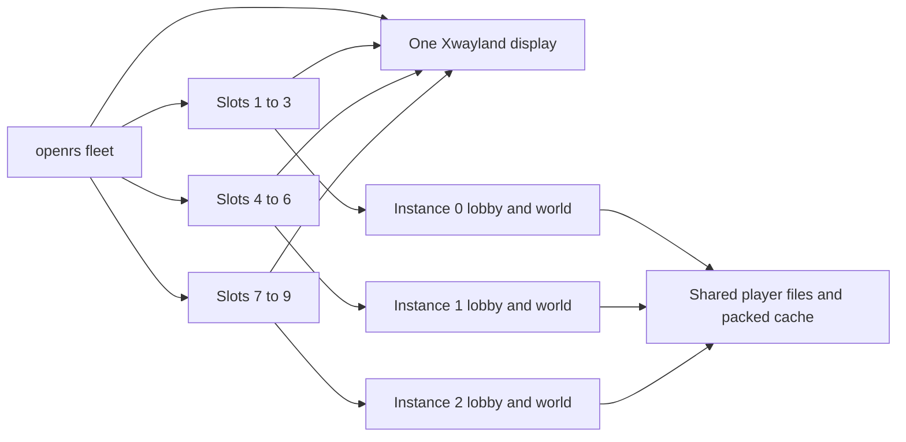
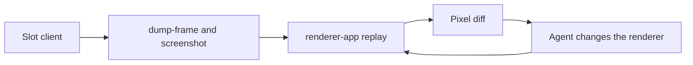

# Fleet

The fleet runs up to nine clients at once, each embodied by one agent. It reuses the control bridge described in `CONTROL_PROTOCOL.md` and the player files described in `PLAYER-INTERFACES.md`, and adds isolation, staggered startup, accounts and one local server instance for every three slots.



# Commands

| Command | Effect |
| --- | --- |
| `openrs fleet up [N]` | Starts the local server instances slots 1 to `N` need, prepares the accounts, starts slots 1 to `N` (default 9), at most `parallel` loading at once, and prints the time each slot took to reach the world |
| `openrs fleet status` | One row per running slot with its server (`local0` to `local2` or the configured name), role, account, pid, game state, tick, tile, RSS, PSS and CPU, then the totals including the display |
| `openrs fleet do <slot> <cmd...>` | `openrs do` on that slot, batches with `;` work the same |
| `openrs fleet look <slot> [path]` | `openrs look` on that slot |
| `openrs fleet trail <slot> [...]` | `openrs trail` on that slot |
| `openrs fleet place <slot> [x y z]` | Moves the slot to the tile, default its configured start. A running slot is teleported with `command tele`, a stopped slot gets a player file edit |
| `openrs fleet down` | Logs every slot out, stops them by recorded pid, stops the local server instances the fleet started, stops the fleet display and removes the fleet state |

- `up` skips slots that are already running, so it can be called again to add slots.
- `down` never touches the single client of `openrs up`, a local server instance the fleet did not start or the shared null audio sink.
- Every process is found through a pid file and a check of the command line, never by pattern kill.

# Isolation

All fleet state lives in `$XDG_RUNTIME_DIR/openrs-fleet`, selected with `OPENRS_STATE`, so it never mixes with `openrs up`.

| Resource | Per slot or shared | Detail |
| --- | --- | --- |
| Control socket | Slot | `s<N>/c.sock` |
| Footprints and shots | Slot | `s<N>/fp` |
| Client home | Slot | `s<N>/home` through `-Duser.home`, so preferences and crash files never collide |
| Log and pid | Slot | `slot<N>.log` and `slot<N>` |
| Display | Shared | One Xwayland with nine windows. Frames are read back with `glReadPixels`, so overlapping windows do not matter |
| Audio | Shared | The existing `openrs_null` sink |
| Packed cache | Shared | `assets/cache-packed`, mapped read only, the pages are shared by the page cache |
| Account and player file | Slot | `fleetN` in the local file store |
| Local lobby and world | Three slots | Instance `(N - 1) / 3`, see Local Server Instances |

One display was chosen over nine because Xwayland costs about 140 MB to 200 MB once, while nine would cost that nine times and add nine special workspace windows to the compositor.

# Client Tuning

| Setting | Value | Reason |
| --- | --- | --- |
| Garbage collector | `-XX:+UseSerialGC` | Smallest footprint, pauses do not matter for a harness |
| Heap | `-Xms64m -Xmx512m` and free ratios 10 and 30 | The client holds about 220 MB of live data, so the heap stays near it |
| Compiler | `-XX:TieredStopAtLevel=1 -XX:CICompilerCount=1` | Less compile CPU and memory while nine clients share eight cores |
| Code cache | `-XX:ReservedCodeCacheSize=48m` | Enough for the C1 only code |
| Stacks | `-Xss512k` | The client uses few deep stacks |
| Allocator | `MALLOC_ARENA_MAX=2` | Fewer glibc arenas for many threads |
| Frame rate | `-Dfps=20` | Cuts render CPU and GPU, enough for frame readback |
| Window | `-Dwindow.size=800x600` | Smaller framebuffers |
| Script sync | `-Dbot.scripts.sync=false` | No network sync nine times |

- The defaults are overridden with `jvm`, `fps`, `window` and per slot `heap` in the config.
- Startup is staggered: a new client only starts while fewer than `parallel` clients are still loading, default 3.

# Configuration

`code/harness/fleet.toml.example` is committed. Copy it to `code/harness/fleet.toml`, which is ignored by git, or point `OPENRS_FLEET` at another file. Without a real file the example is used.

| Section | Keys | Meaning |
| --- | --- | --- |
| `[defaults]` | `heap`, `window`, `fps`, `parallel`, `jvm`, and any slot key | Used by every slot that does not set its own value |
| `[server.<name>]` | `host`, `lobby`, `world` | Target server. For `local` the ports are those of instance 0 |
| `[slot.<N>]` | `role`, `account`, `server`, `credentials`, `start`, `heap` | One slot |

## Credentials

| Value | Source |
| --- | --- |
| `local` | A random password generated on first use and stored in `~/.config/openrs/fleet-local.json`, mode 0600, outside the repository |
| `env:NAME` | The environment variable `NAME` |
| `file:PATH` | The first line of the file at `PATH`, `~` is expanded |

- No password is ever written to the repository.
- Passwords are passed to the client as `-Dautologin=user:pass`, so they are visible in the process list of the same user, like the single client.
- Slots can be pointed at the shared lobby with `server = "shared"` and credentials the user supplies. The fleet never creates accounts on a shared lobby, account creation only runs for `server = "local"`.

```toml
[slot.6]
server = "shared"
account = "my_account"
credentials = "env:FLEET6_PASSWORD"
```

# Local Server Instances

The local world refuses a fourth session from one ip address with login response 9, and loopback is not exempt for ordinary accounts. Every local client connects from `127.0.0.1`, so one local world holds three fleet slots. The fleet does not change that check. It runs several independent local lobby and world pairs instead, three slots on each.

## Slot To Instance

Every slot with `server = "local"` belongs to instance `(N - 1) / 3`.

| Slots | Instance | Lobby port | World port | HTTP and social gateway port |
| --- | --- | --- | --- | --- |
| 1 to 3 | 0 | 24594 | 24595 | 4140 |
| 4 to 6 | 1 | 24604 | 24605 | 4150 |
| 7 to 9 | 2 | 24614 | 24615 | 4160 |

- The ports of instance `i` are the base ports plus `10 * i`. The base ports come from `OPENRS_LOBBY_PORT`, `OPENRS_WORLD_PORT` and `OPENRS_API_PORT` for the server, and from `[server.local]` for the clients, so the two must agree.
- The lobby and world ports are below 32768 on purpose. The kernel hands out 32768 to 60999 as the local port of outgoing connections, so a port such as 44604 was sometimes already taken by an unrelated connection and the second lobby failed with "Address already in use". A unit test keeps the defaults under that limit.
- The client of a slot is started with `host lobby world` of its instance.
- Slots pointed at any other `[server.<name>]` keep the configured host and ports unchanged.

## Starting And Stopping

```bash
openrs player serve 3
openrs player serve status
openrs player serve stop 2
openrs player serve stop
```

| Command | Effect |
| --- | --- |
| `openrs player serve [N]` | Starts instances 0 to `N - 1` (default 1), skipping those already running. Each lobby is started before its world, and the instances one after another |
| `openrs player serve status` | One line per lobby and world with instance, pid, state and ports |
| `openrs player serve stop [I]` | Stops instance `I`, or every instance |

- `fleet up` checks the lobby port of every instance its slots need and starts the instances that do not answer. The ones it started are recorded in `servers` in the fleet state, and `fleet down` stops only those.
- Each instance has its own pid files and logs in `code/harness/target/local`, named `lobby` and `world` for instance 0 and `lobby1`, `world1` and so on for the others.

## What Instances Share

| Resource | Shared | Detail |
| --- | --- | --- |
| Player and account files | Yes | `PLAYER_FILE_DIR`. Accounts are read from disk on every lookup, so an account created through instance 0 logs in on every instance |
| Packed server cache | Yes | `CACHE_BUILD_PATH`, checked at startup. The instances start one after another, so only the first one rebuilds it when `assets/cache` changed |
| Lobby, world and HTTP ports | No | Base ports plus `10 * i` |
| Social gateway | No | Each world joins `ws://localhost:<http port>/social/ws` of its own lobby, so it registers with its own lobby only |
| World id | No | Every instance lists world 100 on its own lobby |
| Pid files and logs | No | One pair per instance |

- An account must only be online on one instance at a time. Each slot has its own account, so this holds for the fleet.
- Other clients on the same instance, such as the single client of `openrs up` on instance 0, count towards its three sessions.

## Local Accounts

- `fleet up` creates `fleet1` to `fleet9` on first use through `openrs player account`, which talks to instance 0, creates the player file at the slot start tile, sets `chosenAccountType` to `true` so no character creation appears, and rewrites the tile on every start.
- Each world allows 2000 players, so capacity is not the limit.
- A slot is marked failed as soon as the log shows a login response other than 2, instead of waiting for the timeout.

# Roles And Start Tiles

Each role has a tile where its feature is visible, and `fleet place` or a player file edit puts the client there.

| Slot | Role | Start tile | What is visible there |
| --- | --- | --- | --- |
| 1 | model-pass | 3212 3428 0 | Varrock square, many npcs, objects and player models |
| 2 | ground-pass | 2920 3445 0 | Taverley hillside, slopes and overlays |
| 3 | sprite-ui-pass | 3222 3218 0 | Lumbridge, default interfaces and minimap |
| 4 | shadow | 2964 3381 0 | Falador, walls and towers casting shadows |
| 5 | particles | 3082 3420 0 | Barbarian Village fire pits |
| 6 | water | 3029 3217 0 | Port Sarim docks next to the sea |
| 7 | textures-materials | 3093 3244 0 | Draynor Village, trees, roofs and mixed materials |
| 8 | scene-camera-lighting | 3164 3487 0 | Grand Exchange, large open plaza |
| 9 | equivalence-diff | 3234 3228 0 | Lumbridge east, the reference scene for frame diffs |

```bash
openrs player pos fleet6 3029 3217 0
openrs fleet place 6 3029 3217 0
openrs fleet do 6 command tele 3029 3217 0 \; wait-tick 3 \; pos
openrs fleet look 6
```

- A player file edit is only safe while the slot is stopped, because the client saves the player on logout.
- `fleet do N command tele x y z` moves a running slot.

# Working With A Slot

- An agent owns one slot number and only uses `fleet do N`, `fleet look N` and `fleet trail N`.
- Calls to different slots run in parallel because every slot has its own socket and its own client thread.
- Screenshots land in `$XDG_RUNTIME_DIR/openrs-fleet/s<N>/fp/shots`.

# Parallel Transpilation

Nine agents work on the renderer at once, one per slot, each comparing the client and the renderer on its own slot's frame.



1. `openrs fleet compare <slot> [dir]` dumps a frame and takes a screenshot from the slot's client in one batch, replays the frame in `renderer-app`, and prints SSIM, PSNR and the differing pixel share, with `client.png`, `web.png` and `diff.png` in `code/harness/target/compare/s<slot>`.
2. Each run appends to `code/harness/target/compare/history-s<slot>.jsonl`.
3. `compare` needs no RenderDoc and about 270 MB of GPU memory, so all nine slots run it at once. `openrs verify` runs it on all nine slots as its `fleet-compare` step.
4. After a crash, `openrs resume` brings the fleet back with the same slots.

| Setting | Value | Reason |
| --- | --- | --- |
| `CARGO_TARGET_DIR` | `code/renderer/target-s<slot>` | Builds never block or overwrite each other |
| Build profile | `cargo build --profile iter` | No link time optimization and incremental, about 1 s per change instead of 66 s |
| `OPENRS_RENDERER_EXE` | `code/renderer/target-s<slot>/iter/renderer-app` | `compare` replays with the agent's own build |

- Only the equivalence slot runs `openrs equiv`, because RenderDoc replays need gigabytes of GPU memory. All replays from any `openrs` process take turns behind one lock file.
- The client jar is shared by the running fleet, so agents never rebuild it while the fleet runs.

# Measurements

Measured by `openrs verify` on this machine, 8 cores, 62 GB, GTX 1660 SUPER, with other servers running.

| Measure | Value |
| --- | --- |
| `fleet up 9` across three local server pairs | 74 s, and 95 s through `openrs resume` after a crash |
| Time for each slot to reach the world | 7.1 s to 14.0 s |
| Nine clients in total | 6.7 GB to 8.9 GB RSS, 5.9 GB to 8.0 GB PSS |
| CPU of nine clients | 370 % to 520 % of one core |
| Xwayland | 213 MB, once |
| Nine `fleet do` calls in parallel | 46 ms to 185 ms in total |
| Nine `fleet compare` runs in parallel | 39 s |
| `fleet down` | 4 s |

## Server Instance Memory

Measured with three instances running.

| Part | RSS |
| --- | --- |
| Lobby | 3.1 GB to 3.5 GB, it holds the 513 MB packed cache in memory for JS5 |
| World | 1.9 GB |
| One lobby and world pair | about 5 GB |
| Three pairs for nine slots | about 15 GB, on top of 6.1 GB for nine clients |

- The start scripts read `JAVA_OPTS`, `LOBBY_OPTS` and `WORLD_OPTS`, which `openrs player serve` passes through, so `JAVA_OPTS=-Xmx2g openrs player serve 3` caps every instance. Keep 3 GB while the cache has to be rebuilt.
- The cache files are read through the page cache, so the three worlds share those pages.
