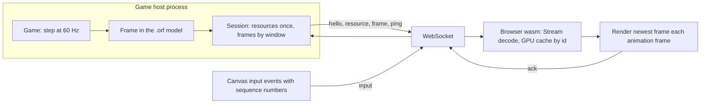

# Frame Stream

The web client is a thin browser renderer. The game runs outside the browser as a game host, simulates at a fixed rate, produces draw frames in the `.orf` data model of `RENDERER-FRAME-FORMAT.md` and streams them over one WebSocket. The browser renders the newest frame it holds and sends input events back. The lobby's TCP protocol and the cache never enter the browser.

| Side | Code |
| --- | --- |
| Codec, both sides | `code/renderer/src/stream.rs`, native and wasm, no GPU code |
| Browser state | `stream::Stream` in the same file, used by `App` in `code/renderer/src/web.rs` |
| Page | `code/web/static/stream.js` opens the socket, forwards input, acks frames, keeps the round trip |
| Host | `code/games`, the `openrs-games` binary, see `GAMES.md` |

## Messages

Every message is a binary WebSocket message whose first byte is the kind. Integers and floats are little endian, as in the frame format.

### Host To Browser

| Kind | Name | Body |
| --- | --- | --- |
| 0 | `hello` | UTF-8 JSON: `{"game":"orbit","width":800,"height":600,"tick":60}`, the game name, the frame size before the first resize and the simulation rate |
| 1 | `resource` | A complete `ORF3` file holding only mesh and texture chunks, no draws |
| 2 | `frame` | `u32` frame number, `u32` last processed input sequence, `u32` frames the host dropped so far, then a complete `ORF3` file with uniforms, instances and draws, no meshes or textures |
| 3 | `ping` | `u32` frame number, sent once a second while no frame can be sent |

- Both `resource` and `frame` bodies are exactly what `frame::write` produces, so the browser parses them with `frame::parse` and the Kotlin `OrfWriter` can produce them unchanged, including the per chunk zlib compression of records of 128 bytes and more.
- A `frame` references meshes and textures by id. The host sends a resource once per connection, and again only when the content behind an id changed, which it detects with a hash of the bytes. Per frame geometry such as particles or a HUD reuses one id, so the browser overwrites one GPU buffer instead of growing.
- The browser keeps meshes and textures in its GPU cache keyed by id until the connection ends, and uploads uniforms and instances with every frame.

### Browser To Host

| Kind | Name | Body |
| --- | --- | --- |
| 0 | `input` | `u32` sequence, `u8` event kind, `u8` button, `f32` a, `f32` b, `u8` length and the key code bytes |
| 1 | `ack` | `u32` number of the frame the browser has just rendered |
| 2 | `pong` | Nothing, the answer to a `ping` |

| Event kind | Name | `button` | `a`, `b` | Code |
| --- | --- | --- | --- | --- |
| 0 | key down | 0 | 0, 0 | `KeyboardEvent.code` such as `KeyW` |
| 1 | key up | 0 | 0, 0 | The same code |
| 2 | mouse move | Pressed buttons mask | x, y in canvas pixels | Empty |
| 3 | mouse down | 0 left, 1 middle, 2 right | x, y | Empty |
| 4 | mouse up | The same | x, y | Empty |
| 5 | wheel | 0 | delta x, delta y | Empty |
| 6 | resize | 0 | width, height of the canvas in pixels | Empty |
| 7 | focus | 0 | 1 focused, 0 blurred | Empty |

- Sequence numbers start at 1 and grow by one per event on one connection. The browser sends a resize and a focus event as soon as the socket opens, so the host always knows the canvas size.
- Canvas pixels are the drawing buffer coordinates, with the device pixel ratio applied, the same space as the sprite pass.

## Flow Control

The host never queues frames without bound.

1. The browser acks every frame it renders with the frame number.
2. The host allows `WINDOW` frames in flight, two, counted as the last sent number minus the last acked number.
3. A simulation tick whose frame cannot be sent is still simulated, but its frame is dropped and the host's drop counter grows. The next sent frame carries that counter.
4. The browser renders the newest frame it holds once per animation frame. A frame that is replaced before it was rendered counts as dropped on the browser side.

So a browser running at 30 frames per second receives about 30 frames per second from a 60 Hz game, with the host dropping every other frame and the socket holding at most two frames. The frame numbers always reflect the simulation, so a gap in the numbers is a drop and the HUD of the `orbit` game shows which tick is on screen.

## Latency

- Every `frame` carries the sequence number of the last input the game processed before producing it.
- The page remembers the send time of every input sequence. When the rendered frame's echoed sequence matches a remembered one, the round trip is now minus that time, and remembered entries up to that sequence are dropped.
- The round trip covers the socket both ways, up to one host tick of 16.7 ms waiting for the next simulation step, and up to one browser frame waiting for the next animation frame. Measured on one machine it is 17 to 35 ms at 48 to 60 page frames per second.

## Browser Side

| `App` method in `web.rs` | Task |
| --- | --- |
| `push(bytes)` | Decodes one host message into the `Stream`, returns the `pong` bytes for a `ping` or nothing, throws on a malformed message |
| `shown()` | Number of the host frame on screen, the page acks it when it changes |
| `stats()` | JSON of the stream counters below |
| `disconnect()` | Forgets the stream and the live frame, the page then shows the built-in scene again |

`App.frame()` takes the newest stream frame when one arrived, merges the resources received since the last render into it, renders it, and keeps rendering the same frame while nothing new arrives, with its meshes and textures cleared so they are not uploaded twice.

| Stat | Meaning |
| --- | --- |
| `messages`, `bytes` | Host messages received and their total size |
| `resources` | Meshes and textures received |
| `received`, `rendered`, `dropped` | Frames received, rendered, and replaced before rendering |
| `hostDropped` | Frames the host dropped because the window was full |
| `hostFrame`, `shown`, `firstFrame` | Newest frame number received, the one on screen, and the first one of the connection |
| `inputSeq` | Input sequence echoed by the newest frame |
| `frameBytes` | Size of the newest frame message |
| `seq`, `sends`, `rttMs`, `rttMaxMs` | Page side: inputs sent, the latest and the largest round trip |
| `game`, `host`, `state`, `error`, `opened` | Page side: connection target and state, the last error, how many connections were opened |

The page reads `?game=NAME&host=HOST:PORT`, the host defaults to the page host on port 8100, and `window.openrs.game` offers `connect(name, host)`, `disconnect()` and `stats()`. The harness commands are in `WEB-HARNESS.md`.

## Kotlin Client As A Host

The client becomes one more host speaking this protocol.

1. The `dump-frame` path already serializes every presented frame through `OrfWriter` as `ORF3` chunks with meshes, textures and uniforms deduplicated by hash. The writer streams each chunk as it is complete, so a frame message is that output with the header and the end chunk, and a resource message is the mesh and texture chunks the hash table has not sent on this connection.
2. The client's game loop is the simulation, so `frame` messages carry the frame number of the presented frame and the sequence of the last browser input the client applied before rendering it.
3. Browser inputs are applied through the same path as the control server, which already drives keys and the mouse without the real desktop.
4. The client keeps the lobby's TCP connection and the cache, and listens for the WebSocket next to the control server.

Nothing in the browser changes between a test game and the client, because both produce the same chunks.

## Native Resource Epoch Extension

The native host optionally offers `resourceEpochs: 1` in hello. A capable consumer replies with the exact two-byte acceptance `[3, 1]`; ordinary test-game hellos and older clients keep their existing behavior.

- A negotiated reset is the ten-byte browser-bound record `[4, 1, epoch:u32, after:u32]`, with integers little endian. It is sent only after all in-flight frames through the barrier are acknowledged.
- The first new-epoch frame redeclares every resource it references. Old IDs are not reused before reset, and stale or malformed barriers are rejected.
- GPU resource caches are replaced just before drawing the new epoch. Pipelines, surface, frame numbering, controller and input sequence continue.
- Limits are 65536 identities, 512 MiB resource content or 4096 sent frames per epoch. Legacy consumers do not receive resets they did not negotiate.
- Tests cover 4096 synthetic changing frames, 300 real WebSocket frames against fake native control, input during ACK drain, legacy interoperability and native GPU-handle lifetime. Live Chromium endurance is a separate measurement, not proven by those tests.
