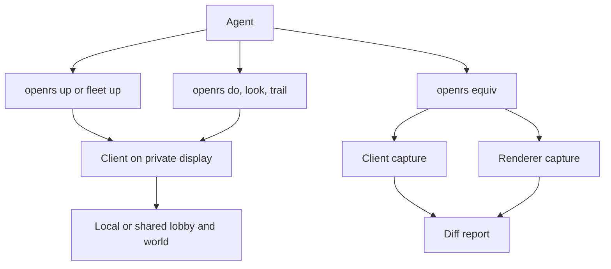
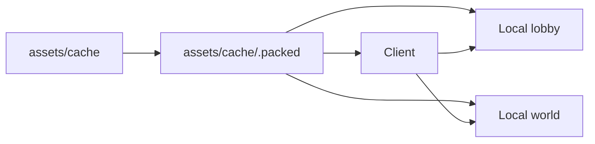
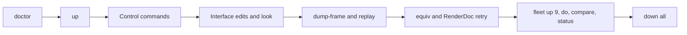
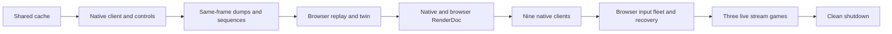

# Harness

The harness is the `openrs` command line tool in `code/harness`. It starts the client, the local server and RenderDoc, lets an agent embody a player, and measures how closely the Rust renderer matches the client. This page lists every command and points to the document that covers it.



# Build

```bash
cd code/harness && cargo build --release
cd code/client && ./gradlew shadowJar
cd code/renderer && cargo build --release
cd code/web && cargo build --release
```

- The packed cache is built once with `openrs cache build`.
- RenderDoc is built once with `openrs capture setup`.
- `openrs up` and `openrs fleet up` keep the client jar and the packed cache fresh on their own, see Freshness.

# Local Loop

The default test loop runs entirely on this machine, with the client, the lobby and the world all reading one packed cache.



1. `openrs up` checks the pack, starts the local lobby and world on ports 24594 and 24595 if they are not running, and logs a local account into the world.
2. `openrs do`, `look` and `trail` drive the client.
3. `openrs down` stops the client, and `openrs down all` also stops the web client, the display and the local server.

- The local server is started with `CACHE_BUILD_PATH` set to `assets/cache/.packed`, so the server and the client share one pack and the login CRC check always matches.
- The local world is world 100, started with `WORLD_BOTS_ALLOWED=true` so clients with the bot sidebar list it. Every local client is pinned to it with `-Dautologin.world=100`, and AutoLogin sets the game host for that world before the world login.
- A recorded process id only counts when its command line is this repository's server, client or Xwayland, so a stale pid file never blocks a start or stops an unrelated process.
- `openrs up shared` targets the shared lobby instead, whose cache build differs, see `CACHE.md`.
- Measured start of the local lobby and world on the shared pack: 8 s and 12 s.

# Commands

| Command | Purpose | Document |
| --- | --- | --- |
| `openrs cache build`, `status`, `verify` | Packed cache from `assets/cache` and the CRC check against a lobby | `CACHE.md` |
| `openrs up`, `down` | One client in the world, ready for commands | `CONTROL_PROTOCOL.md` |
| `openrs do`, `look`, `trail` | Commands, vision and footprints for one client | `CONTROL_PROTOCOL.md` |
| `openrs run`, `show`, `hide`, `toggle`, `shot`, `stop` | Private display, null audio and the display toggle | `CONTROL_PROTOCOL.md` |
| `openrs web up`, `down`, `do`, `look`, `trail`, `run`, `show`, `hide`, `toggle` | The web renderer in isolated Chromium, with keyboard, pointer, wheel and text input through DevTools | `WEB-HARNESS.md` |
| `openrs web fleet` | Up to nine isolated browsers on one server | `WEB-HARNESS.md` |
| `openrs web up --game NAME`, `openrs games list` | Start a streaming game host and select orbit, walker or buttons | `GAMES.md` |
| `openrs player` | Player files, interfaces and the local lobby and world | `PLAYER-INTERFACES.md` |
| `openrs fleet` | Up to nine clients in parallel, and `fleet compare` for each slot | `FLEET.md` |
| `openrs resume` | Restarts what a crash left behind, including the web client | This page |
| `openrs capture` | RenderDoc captures, summaries and diffs | `RENDERDOC.md` |
| `openrs equiv` | Equivalence loop between the client and the renderer | `RENDERDOC.md` |
| `openrs twin` | Client and browser serialization and image comparison, with `--frames N --every K` for sequences | `TWIN.md` |
| `openrs doctor [--deep]` | Checks native and browser prerequisites; deep mode verifies the real WebGPU adapter | `WEB-HARNESS.md` |
| `openrs verify --group all\|native\|web` | Full verification or one side only; the web group never starts the native client | This page |
| `openrs help` | Every command with one line each | This page |

`openrs help` prints the same table the command line dispatches from, so the list never drifts from the commands that exist.

# Freshness

`openrs up` and `openrs fleet up` check three things before anything starts.

| Artifact | Stale when | Rebuilt with |
| --- | --- | --- |
| Client jar `code/client/build/libs/darkan-client-shaded-2.0.0-all.jar` | Missing, or older than the newest file or folder in `code/client/src`, `build.gradle.kts`, `settings.gradle` or `gradle.properties` | `./gradlew shadowJar` in `code/client` |
| Renderer `code/renderer/target/release/renderer-app` | Missing, or older than the newest file in `code/renderer/src`, `shaders` or `Cargo.toml` | `cargo build --release --bin renderer-app` in `code/renderer` |
| Packed cache `assets/cache/.packed` | The manifest hash of `assets/cache` differs from the stamp, as in `openrs cache build` | The `openrs cache build` logic |

- Each rebuild prints one line such as `rebuilt client jar (older than the newest client source) in 41.2s`. Nothing is printed when all are fresh.
- The renderer is always rebuilt when stale, because no running process holds it. A jar or pack rebuild is skipped with a message while any client runs on it, because a rewritten jar or pack breaks a running JVM.
- `openrs up` skips the check when its client is already in the world.
- `--no-build` skips the check, for example `openrs up --no-build` or `openrs fleet up 9 --no-build`.
- The cache manifest is hashed by several threads, so a fresh check of the 410 000 file tree takes about 0.2 s.

# Doctor

`openrs doctor` runs every check in parallel and prints one line per finding, with a fix after `fix:` on every line that is not a pass. It takes about half a second when things are fine and exits 0 when no line is `FAIL`.

```text
WARN jar        client jar is older than the newest client source  fix: openrs up rebuilds it, or cd code/client && ./gradlew shadowJar
PASS cache      packed cache matches assets/cache
FAIL sandbox    restricted sandbox detected, home, gradle, runtime not writable: gradle, the client and the local server cannot run in this session  fix: run openrs from an unrestricted shell
12 pass, 5 warn, 5 fail in 260 ms
```

| Check | Pass | Warn | Fail |
| --- | --- | --- | --- |
| `jar` | Jar newer than every client source | Jar stale, `up` rebuilds it | Jar missing |
| `cache` | Pack matches `assets/cache` | Pack stale or missing, `up` builds it | `assets/cache` missing or unreadable |
| `renderdoc` | `openrs capture verify` finds everything | | Anything missing, fix `openrs capture setup` |
| `gpu` | Vulkan lists a hardware device, or device nodes exist without `vulkaninfo` | Vulkan lists only software devices | No `/dev/nvidia*` or `/dev/dri/renderD*` |
| `display` | Live Wayland socket and Xwayland installed | | No socket or no Xwayland |
| `hyprland` | `hyprctl` reaches the running Hyprland | | Not reachable, the private display and the toggle need it |
| `import` | ImageMagick present for the `look` fallback | Missing | |
| `home`, `gradle`, `runtime`, `target` | Writable | | Not writable |
| `sandbox` | | | Shown when home, `~/.gradle` or `XDG_RUNTIME_DIR` is read only, which means a restricted sandbox |
| `java`, `jdk` | Java 17 or newer, a JDK 26 for the server tools | No JDK 26 | No Java or an old one |
| `gradlew-client`, `gradlew-server` | Wrapper distribution downloaded | Not downloaded yet | Wrapper missing |
| `local0`, `local1`, `shared` and other servers | Lobby and world ports open | Local ports closed with the server installed, or the shared lobby unreachable | Local ports closed and the server not installed |
| `fleet` | The fleet file parses, every slot has a role, account, tile, server and credentials | | The first problem found |
| `disk` | At least 5 GB free under `code/harness/target` | Under 5 GB | Under 1 GB |

- The servers come from `openrs up`, every server of the fleet file including each local instance, and the shared lobby, each probed once.

# Verify

`openrs verify` drives the whole harness live, one small step at a time, and stops at the first failure with the step name and the last lines of output. It needs an unrestricted session with the GPU, the display and the local server.



| Step | What is exercised |
| --- | --- |
| `doctor` | `openrs doctor` exits 0 |
| `down-before`, `reset-player` | No client or fleet runs, the `claudeqa` inventory is cleared and the player placed at 3222 3218 |
| `up`, `time-to-world` | `openrs up` with scripts enabled, then the `[Milestone]` lines of the client log |
| `reads` | Every state read in one batch |
| `teleport`, `walk`, `waits` | `command tele`, `walk` and every wait form |
| `chat`, `give-item` | Public chat seen by `wait-until chat`, an item added and seen by `wait-until inv` |
| `widget-drop`, `take` | The item dropped through `widget 679 0 8`, found on the ground and taken back |
| `npc`, `object` | Option 1 on the first named npc and object |
| `scripts` | The first script started, seen running and stopped |
| `look`, `look-display` | A frame readback, then `look` with `OPENRS_LOOK_VIA=display`, which forces the display screenshot fallback |
| `iface-open`, `iface-text-look`, `iface-item-model`, `iface-close` | `openrs player iface` opens interface 275, sets text, an item and a model live, `look` sees it, then it closes |
| `dump-frame`, `renderer-replay` | A `.orf` dump replayed headless by `renderer-app --replay` |
| `twin` | `openrs twin lumbridge`: the client frame replayed in the browser, both dumped and compared, passing when the serialized frames are identical and the side by side image exists |
| `twin-multiframe` | Three recorded frames, all three serialized frames identical on the browser side, a per-frame report and contact sheet |
| `equiv` | `openrs equiv --live --cold`, which must run in replay mode on a dumped frame |
| `renderdoc-retry` | A capture that fails takes the retry path, then a renderer capture with `--retries` succeeds |
| `down`, `fleet-up`, `fleet-time-to-world`, `fleet-do` | Nine slots, their world entry times and one parallel `fleet do` round |
| `fleet-compare` | `openrs fleet compare` on all nine slots at once, each slot's SSIM recorded |
| `fleet-status`, `fleet-down`, `down-all` | The memory totals and the shutdown |

- `openrs verify list` prints the steps and `openrs verify --from <step>` resumes at one.
- The summary is written to `code/harness/target/verify/summary.json` with the status, time and detail of every step and the measurements: milestones, time to world, the equivalence verdict and score, the fleet world entry times and the fleet memory totals.
- Screenshots, the frame dump, the replay image and the capture folders land next to it.
- A failure leaves the clients running for inspection, `openrs down all` and `openrs fleet down` clean up.

# Documents

| Document | Topic |
| --- | --- |
| `CACHE.md` | Packed cache, login CRC table and the shared lobby's cache build |
| `CONTROL_PROTOCOL.md` | Control server, wire format, waits, vision, footprints and the embodied tester guide |
| `PLAYER-INTERFACES.md` | Interfaces stored in the player file and live edits |
| `FLEET.md` | Nine client fleet, roles, start tiles, accounts and measurements |
| `RENDERDOC.md` | Capture setup, frame summary, diff and the equivalence loop |
| `RENDERER.md` | The Rust WebGPU renderer and the shader translation |
| `RENDERER-FRAME-FORMAT.md` | The `.orf` frame dump and replay format |
| `MODERN-RENDERER-WEB-TRANSFER.md` | What the modern renderer is and the plan to move it to the web |
| `WEB.md` | The Rust web server and page |
| `WEB-HARNESS.md` | `openrs web`, the browser, the page bridge and its commands |
| `TWIN.md` | `openrs twin`, the output folder, the verdict and how to read a report |
| `FRAME-STREAM.md` | Binary WebSocket protocol, resource reuse, input sequence acknowledgements and backpressure |
| `NATIVE-WEB-HOST.md` | Live hosted native session, control socket, bounded frame spool and browser integration |
| `TRANSPILATION-STATUS.md` | Current live results, read-only boundaries and unfinished rendering/gameplay work |
| `GAMES.md` | Deterministic test games running outside the browser through the production stream architecture |
| `SESSION-START.md` | The prompt for starting a new Claude Code session on this project |

# Transpilation Work Split

Nine agents can work on the renderer at once, one per fleet slot.

| Slot | Role | Work |
| --- | --- | --- |
| 1 | model-pass | Model pipeline and instancing |
| 2 | ground-pass | Terrain, overlays and textured ground |
| 3 | sprite-ui-pass | Sprites, fonts and interfaces |
| 4 | shadow | Shadow pass |
| 5 | particles | Particle pass |
| 6 | water | Water, including a replacement for the tessellated water shaders |
| 7 | textures-materials | Texture arrays and material effects |
| 8 | scene-camera-lighting | Camera, fog and lighting uniforms |
| 9 | equivalence-diff | Runs `openrs equiv` on every scene and reports the score trend |

1. The agent places its slot at the role's start tile with `openrs fleet place`.
2. It dumps a frame with `dump-frame` and replays it in the renderer.
3. It changes the renderer and runs `openrs equiv` until its pass matches.

# Accounts

- Local accounts `fleet1` to `fleet9` are created on the local server by `openrs fleet up`. Their passwords are generated into `~/.config/openrs/fleet-local.json`, outside the repository.
- Accounts on the shared lobby are created by the user and named in `code/harness/fleet.toml`, which git ignores, through `env:` or `file:` credential sources.

# Streaming Games And Temporal Tests

The production web architecture keeps the game host outside the browser. Resource records are sent over WebSocket on change, draw frames reference them, and input sequence acknowledgements provide latency measurements. An acknowledgement window bounds queued frames when the browser falls behind.

| Workload | Verified result |
| --- | --- |
| Orbit | Deterministic animated scene, about 4.5 KB per streamed frame including changing HUD and particle resources |
| Walker | Keyboard and click-to-move input, around 35 ms round trip in the measured local session |
| Buttons | Hover, click counts and slider dragging, 17 to 25 ms round trip in the measured local session |
| Lumbridge, 30 frames | Mean SSIM 0.9762, minimum 0.9760; 30 of 30 serialized frames identical |
| Varrock, 20 frames at stride 2 | Mean SSIM 0.9496, minimum 0.9367; 20 of 20 serialized frames identical |
| Multiframe artifacts | Same-frame client screenshots and records, browser output per frame, contact sheet, GIF and JSON report |

- Temporal tests correctly fail the pixel thresholds when water and snow differ. Identical serialized frame data proves transport preservation, not rendering equivalence.
- `openrs equiv --frames N` supports up to five RenderDoc frame comparisons as a slower optional check.
- The Kotlin RuneScape client has not yet been connected as a streaming game host; the interactive test games validate that architecture without claiming the whole game runs in the browser.

# Verified Results

The final integrated run passed all 55 live steps in 405 seconds against the single local cache root. The web-only group passed all 18 steps separately in 25.7 seconds.

| Check | Measured result |
| --- | --- |
| Cache | `assets/cache/.packed`, fresh source manifest, 37 index tables |
| Cache ready and first world frame | 3.5 s and 8.8 s from JVM start |
| Native fleet | Nine clients across three local server pairs, all logged in and controlled in parallel |
| Browser fleet | Nine browsers measured during development; three isolated browsers exercised by every integrated verification run |
| Native serialization and browser replay | Byte-identical frame files, nonblank screenshots, a side-by-side comparison and a strict three-frame sequence |
| Streaming games | Orbit, walker and buttons all rendered; input sequences reached the host and were echoed back |
| Browser capture | Real NVIDIA WebGPU adapter, RenderDoc captures from Chromium's Vulkan GPU process |
| Browser equivalence | 97.5 out of 100, still FAIL against strict rendering thresholds |
| Native equivalence | 74.3 out of 100, still FAIL against strict rendering thresholds |
| Median repeat replay CPU time | Native 1.22 ms; browser 0.92 ms for the same 1882-draw frame |
| Median repeat replay including fence | Native 1.59 ms; browser 5.63 ms |
| Normal browser pacing | 180 rendered frames in 2.92 s, about 60 frames per second |
| Repeated resource uploads | Zero for unchanged frames after the first upload |
| Automated tests | 121 harness, 21 renderer, 10 game-host, 74 Python, 10 JVM tests |



- A harness PASS means the tools ran and preserved their data. Rendering parity can still FAIL, and those verdicts remain in the reports.
- Normalized scores must be read with image metrics, known skipped passes and raw mismatches. Alpha-state and unexplained texture differences are not silently dismissed.
- These measurements use Linux, Hyprland and the GTX 1660 SUPER. They are not promises for every scene or machine.
- RenderDoc replays take turns across processes behind a file lock because each full replay can consume gigabytes of GPU memory.

# Crash Recovery

`openrs resume` restarts what a crash left behind.

1. Every fleet slot whose state file remains and whose client is gone brings the fleet back up to that size. `fleet up` skips slots that still run and starts the local servers they need.
2. A single client whose state file remains and whose process is gone is started again with `openrs up`.
3. `openrs resume web` restores only the web client and web fleet with their recorded startup arguments; surviving browser slots keep their PIDs. A crashed test-game host is restarted and the page reconnects.
4. When nothing was left behind it prints `nothing to resume`.

- `openrs down` and `openrs fleet down` remove the state files, so a clean shutdown is never resumed.
- Measured after a session crash: the nine slot fleet and its three server pairs came back in 95 s.

# Known Limits

| Limit | Effect |
| --- | --- |
| Shared lobby cache build differs from `assets/cache` | Login works through the lobby's CRC table, but content can differ from the shared lobby |
| Offscreen targets not replayed | The minimap and other offscreen draws are skipped on replay, which lowers the equivalence score |
| Platform | Development runs on Linux with Hyprland only: the client's GL context is GLX and the private display needs Hyprland. Every other platform is reached through the WebGPU build |
| Server memory | Three local server pairs for nine slots use about 15 GB, mostly the lobbies holding the packed cache in memory |
| Water reflections and bloom | The planar reflection target and bloom are not ported to the renderer yet |
| Hosted game milestone | The native session host now carries live gameplay and browser input, preserving original Kotlin gameplay/CS2. It remains capture-bound and is not a standalone browser engine; see `TRANSPILATION-STATUS.md` |
| Sandboxed sessions | A Claude Code session whose Bash commands run in a sandbox cannot build to `~/.gradle`, see the GPU or start a display, so it cannot run the client; `openrs doctor` reports this as a restricted sandbox |
