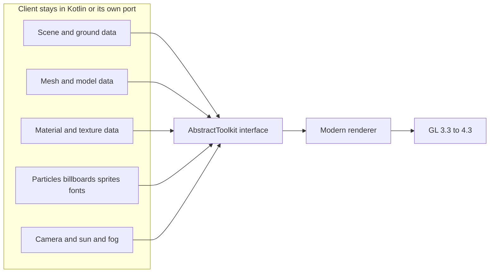
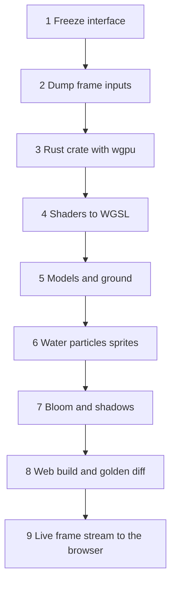
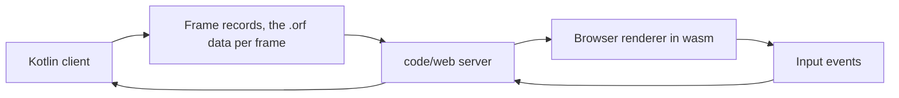

# Modern Renderer Web Transfer

This document defines what the modern renderer is, what it needs from the rest of the client, and how only that part is ported to Rust for the web. The cache, lobby and server stay as they are, see `_APP-SPECIFICATION.md`.

## Renderer Selection

- The client always runs `ModernGLToolkit`, toolkit id 3, created through `AbstractToolkit.toolkitForType`.
- `ToolkitPreference` always reports id 3, is not visible in settings and ignores any other value.
- The console commands `toolkit` and `tk0` to `tk5` are removed, the CS2 toolkit ops no longer change the renderer.
- The profiling and settings flow in `GameShell.calculateGraphics` and `PreferenceManager.setHardwarePerformance` profile only the modern toolkit.

### Remaining Non Modern Code

| Code | Why it still exists | Reachable |
| --- | --- | --- |
| `SafeModeToolkit` | `AbstractToolkit.BOOTSTRAP_MODE`: loading screen before the cache is ready, the CPU benchmark in `ProfileCpu`, and the offscreen 36 by 32 item icon rasterizer in `InterfaceComponentRenderer.renderItems` | Only through `AbstractToolkit.create(BOOTSTRAP_MODE, ...)` |
| `OpenGlToolkit` | Base class of `ModernGLToolkit`, supplies context creation, matrices and texture state | Yes, as parent |
| `toolkit/context` | `GlxContext` creates the GLX core context for `jaggl/OpenGL.kt`; the web port has no context layer | Yes, platform glue |

The web port replaces the item icon rasterizer by a render to texture path of the modern sprite renderer, so `SafeModeToolkit` is not transferred. The legacy HD toolkit (`OpenGLNativeToolkit`, `AbstractNativeToolkit` and the `Native*` shader, sampler and buffer classes) is deleted.

## Module Boundary

The boundary is `AbstractToolkit`, which has 86 abstract methods implemented by `ModernGLToolkit`. The renderer is everything below it.

## Renderer Contents

Root `code/client/src/main/kotlin/com/jagex/game/runetek5/`.

| Group | Path | Role |
| --- | --- | --- |
| Entry | `toolkit/ModernGLToolkit.kt` | Implements the interface, owns every renderer below |
| GL core | `graphics/modern/core` | Vertex, index, array buffers, buffer staging, shader program |
| GL state | `graphics/modern/state`, `graphics/modern/util/GLWrapper.kt`, `GpuTimer.kt` | Cached render state, call wrapper, timer queries |
| Targets | `graphics/modern/framebuffer`, `graphics/modern/postprocess` | Framebuffers, MSAA resolve, bloom |
| Textures | `graphics/modern/texture`, `graphics/modern/material` | Texture manager, material adapter, effect manager, scroll |
| Batching | `graphics/modern/batch` | Frame batchers, instanced model batcher, model cache, draw batch |
| Scene | `graphics/modern/scene/RetainedStaticScene.kt` | Retained static geometry |
| Builders | `graphics/modern/util/ModernModelBuilder.kt`, `MeshConverter.kt` | Mesh to GPU vertex data |
| Passes | `graphics/modern/renderer` | Model, ground, water, particle, billboard, sprite, font, surface mask, shadow, scene |
| Sprite glue | `graphics/sprite/ModernSpriteGL.kt` | Sprite handle consumed by the interface |
| Debug only | `graphics/modern/debug` | Not transferred |

Total of about 18700 lines in `graphics/modern` and about 6900 lines in `ModernGLToolkit.kt`.

## Data Inputs

| Input | Kotlin type | Used for |
| --- | --- | --- |
| Models | `Mesh`, `ModelGL`, `ModelFunctionMask`, `Matrix43` | Vertex positions, normals, face colors, texture ids, face alpha, transforms |
| Animated pose | `PoseMemoOwner`, `PoseMemo` | Cached skinned vertex output |
| Terrain | `GroundGL`, `GroundFunctionMask`, `Scene` | Tile heights, shading, overlays, underlays, textured tiles |
| Materials | `MaterialProvider`, `MaterialType`, `MaterialTypeList` | Texture ids, blend, scroll, specular, cube map effects |
| Textures | RGBA pixel arrays, mip levels | Material atlas and per material 2D textures |
| Sprites | `NativeSprite`, `SpriteType`, `SpriteGL` | Interface images, minimap, icons |
| Fonts | `FontMetrics`, `AbstractFontRenderer` | Glyph quads |
| Lighting | `PointLight`, sun vector and color, fog start and color | Shader uniforms |
| Camera | `Matrix44` view and projection, viewport | Uniforms |
| Water | `addWater`, `addWaterTile`, sun cube texture | Water passes |
| Particles | `ParticleWrapper`, `PointEntity` | Particle pass |
| Billboards | `BillboardTypeList` | Model billboards |
| Entities | `RenderedEntityCache`, `RetainedSceneHook` | Retained scene invalidation |

All inputs are plain numeric arrays once converted, so the Rust port consumes them as byte slices, not Kotlin objects.

## Interface To Narrow

The 86 abstract methods split into groups. The port implements the first four groups and a thin surface for the others.

| Group | Methods |
| --- | --- |
| Frame lifecycle | `initialize`, `render`, `renderLastFrame`, `awaitRenderCompletion`, `shutdown`, `resetTextureState`, `generateFlags` |
| Scene submit | `createModel`, `createGround`, `addWater`, `addWaterTile`, `renderParticles`, `onTilesDrawn`, `renderWorldmapTile` |
| Camera and light | `setViewMatrix`, `setModelMatrix`, `calculateProjection`, `updateSun`, `applyLighting`, `calculateFog`, `copyLights`, `setSunCubeTexture` |
| Post | `bloomSupported`, `bloomEnabled`, `beginBloomCapture`, `compositeBloomEffects`, `setBloomFilter`, `resetBloom` |
| 2D | `drawQuad`, `drawLine`, `drawFilledRectangle`, `generateSprite`, `createFontRenderer`, `createComponentSurface`, clipping group |
| Capability | `hasShadows`, `hasBloomSupport`, `hasHardwareRendering`, `hasAntiAliasing`, `getMaxLights` |
| Not ported | `getNativeMemory`, `setNativeHeap`, `benchmark`, `createDelegatingDisplay`, `getImageProducer`, `getRenderBuffer` |

## GL Calls And Features

The renderer needs OpenGL 3.3 core as a base, with these features above it.

| Feature | GL version | Where | WebGL2 status |
| --- | --- | --- | --- |
| Instanced draw with base instance | 4.2 | `InstancedModelBatcher` | Missing, use per instance vertex attribute divisors |
| Multi draw elements indirect | 4.3 | `InstancedModelBatcher` | Missing, use one draw per batch |
| Shader storage buffers | 4.3 | `InstancedModelBatcher` | Missing, use uniform buffers or data textures |
| Bindless texture handles | ARB extension | `InstancedModelBatcher` | Missing, use a texture array |
| Tessellation shaders | 4.0 | `hdWater.tesc`, `hdWater.tese` | Missing, replaced in `code/renderer` by CPU tessellation with the same displacement, see `RENDERER.md` |
| Clip distance | 3.0 | `groundTextured.vert` | Missing, use a discard in the fragment shader |
| Uniform buffer objects | 3.1 | Light and material blocks | Available |
| Vertex array objects | 3.0 | `VertexArray` | Available |
| Framebuffer, renderbuffer, MSAA blit | 3.0 | `Framebuffer` | Available |
| Timer queries | 3.3 | `GpuTimer` | Not ported |
| Debug output | KHR | `ModernGLToolkit` | Not ported |
| Polygon mode, quads, fixed function fog and lights | Legacy | Removed, the client runs on a 4.3 core profile context | Not needed |

Core call families in use: buffer create and upload, vertex attribute setup including integer attributes, shader compile and link, uniform upload, texture upload with mipmaps, framebuffer attach and blit, blend, depth, cull, scissor and viewport state, indexed and instanced draws.

## Shaders

All 33 files live in `code/client/src/main/resources/shaders`. They use GLSL 330 core, three use 400 core.

| Pass | Files |
| --- | --- |
| Model | `model.vert`, `model.frag`, `batched.vert`, `batched.frag` |
| Ground | `ground.vert`, `ground.frag`, `groundTextured.vert`, `groundTextured.frag` |
| Water | `water.vert`, `water.frag`, `waterHD.vert`, `waterHD.frag`, `waterLapping.*`, `waterReflecting.*`, `waterRippling.*`, `waterfall.*` |
| Tessellated water | `hdWater.vert`, `hdWaterTess.vert`, `hdWater.tesc`, `hdWater.tese`, `hdWater.frag` |
| Particles | `particle.vert`, `particle.frag` |
| Sprites | `sprite.vert`, `sprite.frag` |
| Shadow | `shadow.vert`, `shadow.frag` |
| Materials | `materialCubeSpec.vert`, `materialCubeSpec.frag` |

## Port Plan

| Step | Work | Status |
| --- | --- | --- |
| 1 | Reduce `AbstractToolkit` to the five groups above with `ModernGLToolkit` as the only implementation | The modern toolkit is the only one, the narrow interface is not cut yet |
| 2 | Dump the inputs of one frame | Done: `dump-frame` streams `.orf` files, see `RENDERER-FRAME-FORMAT.md` |
| 3 | Rust crate on `wgpu`, native Vulkan for tests and WebGPU or WebGL2 in the browser | Done: `code/renderer`, see `RENDERER.md` |
| 4 | Convert the shaders to WGSL | Done: 32 WGSL modules validated by naga, tessellated water replaced by CPU tessellation, clip distance by discard, bindless textures by texture arrays |
| 5 | Models and ground | Pipelines done |
| 6 | Water, particles, billboards, sprites and fonts | Pipelines done, planar water reflection target not ported |
| 7 | Bloom and shadows | Shadow pass done, bloom not ported |
| 8 | wasm build and golden diff | wasm builds, `openrs equiv` diffs the client and the renderer on the same dumped frame |
| 9 | Live frame stream from the client to the browser | Not started, see below |

- Every pipeline is verified without a GPU by naga validation and layout tests, and the client and renderer layout tables are checked against one shared fixture.
- No pass is accepted as transferred until `openrs equiv` passes on a real dumped frame on a GPU.

## Frame Stream

The browser only runs the renderer, so the Kotlin client keeps running the game and sends each frame's draw data to the browser.

- The frame records reuse the `.orf` chunks, with meshes and textures sent once and referenced by hash afterwards.
- Input from the browser is sent back and applied to the client through the same path as the control server.
- A browser cannot open the lobby's TCP connection, so the client stays next to the server, or a WebSocket relay carries the game protocol.
- The choice between the two is open and decides where the client process runs.

## Transfer Order Rules

- The Rust crate takes bytes and ids only, never game logic.
- The cache decode, scene building and model animation stay on the client side until a later transfer.
- Each pass is accepted only when its golden frame diff passes.
