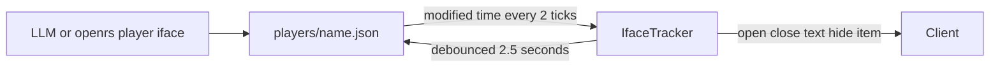

# Player interfaces

The player file in file mode carries an `interfaces` section. It lists every interface the player has open, with names beside the ids, so an LLM can read the screen state and change it while the player is online.

# File format

The section sits at the top level of `players/<name>.json`, next to the other player fields.

```json
"interfaces": {
  "top": { "id": 746, "name": "interface_746" },
  "open": [
    {
      "id": 275,
      "name": "interface_275",
      "slot": "MINIGAME_HUD",
      "parent": { "interface": 746, "interfaceName": "interface_746", "component": 12, "componentName": "component_746_12" },
      "clickThrough": true,
      "components": {
        "2": { "name": "component_275_2", "text": "live edit", "pin": true }
      }
    }
  ]
}
```

## Interface entry

| Field | Meaning |
| --- | --- |
| `id`, `name` | Interface id and its gameval name |
| `slot` | Name of the window pane slot (`InterfaceManager.Sub`) such as `CENTRAL`, `TAB_SKILLS`, `MINIGAME_HUD`. Resolved against the current screen mode |
| `parent` | Explicit parent interface and component, used when there is no named slot |
| `clickThrough` | Whether clicks pass through the interface |
| `open` | Set to `false` to close the interface |
| `components` | Component states keyed by component id |

## Component state

| Field | Meaning |
| --- | --- |
| `name` | Component gameval name |
| `text` | Text set on the component |
| `hidden` | Hidden flag |
| `item` | Object shown, `id` and `amount` |
| `model`, `graphic` | Model or sprite id assigned |
| `events` | Click event flags, `from`, `to` and `settings` |
| `pin` | Marks a state the player wants kept on login |

- Names come from `assets/cache/gamevals/interface.json` and `component.json`. Ids without a proven name show the placeholder name.
- Only components the server has set are listed. The full component catalogue of an interface is printed by `openrs player iface <name> show <iface>`.

# Server behaviour

All server code lives in `code/server/world/src/main/java/com/rs/db/IfaceTracker.kt`. Each `InterfaceManager` owns one tracker.

## Tracking

- `WorldEncoder` reports every text, hidden, item, model, graphic and event packet to the tracker.
- `InterfaceManager` reports opens and closes, so state of a closed interface is dropped.

## Saving

- Every save of the player file writes the live `interfaces` section.
- A save keeps the file section instead of the live one when the file was edited and the world has not read it yet, so an edit is never overwritten.
- Interfaces such as the central window are closed by logout, so they are not restored. Tabs and overlays persist.

## Login

- After the default interfaces are sent, the section is applied. Missing or partial sections are fine.
- Interfaces not yet open are opened. An interface already open in another slot is moved.
- Component state is restored for newly opened interfaces and for components with `pin`. Other components keep the value the server just sent.
- Entries with `open: false` are closed.

## Live updates



- The world checks the file modified time every second tick, which is one stat call.
- A changed section is diffed against the live state and only differences are sent.
- Server side changes mark the tracker dirty, and the section is written back at most every 2.5 seconds and only when it changed.

# Command line

All commands work on the file. With the world running they are applied live.

| Command | Effect |
| --- | --- |
| `openrs player iface <name> list` | Open interfaces and their slots |
| `openrs player iface <name> show <iface>` | Entry JSON and the component catalogue |
| `openrs player iface <name> open <iface> [slot or iface:comp]` | Open, default slot `CENTRAL` |
| `openrs player iface <name> close <iface> [slot or iface:comp]` | Close |
| `openrs player iface <name> text <iface> <comp> <text>` | Set text |
| `openrs player iface <name> hide <iface> <comp> <true or false>` | Hide or show |
| `openrs player iface <name> set <iface> <comp> item <obj> [amount]` | Show an object |
| `openrs player iface <name> set <iface> <comp> model or graphic <id>` | Assign a model or sprite |
| `openrs player iface <name> set <iface> <comp> events <from> <to> <settings>` | Set event flags |

- Interfaces and components accept gameval names or numbers. Objects accept obj gameval names.
- Edits mark the component with `pin` so it survives a relog.
- An interface must be in the file before its components are edited, so open it first.

# Limits

- Item containers filled by inventory packets are not listed, only single item assignments.
- Closing is done with `open: false`. Deleting an entry does nothing.
- Only the file backed mode is supported, the Mongo mode has no `interfaces` section.
