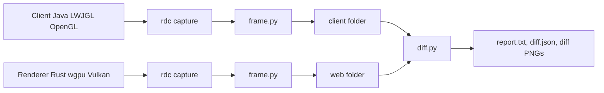
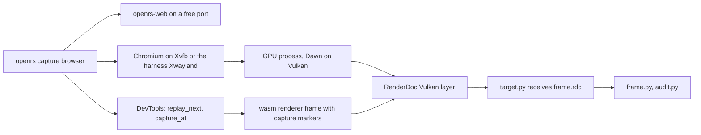
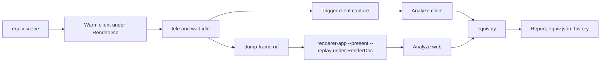

# RenderDoc

RenderDoc is a first-class tool of the repository. It lives in `code/renderdoc` and is driven through `openrs capture` from the harness crate `code/harness/crates/renderdoc`. It captures both sides of the transpilation, normalizes each capture into the same folder format, and compares the two so that equivalence can be measured from text output.

# Layout

| Path | Task |
| --- | --- |
| `code/renderdoc/py/frame.py` | Replays an `.rdc` and writes the normalized capture folder |
| `code/renderdoc/py/diff.py` | Aligns two capture folders and reports mismatches and pixel metrics |
| `code/renderdoc/py/equiv.py` | Equivalence report with verdict, score, grouped mismatches, worst regions and the history |
| `code/renderdoc/py/overview.py` | One line per draw overview of a capture folder |
| `code/renderdoc/py/audit.py` | Pass or fail checks on a capture |
| `code/renderdoc/py/target.py` | Waits for the next capture of any RenderDoc target in a process tree, used for the browser |
| `code/renderdoc/native/deepbind.c` | `LD_PRELOAD` shim that loads the JVM GL library with `RTLD_DEEPBIND` |
| `code/renderdoc/patches` | Fixes applied to the pip installed `rdc-cli` |
| `code/renderdoc/mcp_server` | MCP server exposing `rdc-cli` plus `frame_summary` and `compare_transpilation` |
| `code/renderdoc/tests` and `code/renderdoc/golden` | Regression tests over stored golden summaries |
| `code/renderdoc/apps` | `gl_scene.c` and `wgpu_scene`, the same scene in OpenGL 3.3 core and wgpu |
| `code/renderdoc/.env` | Built RenderDoc, Python venv and Vulkan layer, ignored by git |
| `code/harness/crates/renderdoc` | Thin Rust crate: setup, process launching, display handling, retries, `equiv` orchestration |



# Setup

- `openrs capture setup` is idempotent. When everything is installed it only checks files and Python imports and finishes in about one second.
- Setup builds RenderDoc with OpenGL and Vulkan enabled only when the module or the GL symbols are missing, installs `rdc-cli`, Pillow, numpy and `mcp` into `code/renderdoc/.env/v`, applies the patch, writes the Vulkan layer manifest to `.env/layer`, and compiles the preload shim.
- `openrs capture verify` checks the same files without running anything, `verify --full` also runs `rdc doctor`.
- `OPENRS_RDOC_ENV` points the whole toolchain at another environment directory.

# Capture Commands

| Command | Target | API |
| --- | --- | --- |
| `openrs capture client` | Shaded client jar, JVM injected through the deepbind shim | OpenGL |
| `openrs capture web` | Renderer binary from `code/renderer/target`, or `--exe PATH` or `OPENRS_WEB_EXE` | Vulkan through wgpu |
| `openrs capture browser` | The wasm renderer in `/usr/bin/chromium`, served from `code/web/static` | WebGPU through Dawn on Vulkan |
| `openrs capture exec --api gl or vulkan -- cmd args` | Any program | Chosen by `--api` |

Shared options:

| Option | Meaning |
| --- | --- |
| `--frame N` | Capture frame N then stop the process |
| `--seconds S` | Without `--frame`, run S seconds then trigger a capture |
| `--out DIR` | Capture folder, default `code/harness/target/capture/<command>` |
| `--display :N` | Use an existing X display, otherwise the harness display or a private Xvfb is used |
| `--retries N` | Repeat the capture with a delay between attempts, useful while the client context is being converted |
| `--jar PATH` | Client jar |
| `--exe PATH` | Renderer binary |
| `--orf FILE` | Browser only, replay this frame file in the page |
| `--scene NAME` | Browser only, built in scene of the page, default `all` |
| `--url URL` | Browser only, use a page that is already served instead of starting `openrs-web` |

- The real desktop is never used. Wayland is unset, the app runs on Xvfb, and the client gets a null audio sink.
- Vulkan capture works on Xvfb with the NVIDIA driver. The Vulkan implicit layer is enabled through `VK_ADD_IMPLICIT_LAYER_PATH` and `ENABLE_VULKAN_RENDERDOC_CAPTURE`.
- RenderDoc delimits frames by presents, so the renderer must present to a window surface. `renderer-app --present` always opens a window on the display, presents `--frames` frames (default 30) and exits, ignoring `--out`. With `--replay` the window takes the size of the frame file, so the swapchain matches the client frame.
- A capture by seconds triggers through `rdc attach` and `rdc capture-trigger`, then polls `rdc capture-list` once per second. The previous single call waited its whole 30 second timeout, so a capture by seconds cost the seconds plus 30. It now costs the seconds plus about one.
- `openrs capture analyze <rdc> [dir]` normalizes an existing capture, `openrs capture summary <dir> [max-draws]` prints one line per draw.
- `openrs capture selftest` builds both test apps, captures them and prints the diff, used to prove the toolchain end to end.

# Browser Capture

`openrs capture browser [--frame N | --seconds S] [--out DIR] [--orf FILE | --scene NAME] [--url URL] [-- chromium args]` captures the real web build, the renderer compiled to wasm and running on WebGPU in Chromium, and writes the same capture folder as the other kinds.



1. `openrs-web` serves `code/web/static`, and the capture folder under `/files/`, so the frame file is fetched from `/files/frame.orf`. The wasm and the server are rebuilt first when stale.
2. Chromium is started through the `web` crate launcher on the private display, with an isolated profile under `$XDG_RUNTIME_DIR`, `--no-sandbox --disable-gpu-sandbox --disable-gpu-watchdog`, and the Vulkan implicit layer through `VK_ADD_IMPLICIT_LAYER_PATH` and `ENABLE_VULKAN_RENDERDOC_CAPTURE`. Only the GPU process loads Vulkan, so it is the only RenderDoc target. The user's Brave and its profile are never touched.
3. Over DevTools the harness waits for the first rendered frame, checks the WebGPU adapter and refuses SwiftShader, then loads the frame file with `replay_next`.
4. `target.py` attaches to the RenderDoc target whose process descends from the browser, then the harness calls `capture_at`.
5. The renderer brackets the chosen frame with the RenderDoc queue markers `capture-marker,begin_capture` and `capture-marker,end_capture`. Dawn forwards them as Vulkan debug labels, RenderDoc starts and ends the capture on Dawn's device around that submit, and `target.py` moves the file to `frame.rdc`.
6. Chromium, the server and a private Xvfb are stopped by their process ids, the Chromium log is kept as `app.log`.

| Exported wasm function | Effect |
| --- | --- |
| `frames()` | Frames rendered since the page loaded |
| `capture_at(n)` | Capture frame `n`, or the next one when `n` has passed, returns the frame chosen |
| `replay_next(bytes)` | Validate a frame file and replay it from the next frame, at the size of the frame |

The functions are free exports of `renderer.js`, so DevTools reaches them with a dynamic import of the same module and `boot.js` needs no change.

## Frame Selection

- `--frame N` captures the Nth frame after the page is ready, or after the frame file is loaded. Without `--frame` and `--seconds`, N is 3.
- `--seconds S` waits S seconds and captures the next frame.
- Present based frame counting is not used. Chromium composites through ANGLE on Vulkan and presents its own swapchain, so a trigger or a queued frame could land on a compositor frame. The markers capture exactly one renderer submit on Dawn's device.

## Renderer Draws

- In the wasm build the renderer wraps every frame in the debug group `openrs`. The native build adds no group, so native summaries are unchanged.
- `frame.py` tags every draw and clear with `origin`: `renderer` inside the group and `browser` outside it, when any draw of the capture is in the group. `meta.browser` counts the browser draws.
- The final target of a tagged capture is the output of the last renderer draw, since the canvas texture is not a swapchain image.
- `diff.py` drops browser draws, browser clears and targets that no renderer draw writes, and strips `openrs` from markers, so `capture diff` and `equiv` compare only what the renderer drew.
- Dawn compiles WGSL with Tint, which lowers every uniform block to an array of `uvec4`. `frame.py` recognizes Tint SPIR-V by its generator id and records such a block as `<block>._words`, each word read as a float, or as an integer when it is below 2^23 or not a number. When either side of a draw has words, the uniforms are compared as the set of non zero values.

## Measured

| Capture | Draws | Size | Time |
| --- | --- | --- | --- |
| Page scene `all` | 12, all renderer draws | 1279x843 | 11.8 s end to end |
| Dumped client frame | 1730 | 765x503 | 39 s, 25 s of it replay |

The same frame file captured natively with `openrs capture web` and diffed against the browser capture is `EQUIVALENT`: 1730 of 1730 draws aligned, no mismatch, identical pixels.

# Capture Folder

| File | Content |
| --- | --- |
| `frame.rdc` | Raw capture |
| `summary.json` | Normalized frame summary |
| `targets/T*.png` | One PNG per render target, exported at the last event that wrote it |
| `shaders/S*_vs.txt`, `S*_fs.txt` | GLSL source for OpenGL, SPIR-V disassembly for Vulkan |
| `app.log` | Output of the captured process |
| `audit.txt` | Output of `audit.py` |

- `summary.json` is cached by the capture size and modification time plus the format version. Analysis of an unchanged capture returns in a fraction of a second. `OPENRS_FORCE=1` rebuilds it.
- Captures with more than 150 draws are replayed by several worker processes, `OPENRS_JOBS` sets the count and `OPENRS_CHUNK` the minimum draws per worker.

# Summary Format

`summary.json` has the keys `meta`, `targets`, `shaders`, `clears` and `draws`, one record per line so it can be read with line tools.

| Key | Content |
| --- | --- |
| `meta` | API, draw and clear counts, replay and export seconds, cache stamp |
| `targets` | Id, size, format, samples, `final`, `swapchain`, last writing event, PNG path |
| `shaders` | Id, stage, entry, content hash, input signature, output count, constant block names, source file |
| `clears` | Clear actions with the targets they write |
| `draws` | Ordered draw and dispatch records |

`meta.browser` is the number of draws and clears outside the renderer group, only non zero for browser captures.

Draw record fields:

| Field | Content |
| --- | --- |
| `eid`, `name`, `marker` | Event id, API call, enclosing debug marker path |
| `topology`, `indexed`, `count`, `instances` | Primitive topology, vertex or index count, instance count |
| `shaders`, `program` | Shader ids per stage and the program id of the combination |
| `state` | Blend per target, cull, front face, fill, depth, stencil, viewport size, scissor |
| `uniforms`, `uniform_hash` | Decoded values per stage and variable, hash of all of them |
| `vertex` | Per attribute location, name, format, count, hash of the decoded values, first values |
| `index` | Index format, hash of the index values, maximum index |
| `textures` | Stage, slot, id, size, mips, format, content hash, vertically flipped hash |
| `buffers` | Bound storage buffers with content hash |
| `outputs`, `depth` | Render target ids written and the depth target id |
| `origin` | `renderer` or `browser`, present only in captures that contain the `openrs` group |

Normalization rules that make OpenGL and Vulkan comparable:

- Ids are ordinals by first use, shaders with identical code share one id.
- Vertex data is decoded through its format and hashed in index order, so buffer layout and padding do not matter.
- Floats are rounded to four decimals before hashing.
- Vulkan viewports with negative height are flipped, a scissor covering the viewport is recorded as none, depth is recorded only when the test is enabled.
- Texture hashes are taken on RGBA bytes with BGRA swizzled, the flipped hash allows detecting a vertical flip.
- Textures that are render targets are rehashed per draw, other textures are hashed once per capture.

# Diff

`openrs capture diff <client-folder> <web-folder> [out-dir] [max-lines]` writes `report.txt`, `diff.json` and difference images into `out-dir` and prints the report.

1. Draws are aligned by the sequence of topology, count and instance count with a longest matching sequence search, unmatched draws are listed as only client or only web.
2. Each aligned pair is compared on state, index hash, vertex attribute hashes, uniforms and texture hashes.
3. Uniforms are paired by name when both sides have it. Anonymous Vulkan members and unnamed values are paired by value as a multiset, so layout differences do not matter but value differences do.
4. Render targets are paired, final to final first then by size, and compared pixel by pixel.

| Metric | Meaning |
| --- | --- |
| `psnr_db` | Peak signal to noise ratio, above 40 is visually identical |
| `ssim` | Windowed structural similarity on luminance, 1.0 is identical |
| `mse`, `max_diff` | Mean squared error and the largest channel difference out of 255 |
| `differing_pixels_pct`, `bbox` | Share of pixels off by more than 8 and their bounding box |
| `diff_png` | Absolute difference amplified four times |

| Verdict | Rule |
| --- | --- |
| `EQUIVALENT` | Final target SSIM at least 0.995 and no draw mismatch |
| `CLOSE` | Final target SSIM at least 0.95 and the same draws, with remaining mismatches listed |
| `DIVERGENT` | Anything else |

- A size mismatch is reported and the web image is resized before measuring.
- Clears done as render pass load operations in Vulkan are not actions, so clear counts are informational.
- The self test scene differs on purpose in one place: wgpu alpha blending uses a source factor of one for alpha while the OpenGL scene uses source alpha, and the diff reports it as the only mismatch with the final image identical at 76.9 dB.

# Equivalence Loop

`openrs equiv <scene>` or `openrs equiv --live` runs the whole comparison of the original client against the Rust renderer and prints one report. The exit code is 0 for `PASS`, 1 for `FAIL` and 2 for an error.



## Commands

| Command | Effect |
| --- | --- |
| `openrs equiv <scene>` | Place the player at the scene, capture the client frame, capture the renderer on the matching frame, compare |
| `openrs equiv --live` | Same without placing, the player position of a running `openrs up` client is read and restored in the capture client |
| `openrs equiv history [scene] [count]` | Table of past runs with score deltas and a trend line per scene |
| `openrs equiv scenes` | Scene names with their tiles |
| `openrs equiv test` | Golden regression tests, the capture selftest and a report over the selftest folders |
| `openrs equiv down` | Stop the warm client |

| Option | Meaning |
| --- | --- |
| `--top N` | Worst regions and listed differences, default 5 |
| `--min-ssim X` | Final target SSIM needed to pass, default 0.99 |
| `--max-mismatch N` | Aligned draws allowed to differ, default 0 |
| `--settle N` | Game ticks to wait after arriving, default 4 |
| `--reuse` | Skip captures and report on the folders of the last run |
| `--cold` | Stop the client after the run |
| `--builtin` | Skip the frame dump and use the renderer built in scene |
| `--exe PATH`, `--size WxH`, `--out DIR` | Renderer binary, built in scene size, output folder |
| `--target native` or `browser` | Capture the renderer as the native binary, the default, or as the wasm build in Chromium |

Scenes are `login`, `lumbridge`, `varrock`, `draynor`, `falador` and `edgeville`. `login` waits for the login window and takes the frame after three seconds, the others teleport with the `tele` command, wait for the position and for idle, then wait the settle ticks.

## Speed

- The client runs on its own control endpoint, `openrs-equiv.sock`, and the account `equivqa`, so a client of `openrs up` or a fleet is never touched.
- The client stays running after a run and the next run attaches to it, which removes the world entry time. A new jar or another mode restarts it.
- The jar is copied to `code/harness/target/equiv/client.jar` before launching, because a rebuild of the shaded jar breaks a running JVM.
- The renderer capture runs while the client capture is analyzed.
- Analysis is skipped when the folder is newer than the capture and `frame.py`.
- `frame.py` reads vertex buffers only over the index range a draw uses. A frame of 1077 draws took 285 seconds with whole buffer reads and 31 seconds with range reads on the same loaded machine.

## Frame Matching

1. After the client capture, `dump-frame` writes the frame as `.orf` at the same player position.
2. The renderer replays that file with `--present`, so both captures describe the same frame.
3. When `dump-frame` is missing, fails or writes an empty file, the renderer built in scene `all` is used and the mode shows `builtin`. Scores of the `builtin` mode only measure how far the renderer is from the client in general.

## Browser Target

`openrs equiv --live --target browser` runs the same loop with `openrs capture browser` in place of `renderer-app`. The client is captured, the frame is dumped, and the browser page replays that `.orf` and is captured on its third frame.

- Results land in `code/harness/target/equiv/<scene>-browser`, and the history scene is `<scene>-browser`, so native and browser scores keep separate trends.
- The verdict, score and report format are the same as for the native target.

| Run on one live position | Score | Final SSIM | Renderer draws | Client draws |
| --- | --- | --- | --- | --- |
| `openrs equiv --live` | 73.0 | 0.9691 | 1633 | 1659 |
| `openrs equiv --live --target browser` | 72.9 | 0.9683 | 1633 | 1652 |

The two runs capture the client separately, and the world moves between them, so the client draw counts differ by a few animated models.

## Report

| Section | Content |
| --- | --- |
| Header | Scene, mode, verdict, score and the previous score with its delta |
| `thresholds` | Each check with the needed and the measured value |
| `pixels`, `sizes` | PSNR, SSIM, MSE, largest difference, differing share, bounding box |
| `draws` | Counts, matched, mismatched, unmatched grouped by shader or pass |
| `mismatches by shader/pass` | Draw count and kinds per group with example lines |
| `texture hash differences`, `uniform differences` | The first differing draws |
| `textures` | Unique texture hashes per side and which exist on one side only |
| `worst regions` | Tiles of the final image sorted by mean difference, with pixel coordinates |
| `files` | Difference image, text and JSON report, both capture folders |

- A group is the debug marker when there is one, otherwise the vertex input names of the vertex shader with the topology, which is stable across OpenGL and Vulkan.
- The score is 100 times half the final SSIM plus a quarter of the matched draw share plus a quarter of the share of aligned draws without a mismatch.
- `PASS` needs the final SSIM at least `--min-ssim`, no unmatched draw and at most `--max-mismatch` mismatched draws.
- Everything lands in `code/harness/target/equiv/<scene>`: `equiv.json`, `report.txt`, `diff`, `client`, `web`, `frame.orf`. Runs append to `code/harness/target/equiv/history.jsonl`.

## Tests

- `code/renderdoc/tests/test_equiv.py` runs `equiv.py` over the golden summaries in `code/renderdoc/golden/selftest` and checks the stored verdict and score, a failing strict threshold, a removed draw, injected texture and uniform differences and a painted image region.
- `openrs equiv test` runs those tests, then `capture selftest`, then a report over the freshly captured selftest folders with `--min-ssim 0.995 --max-mismatch 1`.

# Multi Frame Equivalence

```bash
export OPENRS_WEB_STATE=$XDG_RUNTIME_DIR/openrs-web-multi
openrs equiv lumbridge --frames 2 --target browser --cold
```

- `--frames N` is optional and limited to 1 through 5. Without it, the existing single-capture path is unchanged.
- The client is placed once, then N back-to-back RenderDoc capture and `.orf` dump pairs are collected. Each dump is replayed and captured in the chosen native or browser target, then analysed with the normal checks.
- `frames/0000/` and the following numbered folders contain each client capture, target capture, frame dump and `equiv.json`. The root `equiv.json` and `report.txt` give every frame's score, the mean score and mean SSIM. All per-frame verdicts must pass for the sequence to pass.
- This is substantially slower and more GPU-intensive than `twin --frames`: capture analysis replays full frames. Keep it for short deep investigations, not routine animation sweeps.
- A world scene or `--live` is required. `login`, `--builtin` and `--reuse` are rejected with this flag. Capture and dump are armed together as in the existing path, so they can still differ by one neighbouring frame.

# Comparison Conventions

The report preserves real rendering differences while normalizing API representation differences. A high image score does not prove that every pass was replayed.

| Item | Normalization | Evidence |
| --- | --- | --- |
| Scissor and viewport | Convert OpenGL bottom-left coordinates to the target's top-left coordinates | Target height and tests of both origins |
| Vertex clip rectangles | Flip y0 and y1 for `aClip`, preserving their order as rectangle bounds | Hash the normalized values and retain the original diagnostics |
| Index offsets | Compare indices relative to the first used vertex, and compare the vertex values separately | Shared OpenGL arenas and per-draw WebGPU buffers address the same geometry differently |
| Clip-space matrices | Convert the recognized forward projection or shadow matrix z row to `(z + w) / 2` before comparison | A sixteen-value matrix, recognized member name and tests using real captured values |
| Inverse matrices | Do not convert automatically | The renderer preserves the original inverse view-projection in the relevant shaders |
| Placeholder textures | Ignore bound 1 by 1 placeholders in content-hash inventory | They are the renderer's default unassigned resources; this heuristic is not proof of shader usage |
| Texture order | Match texture content hashes instead of API binding-slot numbers | Different shader binding layouts can bind the same image |
| Time-driven data | List detected capture-time drift separately | Adjacent captures can have different animation time; unexplained uniform differences stay failures |

- Alpha blend factors remain real state differences, even when only the alpha source factor differs. Without downstream-use evidence, they cannot safely be dismissed as a convention.
- A client texture missing from the web capture remains a real content difference. The diff does not assume it was unused.
- `classify.py` assigns unmatched draws a shader family, owner and reason: offscreen replay skip, tessellation replacement, unported pass, detected frame drift or unexplained missing geometry. Known skips remain visible and are not proof of a complete port.
- The report distinguishes known skips from unexplained unmatched draws. Pixel thresholds still apply to the final image, and unexplained differences fail the verdict.
- Scores before and after normalization are not directly comparable: the original 73-point baseline counted representation differences. Use the history together with SSIM, skipped-pass counts and the detailed report.
- Client capture and frame serialization are armed back to back, not guaranteed to be the same frame. `dump-frames` pairs the serialized records and screenshot within the same rendered frame for temporal tests.
- Relative `--out`, `--exe`, `--jar` and `--orf` paths resolve against the caller's working directory before a child changes directories.

# MCP Server

- `code/renderdoc/mcp_server/server.py` exposes the `rdc-cli` commands as tools.
- `frame_summary` normalizes a capture and `compare_transpilation` runs the diff, both return the same text as the command line.
- Register with `claude mcp add rdc-tools -- code/renderdoc/.env/v/bin/python code/renderdoc/mcp_server/server.py`.

# Known Limits

- The real client needs a core-profile context, display lists or immediate mode calls make RenderDoc fail with unsupported function.
- Storage buffers are read in the first four megabytes only, vertex buffers are read over the index range of each draw.
- Only mip 0 and slice 0 of each bound texture are hashed.
- Shader source differs between languages, so shaders are matched by input signature and uniform values and never by text.
- `dump-frame` of a client running under RenderDoc was seen to write an empty file or to abort the JVM with a heap error while the command was under development, `equiv` then falls back to the built in scene.
- Two clients on the same account clash, a client that crashed keeps the session on the server for a while and the next login answers with response 5.
- The browser capture needs `--enable-unsafe-webgpu` and Chromium's Vulkan feature. Without them WebGPU falls back to SwiftShader and the capture refuses to run.
- A browser capture with `--url` fetches `--orf` from `/files/frame.orf` of that page, so the server must serve the capture folder there.
- The page bridge supports frame replay now. Browser RenderDoc capture also uses a marked `replay_next` frame to exclude Chromium compositor work.

# GPU Memory

- Every analysis replays the capture on the GPU, and a full game frame needs gigabytes of GPU memory on replay.
- Replays run one at a time: `openrs equiv` captures the client and the renderer in parallel, but their analyses, and the summary and audit of each, take turns behind one lock.
- Vulkan captures are analyzed in one process unless `OPENRS_JOBS` is set. If parallel workers fail, the analysis falls back to one process instead of failing.
- A failed capture never signals process id 0 or 1, so a failed capture cannot stop the harness itself.


# Final Integration Check

- The complete harness verification ran both native and browser capture paths on the consolidated local cache. Browser rendering used NVIDIA WebGPU, not SwiftShader.
- The latest browser-target score was 97.5 and native-target score 74.3. Both rendering verdicts were FAIL. These are separate captures and their scores are not a claim that one backend is more correct.
- The normalization tests use recorded matrix values and synthetic origin, texture and classification cases. WebGPU raw-word uniform blocks still provide weaker diagnostics than named, reflected client uniforms; the detailed evidence and image differences remain necessary.
- Alpha blend changes and missing client textures remain mismatches unless their irrelevance can actually be demonstrated. The golden selftest intentionally detects its differing alpha factor.
