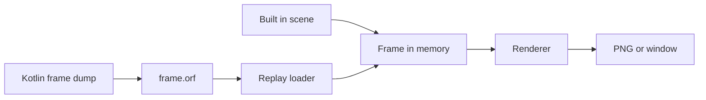

# Renderer Frame Format

This document defines the binary frame description that the Kotlin client can dump and `code/renderer` replays. The format file extension is `.orf`.

## Purpose

- One file holds everything needed to draw one frame: meshes, textures, uniform blocks and draw calls.
- The same description is produced by the built-in test scenes, so a Kotlin dump and a Rust scene use one code path.
- Replay lets RenderDoc captures and pixel comparison use identical input on both sides.



## Encoding Rules

- All integers are unsigned 32 bit little endian. Uniform and header floats are 32 bit IEEE little endian; typed texture components use the explicitly declared precision.
- Every list is a `u32` count followed by its items, with no padding or alignment.
- Ids are chosen by the writer and only need to be unique per kind within a file.
- The reserved id `4294967295` means no texture or no instance buffer, the renderer binds a white 1 by 1 texture or draws one instance.

## File Layout

The file is a header followed by a stream of chunks, so a writer can emit each record as soon as it is complete and never holds a whole frame in memory. Normalized frames retain `ORF3`; a frame containing a typed texture uses `ORF4`. Older readers reject that magic instead of treating half-float bits as normalized bytes. The loader accepts the older `ORF2` and `ORF1` files, whose sections were count prefixed lists inside one zlib stream.

| Section | Content |
| --- | --- |
| Header | Magic `ORF3` or `ORF4`, flags, width, height, clear color as 4 floats |
| Chunks | One chunk per record, in any order that defines a record before a draw uses it |
| End | A chunk of kind 5 with both lengths 0, which proves the writer closed the file |

### Chunk

| Field | Type | Meaning |
| --- | --- | --- |
| kind | `u32` | 0 mesh, 1 texture, 2 uniform, 3 instances, 4 draw, 5 end, 6 typed texture in ORF4 only |
| raw length | `u32` | Byte length of the record |
| packed length | `u32` | Byte length of the zlib stream that follows, 0 when the record is stored as is |
| payload | bytes | The record, or its zlib stream |

The client stores records under 128 bytes and compresses larger records at zlib level 1, storing the raw payload instead when compression would not make it smaller. The record headers declare the actual choice. A file without an end chunk was cut short and the loader rejects it.

### Flags

| Bit | Name | Meaning |
| --- | --- | --- |
| 0 | `GL_DEPTH` | The first 16 floats of every uniform block are an OpenGL clip space matrix, the loader remaps depth from range -1 to 1 into 0 to 1 |
| 1 | `DEFLATE` | Records are zlib compressed per chunk, in `ORF2` the whole body after the header is one zlib stream |

## Records

### Mesh

| Field | Type | Meaning |
| --- | --- | --- |
| id | `u32` | Mesh id |
| pass | `u32` | Pass number, which also selects the vertex layout |
| vertex count | `u32` | Number of vertices |
| index count | `u32` | Number of `u32` indices |
| vertices | bytes | Vertex count times the pass stride |
| indices | bytes | Index count times 4 |

### Texture

| Field | Type | Meaning |
| --- | --- | --- |
| id | `u32` | Texture id |
| width, height | `u32` | Size in texels |
| layers | `u32` | Layer count, 1 for a plain texture |
| pixels | bytes | `width * height * layers * 4` bytes of RGBA8, layer major, top row first, no mip levels |

### Typed Texture

Kind 6 is valid only in ORF4. It uses the same stored or bounded-zlib chunk container as ORF3. All header fields are `u32`; the header is 28 bytes.

| Field | Meaning |
| --- | --- |
| id | Texture identity |
| width, height, layers | Texel dimensions; typed recording currently requires one 2D layer |
| format | 1 means RGBA16Float, four little-endian IEEE binary16 components per texel |
| byte length | Exactly `width * height * layers * 8` |
| sampler | Minification, magnification and wrap bits below |
| pixels | Raw half-float components, with the same row order as normalized records |

Sampler bits 0 through 2 encode nearest, linear, nearest-mipmap-nearest, linear-mipmap-nearest, nearest-mipmap-linear and linear-mipmap-linear as values 0 through 5. Bit 3 selects linear magnification instead of nearest. Bits 4 through 5 and 6 through 7 encode S and T addressing: 0 repeat, 1 clamp-to-edge, 2 mirrored-repeat. Other bits and reserved values are rejected. The default value 9 is linear minification and magnification with repeat addressing. Resource identities include format and, for typed records, sampler bits.

Native GL_RGBA16F and GL_RGB16F are read through GL_HALF_FLOAT. RGB16F gains the native implicit alpha of half-float 1, not a quantized color conversion. Swizzles copy complete 16-bit components; zero and one use half-float encodings. HDR values above one, negatives and signed-zero component bits survive transport. Integer, sRGB, other float precisions, typed sprites, typed cubes and typed volumes remain explicitly unsupported. Dimensions are checked before allocation, and the complete record is capped at 32 MiB.

WebGPU uploads RGBA16Float directly. This format is filterable in baseline WebGPU; no float32-filtering feature is needed. Native nearest/linear filtering and S/T addressing are retained at base level. Typed uploads declare exactly one mip level and clamp sampling to that level; the byte-oriented RGBA8 mip generator is never applied. A GPU test samples explicit LOD 4 from the one-level texture and receives base-level values. Native mip levels are not transported, so minified typed textures do not have full mip parity. Finite binary16 values are represented exactly in shader f32 before subsequent arithmetic; NaN payload behavior after GPU sampling is not guaranteed.

### Uniform

| Field | Type | Meaning |
| --- | --- | --- |
| id | `u32` | Uniform id |
| length | `u32` | Byte length |
| bytes | bytes | One uniform block laid out as the pass table below |

### Instances

| Field | Type | Meaning |
| --- | --- | --- |
| id | `u32` | Instance buffer id |
| count | `u32` | Number of instances |
| length | `u32` | Byte length, count times 80 |
| bytes | bytes | Five `vec4` per instance at locations 5 to 9, the four model matrix columns and the per instance extra |

### Draw

| Field | Type | Meaning |
| --- | --- | --- |
| pass | `u32` | Pass number, or 255 for a draw the client skipped |
| mesh | `u32` | Mesh id |
| uniform | `u32` | Uniform id |
| textures | list of `u32` | Texture ids in the shader binding order, missing entries use the white texture |
| state | `u32` | Pipeline state bits below |
| viewport | 4 `u32` | x, y, width, height with a top left origin, all zero for the whole target |
| scissor | 4 `u32` | Same encoding, all zero for no scissor |
| instances | `u32` | Instance buffer id, or none for one instance |
| name | `u32` length and bytes | Empty for a drawn record, for a skipped one the shader name and the reason, such as `groundTextured.water` |

Draws execute in file order. The depth buffer is cleared once per frame. Skipped draws keep their place so a replay summary can report what the client drew that the renderer does not cover yet.

### Ordered Color Clears

Main-target color clears are serialized as Sprite draws in their original operation order, without drawing anything extra into the native framebuffer. The central OpenGL binding and modern wrapper capture the actual clear color, color write mask and enabled scissor immediately before the native clear. The toolkit's existing sprite flush precedes its clear. The main target is the framebuffer bound when recording begins, plus explicitly registered multisample scene aliases; reflection and shadow targets are not aliases.

A clear quad uses the full framebuffer viewport, not the native drawing viewport. Its geometry and top-left clip box cover the framebuffer intersection of the native bottom-left scissor, or the whole framebuffer when scissoring is disabled. RGBA components are clamped and rounded to normalized 8-bit destination values. Blending, depth testing, depth writes and culling are disabled. Texture slot `-2` identifies an untextured clear and bypasses the ordinary Sprite alpha discard, so zero alpha replaces destination alpha rather than preserving old pixels. Ordinary untextured Sprite slot `-1` is unchanged. The projection follows the existing GL_DEPTH conversion. These records use the existing ORF3/ORF4 mesh, uniform and draw encodings and do not relax parser bounds.

The capture summary counts `clear.color.full` and `clear.color.scissored`. A fully disabled color write mask produces no draw; partial masks and enabled framebuffer sRGB conversion reject the recording rather than silently applying different semantics. Depth and stencil clear operations, including those combined with a captured color clear, are not serialized. Replay still clears depth only once at frame start and has no native stencil-clear parity.

The header clear color remains the legacy capture-start GL state, not a framebuffer-history snapshot. Pixels untouched by generated writes during the frame, modulo the audited identity alias transfers below, can depend on an earlier native back buffer. The bounded history mechanism restores only that complement; it never substitutes captured pixels for missing scene geometry.

### Untouched Framebuffer History

The producer tracks a conservative per-pixel set of possible generated color writes. Every 3D, unknown, unsupported or failed main-target draw excludes its entire viewport intersected with enabled scissor from history capture. The audited Sprite and SurfaceMask vertex shaders both project a two-component position with `uProjection * vec4(position, 0, 1)`. Their supported affine triangles exclude individual projected triangle AABBs, expanded by one pixel for floating-point and sample coverage, rather than the bounding box of the whole batch. Geometry is read with each pass's declared vertex stride, 40 bytes for Sprite and 24 for SurfaceMask. Perspective, malformed or numerically unstable projections fall back to the whole viewport. No other pass is eligible for this narrower coverage. Clear rectangles exclude their framebuffer/scissor intersection. Except for the identity transfers below, color blits exclude their whole destination/scissor intersection even when replay does not support their contents. Native binding draws and blits pass through the same coverage hooks. Depth-only operations need no color exclusion.

The toolkit explicitly registers same-sized multisample scene aliases before initializing them from the restored main framebuffer. Only distinct registered surfaces, exact full-frame source and destination bounds with no scaling, offsets or flips, exactly COLOR_BUFFER_BIT, NEAREST filtering, disabled scissoring, disabled framebuffer sRGB conversion and the expected BACK or COLOR_ATTACHMENT0 buffers qualify as identity transfers. An alias must first receive a qualifying copy from an initialized surface before it may resolve back. Registration or resizing requires fresh initialization. Unknown sources, uninitialized resolves and all other transfers retain conservative destination coverage.

All registered surfaces share the same exclusion mask. Outside that mask, an initialized alias contains the same inherited color as the root: initialization and identity resolve only move that color without generating new scene pixels. Draws, clears and nonidentity transfers on any surface add exclusions that are never removed by a later identity copy. Thus a missing 3D draw cannot be repaired by copying the resolved framebuffer. Accepted transfers increment `aliasIdentityCopies` in the capture profile.

At frame end before swap, the producer computes disjoint rectangles in the complement. The complete complement must contain at most ten percent of framebuffer pixels, at most 32 MiB of RGBA8 data and at most 4096 rectangles. An over-budget frame rejects recording before any history readback; it is not clamped, enlarged into a screenshot or filled with a guessed color. Only a double-buffered default framebuffer is supported. Readback selects BACK, reads only those rectangles and restores read-framebuffer, read-buffer, pixel-pack buffer and pixel-pack state.

Each rectangle becomes a normalized one-layer texture and an opaque Sprite draw named `history.untouched`, appended after recorded operations. Reserved texture slot `-3` samples layer zero and bypasses alpha discard, preserving even zero-alpha destination bytes. UVs and stored rows have a top-left origin. Blending, depth tests, depth writes and culling are disabled. The capture profile reports `historyPixels` and `historyRegions`. Unrecognized full-target transfers still conservatively exclude the whole target and can leave no history to inherit.

A missing or unsupported draw remains excluded from history even if its replay emits no pixels. Tests restore inherited border pixels while deliberately leaving an unported mesh visibly wrong inside its viewport. This mechanism does not implement retained depth/stencil, offscreen render graphs or complete rendering parity.

### State Bits

| Bits | Meaning |
| --- | --- |
| 0 | Depth test |
| 1 | Depth write |
| 2 to 3 | Blend, 0 none, 1 source alpha, 2 additive, 3 premultiplied |
| 4 to 5 | Cull, 0 none, 1 back, 2 front |
| 6 | Front face is clockwise |
| 7 and up | Depth compare function as the OpenGL enum minus `GL_NEVER` |

## Passes

| Number | Pass | Shaders | Textures | Depth | Blend | Vertex stride |
| --- | --- | --- | --- | --- | --- | --- |
| 0 | Model | `model.vert`, `model.frag` | 1 | test and write | none, alpha discard | 36 |
| 1 | Ground | `ground.vert`, `ground.frag` | 2 | test and write | none | 28 |
| 2 | Sprite | `sprite.vert`, `sprite.frag` | 1 layered array | always, no write | source alpha | 40 |
| 3 | Terrain | `groundTextured.vert`, `groundTextured.frag` | 2 | test and write | none | 40 |
| 4 | Instanced | `instanced.vert`, `instanced.frag` | 1 | test and write | none, alpha discard | 36, plus an instance buffer |
| 5 | Shadow | `shadow.vert`, `shadow.frag` | 1 | test and write, front faces culled, into the shadow map | none | 36 |
| 6 | Particle | `particle.vert`, `particle.frag` | 1 | test, no write | source alpha | 24 |
| 7 | HdWater | `hdWater.vert`, `hdWater.frag` | 5: wave noise volume, foam noise volume, environment cube, shadow, reflection | test and write, less or equal | source alpha | 28 |
| 8 | Material | `materialCubeSpec.vert`, `materialCubeSpec.frag` | 1 | test and write | none, alpha discard | 36 |
| 9 | Water | `water.vert`, `water.frag` | 2 | test and write | none | 36 |
| 10 | WaterHD | `waterHD.vert`, `waterHD.frag` | 2: normal volume, environment cube | test and write | none | 36 |
| 11 | WaterLapping | `waterLapping.vert`, `waterLapping.frag` | 3: base, overlay volume, overlay | test and write | none | 36 |
| 12 | WaterReflecting | `waterReflecting.vert`, `waterReflecting.frag` | 2: base, cube | test and write | none | 36 |
| 13 | WaterRippling | `waterRippling.vert`, `waterRippling.frag` | 2: texture, volume | test and write | none | 36 |
| 14 | Waterfall | `waterfall.vert`, `waterfall.frag` | 3: texture, volume, waterfall | test and write | none | 36 |

- The scene color and scene depth bindings of HdWater are not in the draw's texture list, the renderer copies its own targets before the first water draw.
- A texture record bound as a volume is uploaded as a 3D texture with `layers` as its depth. A texture record bound as a cube must have 6 square layers, otherwise a white cube is bound.
- The reserved texture id `4294967294` in a shadow map slot (`uShadowMap` of Ground, `uShadowTex` of HdWater) binds the shadow map rendered by the Shadow draws of the same frame.

### Vertex Layouts

| Pass | Attribute | Location | Format | Offset |
| --- | --- | --- | --- | --- |
| Model | position | 0 | 3 floats | 0 |
| Model | normal | 1 | 3 floats | 12 |
| Model | texcoord | 2 | 2 floats | 24 |
| Model | color | 3 | 4 unorm bytes | 32 |
| Ground | position | 0 | 3 floats | 0 |
| Ground | normal | 1 | 3 floats | 12 |
| Ground | color | 3 | 4 unorm bytes | 24 |
| Sprite | position | 0 | 2 floats | 0 |
| Sprite | texcoord | 2 | 2 floats | 8 |
| Sprite | color | 3 | 4 unorm bytes | 16 |
| Sprite | texture slot | 4 | 1 float, minus 1 for untextured | 20 |
| Sprite | clip box | 5 | 4 floats, window pixels with top left origin | 24 |
| Terrain | position | 0 | 3 floats | 0 |
| Terrain | color | 1 | 4 unorm bytes | 12 |
| Terrain | normal | 2 | 3 floats | 16 |
| Terrain | texcoord | 3 | 3 floats | 28 |
| Instanced | same as Model | 0 to 3 | | |
| Particle | position | 0 | 3 floats | 0 |
| Particle | texcoord | 2 | 2 floats | 12 |
| Particle | color | 3 | 4 unorm bytes | 20 |
| HdWater | position | 0 | 3 floats | 0 |
| HdWater | color, alpha is the shore edge factor | 1 | 4 unorm bytes | 12 |
| HdWater | texcoord, z is the water depth | 2 | 3 floats | 16 |
| Shadow, Material, Water passes | same as Model | 0 to 3 | | |

### Uniform Blocks

Blocks follow the std140 layout of the translated shaders, see `src/RENDERER.md`. Matrices are column major, `mat3` is 3 columns padded to 4 floats, booleans are `u32`, and a `vec2` array uses one `vec4` per element.

| Pass | Size in bytes | Member order |
| --- | --- | --- |
| Model | 272 | mvp, modelview, normal matrix, sun direction, sun color, ambient, contrast, fog start, fog end, fog enabled, prelit, texture enabled, fog color, alpha threshold |
| Ground | 4448 | mvp, modelview, normal matrix, sun direction, sun color, ambient, contrast, fog start, fog end, fog enabled, shadow matrix, shadow enabled, point light count, 128 light positions, 128 light colors, ground shadow enabled, ground shadow scale, fog color, shadow bias, shadow intensity, shadow map size |
| Sprite | 64 | projection |
| Terrain | 5552 | view projection, clip plane, texture scale, texture scroll, has normals, sun direction, sun color, ambient, contrast, sun brightness, contrast positive, contrast negative, raw color debug, fog start, fog end, fog enabled, point light count, 128 light positions, 128 light colors, water mode, still fog, 64 lap noise, lap turbulence, lap ambient, water time, ripple fog, has water noise, water colour, depth fog, inverse view projection, viewport, framebuffer size, ground shadow enabled, ground shadow scale, has texture, fog color, combine mode, alpha from vertex |
| Instanced | 4320 | view projection, clip plane, view matrix, sun direction, sun brightness, sun color, contrast positive, contrast negative, fog start, fog end, fog enabled, fog color, alpha threshold, texture time, material flags, texture speed, 128 light positions, 128 light colors |
| Shadow | 144 | light view projection, model matrix, alpha test enabled, alpha threshold |
| Particle | 128 | view projection, texture scroll, ambient, fog enabled, fog start, fog end, texture enabled, combine mode, fog color |
| HdWater | 4432 | view projection, has wave noise, wave scale, time, flow, wave amplitude, has water depth, use planar, planar distort, has foam noise, has env map, shadow enabled, inverse view projection, viewport, framebuffer size, sun direction, sun color, ambient, sky colour, water colour, absorb distance, scatter, refraction, wave strength, slow time, shadow scale, reflection steps, fog enabled, fog start, fog end, point light count, 128 light positions, 128 light colors |
| Material | 272 | mvp, modelview, normal matrix, sun direction, sun color, ambient, contrast, prelit, fog start, fog end, fog enabled, texture enabled, fog color, alpha threshold, specular level, effect enabled, limited texture units |
| Water | 384 | modelview, projection, texture matrix, fog params, water plane, use lighting, use depth plane, light 0 direction, light 1 direction, light 0 diffuse, light 1 diffuse, ambient color, water color, has base texture, fog start, fog end, fog color, fog enabled |
| WaterHD | 336 | modelview, projection, texture matrix, normal matrix, time, scale, fog start, fog end, sun direction, sun colour, sun exponent, break water depth, break water offset, use wave effect, wave intensity, wave exponent, fog color |
| WaterLapping | 1392 | modelview, projection, texture matrix, inverse view rotation, 64 noise, turbulence, ambient light, time, use 3D texture, has overlay, has base texture, overlay const color, fog start, fog end, fog color, fog enabled |
| WaterReflecting | 272 | mvp, modelview, normal matrix, view rotation, has base texture, reflection enabled, fog start, fog end, fog color, fog enabled |
| WaterRippling | 304 | mvp, modelview, normal matrix, sun direction, sun color, ambient, contrast, fog start, fog end, fog enabled, eye plane S, texture scale, fog density, fog position, texture enabled, use 3D texture, anim time, fog color, alpha threshold |
| Waterfall | 304 | mvp, modelview, normal matrix, sun direction, sun color, ambient, contrast, fog start, fog end, fog enabled, eye plane S, eye plane T, anim time R, use 3D texture, texture enabled, has waterfall texture, fog color, alpha threshold |

`tests/layout.rs` checks every size and member order against the WGSL through naga reflection. The HdWater block is the merged block of the synthesized vertex stage and the fragment stage, so its first members come from `hdWater.tese`.

### Layout Cross-Check

The client writes blocks from `Passes` in `graphics/modern/dump/Layouts.kt`, one entry per pass id with the vertex stride, the attributes and the byte offset of every uniform. The renderer reads them with the WGSL structs. A checked-in fixture ties the two:

1. `client_fixture_matches_pass_table` in `code/renderer/tests/layout.rs` reflects every pass with naga into one JSON line: shader name, pass id, stride, attributes as location, offset and size, block size, and every member with its std140 offset. With `PASS_LAYOUTS_WRITE=1` it writes `code/client/src/test/resources/pass-layouts.json`, otherwise it asserts the file equals the reflected text.
2. `PassLayoutTest` in the client reads that resource and asserts that `Passes.byName` has exactly the fixture's pass names, and that each entry's id, stride, attributes, block size and slot offsets equal the fixture. A WGSL boolean member ends in `_u`, which the test strips to reach the GLSL uniform name the client reads.

A shader change that moves a member fails the Rust test until the fixture is regenerated, and the regenerated fixture fails the client test until `Layouts.kt` follows.

```
cd code/renderer && PASS_LAYOUTS_WRITE=1 cargo test --offline --test layout
cd code/client && ./gradlew test --tests '*PassLayoutTest'
```

The sprite shader reads the texture slot as a layer of the single array texture, replacing the eight sampler array of the GLSL source.

## Conventions

- Depth range is 0 to 1, set `GL_DEPTH` when dumping OpenGL matrices.
- Texture rows are stored top row first, the same as OpenGL upload order.
- Culling is disabled for all passes.
- The sprite clip box uses a top left origin, unlike the bottom up box of the GLSL source.

## Client Dump

- `dump-frame [path]` on the control server records the next presented frame and answers with the path, the file size and a summary of drawn and skipped draws per shader, or with the error when the dump failed, in which case no file is left behind.
- `-Drender.dump=<frame>` records that frame number after startup into `frame-<frame>.orf`, or the path in `-Drender.dump.path`.
- Draw data is collected on the OpenGL thread and deduplicated by content. A writer thread compresses and appends records through a chunk-count limit and a 64 MiB queued-payload budget; one bounded producer chunk can also be live. This is bounded buffering, not a claim that the whole process holds only one draw.
- Live stream captures finalize the writer on a completion worker instead of blocking the game thread on compression drain. Offline frame sequences still finalize synchronously so their screenshot and metadata remain tied to the recorded frame.
- Stream metadata and `stream-state` expose capture stages in nanoseconds. Writer lifetime includes waiting for records; compression, readback and writer timings overlap and must not be summed into wall time.
- A draw is routed by the name of its program: programs built from resources are named after their vertex file, so `shadow.vert` routes to pass 5 and `waterfall.vert` to pass 14, the HD water renderer registers its own program as `hdWater`, and generated programs are classified by their source (`instanced`, `optimized`, `surfaceMask`, `fullscreen`). A name without a `Passes` entry, a draw outside the main target, an unsupported primitive or an unsupported resource format is recorded as skipped with its reason. Named HD-water patches are accepted only with three ordered control points; supported terrain water is captured with its actual bindings.
- An attribute narrower than the pass layout, such as a two float water texcoord where the pass stores three, is copied as is and the remaining bytes stay zero.
- Dedicated water readers capture normalized 2D images, 3D volume layers and ordered cube faces from the appropriate sampler targets, preserving swizzles and restoring texture, pixel-pack and PBO state. RGBA16F and RGB16F 2D inputs use typed recording; integer and other higher-precision formats remain explicitly unsupported. Scene depth is reconstructed by replaying the preceding geometry in WebGPU, not quantized into RGBA8.
- Sprite draws read the bound texture of every slot the vertices use into one layered texture per distinct slot set, and rescale the texture coordinates to the layer size.
- `TypedTextureTest` checks the JVM writer against `code/renderer/tests/fixtures/typed.orf`; the bounded Rust host parser and native WebGPU sampling test consume the same bytes, including 4, -0.5, zero and one.
- `code/client/src/test/.../OrfWriterTest.kt` writes a synthetic frame through the same path, and `code/renderer/tests/fixtures/synthetic.orf` is that file, parsed by `cargo test` without a GPU.

## Tools

| Command | Effect |
| --- | --- |
| `renderer-app --scene all --dump frame.orf` | Write a built-in scene as a frame file |
| `renderer-app --replay frame.orf --out out.png` | Render a frame file offscreen |
| `renderer-app --replay frame.orf` | Render a frame file in a window |
