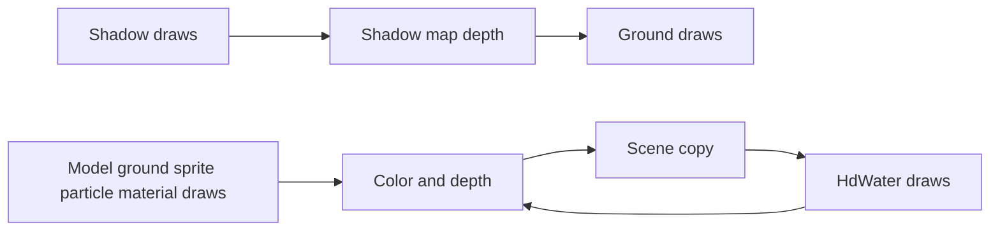

# Renderer

`code/renderer` is the Rust modern renderer, using WebGPU through `wgpu` with WGSL shaders translated by naga. It is a standalone Cargo project, outside the `code/harness` workspace. The frame input is in `src/RENDERER-FRAME-FORMAT.md`.

## Layout

| Path | Task |
| --- | --- |
| `code/renderer/src/gpu.rs` | Instance, adapter, device and queue |
| `code/renderer/src/display.rs` | Surface configuration and presenting |
| `code/renderer/src/pipelines.rs` | Bind group layouts and the pipeline cache |
| `code/renderer/src/resources.rs` | Mesh, texture and uniform buffers keyed by id, bind group cache, tessellated water meshes |
| `code/renderer/src/targets.rs` | Depth target, shadow map and the scene copy that water reads |
| `code/renderer/src/renderer.rs` | Frame loop, shadow pass, main pass, draw submission |
| `code/renderer/src/water.rs` | Screen space tessellation of HD water on the CPU |
| `code/renderer/src/frame.rs` | Frame structs, replay loader and writer |
| `code/renderer/src/pass.rs` | Pass table, vertex structs, layouts and texture binding kinds |
| `code/renderer/src/uniforms.rs` | Uniform block structs |
| `code/renderer/src/scene.rs` | Deterministic built-in scenes and frame sources |
| `code/renderer/src/math.rs` | Matrix helpers |
| `code/renderer/src/shaders.rs` | Embedded WGSL sources |
| `code/renderer/src/capture.rs` | Headless device, offscreen render and readback |
| `code/renderer/src/stats.rs` | Per frame phase timing, GPU timestamp probe and the bench report |
| `code/renderer/src/main.rs`, `window.rs` | Native command line and window |
| `code/renderer/src/web.rs` | Browser entry exported by wasm bindgen |
| `code/renderer/src/bin/shaderc.rs` | GLSL to WGSL translation tool |
| `code/renderer/shaders` | Generated WGSL, committed |
| `code/renderer/tests` | Device free tests and GPU tests that skip without an adapter |

## Run Native

```
cd code/renderer
cargo build --release
./target/release/renderer-app --scene all
./target/release/renderer-app --scene all --frames 3 --out frame.png
```

| Option | Meaning |
| --- | --- |
| `--scene name` | `model`, `ground`, `sprite`, `shadow`, `particle`, `water`, `material` or `all`, default `all` |
| `--frames N` | Frames to render, the last is written, in a window the program exits after N |
| `--out file.png` | Render offscreen without a window and write a PNG |
| `--size WxH` | Frame size, default 800x600 |
| `--present` | Always use a window, present `--frames` frames (default 30) and exit, for RenderDoc frame marking |
| `--replay file.orf` | Use a frame file instead of a scene |
| `--dump file.orf` | Write the scene as a frame file and exit |
| `--check-shaders` | Create every WGSL module on the device and print the validation result |
| `--bench N` | Render the frame N times headless and print CPU, GPU and wall time per frame, see Performance |

- The backend is Vulkan, `WGPU_BACKEND=vulkan` forces it.
- A RenderDoc capture launches `renderer-app` with `--out` or the window mode.

## Run Web

```
cd code/renderer
./build-web.sh
```

- The script builds the `wasm32-unknown-unknown` library and runs `wasm-bindgen --target web`, writing `renderer.js` and `renderer_bg.wasm` into `code/web/static`.
- `boot.js` calls the exported `App.create(canvas, scene)` and then `App.frame()` on every animation frame.
- The page accepts `?scene=name`.

## Passes

Every pass is a `Pass` value in `pass.rs`, numbered as in the frame format, with one vertex layout, one uniform block, one list of texture binding kinds and one default render state. Draws run in file order, except that shadow draws are collected into the shadow pass first.

| Pass | Shader | Target | Textures | Default state |
| --- | --- | --- | --- | --- |
| Model, Instanced | `model`, `instanced` | Main | 2D | Depth test and write |
| Ground | `ground` | Main | 2D ground shadow, shadow map | Depth test and write |
| Terrain | `groundTextured` | Main | Noise volume, 2D, ground shadow, texture | Depth test and write |
| Sprite | `sprite` | Main | 2D array | No depth, alpha blend |
| SurfaceMask | `surfaceMask` | Main | Base texture, mask | No depth, alpha blend |
| Shadow | `shadow` | Shadow map only, no color | 2D alpha texture | Depth test and write, front faces culled |
| Particle | `particle` | Main | 2D | Depth test, no write, alpha blend |
| HdWater | `hdWater` | Main after the scene copy | Wave volume, scene color, scene depth, foam volume, environment cube, shadow, reflection | Depth test and write, less or equal, alpha blend |
| Material | `materialCubeSpec` | Main | 2D | Depth test and write |
| Water, WaterHD, WaterLapping, WaterReflecting, WaterRippling, Waterfall | Same names | Main | 2D, volume and cube as the shader declares | Depth test and write |



### Frame Loop

1. Resources are synchronized: meshes, instances, textures and uniforms of the frame are uploaded, 3D and cube views are created for textures that a draw binds as a volume or a cube, and HD water meshes are tessellated.
2. Pipelines and bind groups are created for every live draw.
3. If any shadow draw exists, or any draw binds the shadow map, a depth only pass clears the shadow map to 1 and renders the shadow draws into it with the full map as viewport.
4. The main pass clears color and depth and renders every other draw in file order.
5. Before the first HD water draw of a run, the main pass ends, color and depth are copied into the scene copy textures, and the pass resumes without clearing. Water fragments read refraction and thickness from the copy.

### Shadow Map

- The shadow map is a `Depth32Float` texture, sized from the shadow draws' viewport width, 2048 by default as `ShadowPass` in the client.
- A draw binds it by using the reserved texture id `4294967294` in the slot of `uShadowMap` or `uShadowTex`. The ground scene does this.
- Depth textures are bound as unfilterable float with a nearest sampler. The ground shader does its own PCF, so this equals the client's nearest depth texture.
- The light matrix in the shadow uniform is depth remapped like every first matrix of a block, the `uShadowMatrix` of the ground block is not, so the shader's `z * 0.5 + 0.5` equals the stored depth.

### Water Technique

The client renders HD water with `hdWaterTess.vert`, `hdWater.tesc` and `hdWater.tese` on GL 4.0, and naga has no tessellation stages. The renderer replaces the three stages by a vertex stage and a CPU tessellator with the same functions.

- `shaderc` synthesizes `hdWater.vert` from the client files: the attribute declarations of `hdWaterTess.vert`, the outputs of the evaluation shader, and the uniforms, `octave` function and `main` body of `hdWater.tese` with the barycentric interpolations replaced by the attributes and the noise fetch given an explicit level zero.
- `water.rs` subdivides every triangle of a water mesh into `N * N` triangles on a barycentric lattice, where `N` is the ceiling of the largest of the three edge levels. An edge level is the same function as `hdWater.tesc`: the screen distance of the two endpoints, projected with `uViewProjection` and the draw viewport, divided by 24 pixels and clamped to 1 to 16. Meshes whose block has `uHasWaveNoise` off are drawn as is.
- The tessellated mesh is cached per mesh and uniform and rebuilt only when the view projection or viewport changes.

Equivalence: the evaluation shader is a function of the barycentric interpolation of the three patch vertices. Linear interpolation commutes with the per vertex reads, so running the same body in a vertex stage over lattice vertices that are the barycentric interpolations of the patch corners yields the same position, edge and depth at each lattice vertex, and the same `vWorld` and `vEdge` varyings for the fragment stage. The differences are the sampling pattern only: the GPU uses fractional odd spacing with a separate level per outer edge, the renderer uses uniform spacing with one level per triangle. Adjacent triangles with different levels therefore do not share subdivision points, which the GPU tessellator stitches. The displacement fades to zero at shore edges through the edge alpha and beyond 6000 units, so the mismatch is limited to open water between tiles of different screen size.

The fragment shader is patched for WebGPU's top left origin: `gl_FragCoord.xy` is flipped to the GL convention, and every scene color, depth and reflection fetch flips its texture coordinate back, so the unprojection with `uViewport` and `uInvViewProjection` matches the client.

The reflection ray marcher uses projected `ndc.z` directly when comparing against the copied scene depth. The replay loader already converts `uViewProjection` to WebGPU's 0–1 depth range; retaining the native shader's additional `z * 0.5 + 0.5` conversion moved the near plane to 0.5 and produced false reflection intersections. The inverse matrix remains in the native GL convention, so unprojection still converts sampled depth with `depth * 2.0 - 1.0`. `tests/water.rs` executes the generated shader's projection function on the GPU and checks near, middle and far depth values; the original conversion fails the near-plane check.

A frozen replay of `code/harness/target/bench/scene-all.orf` at 765×503 changes 54 pixels after the projection correction, with a maximum channel change of 12. All 12 draws, including HD water, remain drawn and zero are skipped. The frozen `verify.orf` remains pixel identical with 1882 drawn and 1117 skipped, including one `hdWater@mode14`: the producer rejected that patch draw before recording its geometry, uniforms or textures. The consumer cannot recover those missing resources. Enabling native water capture requires recording three-index patches in their original order, the HD-water uniform block and layer-packed 3D wave/foam textures and cube faces; terrain water also needs its noise volume and scene-depth binding. These captured-game water paths are not yet verified for parity.

### Capture And Parity Limits

Surface-mask draws are supported. When HD water requests a missing planar reflection, the renderer reconstructs a half-resolution reflection from the captured instanced and textured-terrain draws. This is not a replay of every native offscreen operation, and explicitly skipped native geometry remains missing.

Bloom, fullscreen and `optimized` programs, native multisample rendering and complete offscreen-target equivalence remain unsupported. Base-level RGB16F/RGBA16F 2D textures travel as ORF4 RGBA16Float records; typed mip chains and other typed texture families remain unsupported. See `TRANSPILATION-STATUS.md` for measured hosted-game parity and capture limitations.

## Performance

`renderer-app --replay f.orf --bench N` renders a frame N times headless and prints one line for the first frame and the 50th and 95th percentiles of the rest. The browser prints the same report through `openrs web do bench N`, see `WEB-HARNESS.md`.

```text
bench: 60 frames, gpu time from timestamp queries, 765x503 verify.orf
frame 1: cpu 150.09 ms (sync 136.27, water 0.02, groups 9.28, encode 0.17, submit 4.35), gpu 0.22 ms, wall 158.80 ms, 1882 draws, 3642 calls, 171 uploads, 97.9 MB, 6 fps
frames 2-60 p50: cpu 1.00 ms (sync 0.03, water 0.00, groups 0.33, encode 0.10, submit 0.52), gpu 0.21 ms, wall 1.38 ms, 1882 draws, 3642 calls, 0 uploads, 0 B, 723 fps
```

| Column | Meaning |
| --- | --- |
| `sync` | Resource sync: hashing the frame's records, packing new meshes into arenas, texture upload with CPU mip chains, uniform buffers |
| `water` | CPU tessellation of HD water meshes whose view changed |
| `groups` | Pipeline lookups and bind group creation for every live draw |
| `encode` | Recording the passes, including the scene copies before water |
| `submit` | `queue.submit` |
| `gpu` | GPU time from timestamp queries on every pass, or wall time to the fence when the device has none |
| `wall` | From the start of the frame to the fence, the number the frame rate is derived from |
| `calls` | Render pass commands recorded, after redundant state is skipped |
| `uploads` | GPU buffers and textures created this frame and their bytes |

### Caching

- Every record is identified by a 64 bit content hash of its bytes, kept per id in a pool. A record whose id already maps to the same content is not touched, a record whose content exists under another id is aliased, and nothing is uploaded twice. Uniform buffers are immutable, a changed block is a new buffer.
- All meshes that arrive in one sync are packed into one vertex and one index buffer per vertex stride, and all instance records into one instance buffer. A draw is `draw_indexed` with a first index, a base vertex and a first instance, so a run of draws from one arena binds its buffers once.
- Bind groups are keyed by pass and the content hashes of the bound textures, pipelines by pass and state, both kept across frames in lists that the draws index.
- While encoding, a cursor keeps the viewport, scissor, pipeline, both bind groups, the arena and the instance buffer last set, and a draw records only what differs. Draw order is unchanged, so blending and depth results are identical.
- Pools are swept every 256 frames: entries no id refers to are dropped, arenas and instance buffers no mesh refers to are freed, and the bind group list is rebuilt.
- The replay source hands out the same frame by reference, with meshes, textures and instances only in the first frame.
- A draw whose uniform block is shorter than the pass block is skipped instead of invalidating the command buffer.

### Measured

Native, Vulkan on a GTX 1660 SUPER, `--bench 60`, the frame's own size of 765x503, 50th percentile of frames 2 to 60. Before is the committed renderer timed over `--frames 61` minus `--frames 1`.

| Frame | Draws | Before, ms per frame | After CPU, ms | After GPU, ms | After wall, ms | First frame, ms | First frame uploads |
| --- | --- | --- | --- | --- | --- | --- | --- |
| `verify.orf` | 1882 of 2999 | 4.1 | 1.00 | 0.21 | 1.38 | 150 | 171, 97.9 MB |
| `lumbridge.orf` | 1169 of 1713 | 5.4 | 0.55 | 0.13 | 0.80 | 113 | 142, 83.5 MB |
| `varrock.orf` | 1371 | 5.4 | 0.81 | 0.16 | 1.11 | 128 | 158, 96.0 MB |
| `scene-all.orf` | 12 | | 0.12 | 0.33 | 0.55 | 12 | 20, 116 KB |

| Phase of a `verify.orf` frame | Before | After |
| --- | --- | --- |
| Sync and uploads | Every mesh, instance and texture re-created, every uniform written, the frame cloned | 0.03 ms, hashes compared, nothing uploaded |
| Water tessellation | Cached per mesh and view | 0.00 ms, unchanged |
| Pipeline lookups and bind groups | A `Vec` key per draw, two lookups per draw | 0.33 ms, one lookup per draw into indexed lists |
| Pass encoding | 9 commands per draw | 0.10 ms, 3642 commands for 1882 draws |
| Submit | | 0.52 ms |
| GPU | | 0.21 ms |

The first frame is texture upload: about 150 textures are expanded to RGBA with CPU mip chains, 98 MB in all, which is 120 to 140 ms of the 150 ms. Mesh hashing and arena packing take about 15 ms.

Browser, Chromium WebGPU on the same card, `openrs web do bench 60`, see `WEB-HARNESS.md` for the page loop numbers.

| Frame | Before CPU, ms | After CPU, ms | After GPU, ms | After wall, ms | Load before, ms | Load after, ms |
| --- | --- | --- | --- | --- | --- | --- |
| `verify.orf` | 7.6 | 1.03 | 0.26 | 7.1 | 3665 | 580 |
| `lumbridge.orf` | 4.9 | 0.66 | 0.14 | 5.8 | 4055 | 347 |
| `varrock.orf` | 13.7 | 0.77 | 0.16 | 5.9 | 4389 | 409 |
| `scene-all.orf` | 0.5 | 0.18 | 0.35 | 6.6 | 101 | 31 |

- Before CPU is the page's smoothed `cpuMs`, load is `openrs web do replay` from fetch to the second frame.
- The browser wall time is the fence round trip through Chromium's GPU process, 5 to 7 ms even for 12 draws, and the page loop does not wait for it.
- The pixels are unchanged: `--replay --out` of every bench frame and every scene is byte identical before and after, and `tests/pixels.rs` guards the recorded hashes.

### Final Independent Replay Check

After integration, the 1882-draw `verify.orf` frame was benchmarked independently again.

| Measurement | Native | Browser |
| --- | --- | --- |
| Median CPU | 1.22 ms | 0.92 ms |
| Median including completion fence | 1.59 ms | 5.63 ms |
| 95th percentile including fence | 3.99 ms | 6.90 ms |
| Repeat uploads | 0 | 0 |

- Normal browser playback rendered 180 frames in 2.92 seconds. The benchmark's reciprocal fence time is a throughput ceiling, not the page's display rate.
- First-frame decode and upload remain separate costs. Dynamic streamed games can upload changed uniforms and resources every tick; static replay timings are not an end-to-end game-stream benchmark.
- The normal `cargo test` profile passes the pixel regression suite. The fast `iter` application profile uses abort-on-panic and can collide with unwind-based test artifacts, so it is not the canonical test command.

## Shader Translation

`./shaders.sh` runs `shaderc`, which reads the GLSL files, rewrites them into the Vulkan flavored GLSL that the naga frontend accepts, parses and validates them with naga, and writes WGSL with the naga writer. Every patch asserts that its target text exists, so a client shader change that moves a patched line fails the translation instead of silently dropping the rewrite.

### Rewrites

- Loose uniforms of a vertex and fragment pair merge into one std140 block at group 0 binding 0.
- `bool` uniforms become `uint` members with a `#define` that restores the name.
- A `vec2` uniform array becomes a `vec4` array to satisfy the uniform stride rule.
- Each `sampler` becomes a texture and a sampler at group 1 bindings `2i` and `2i + 1`.
- Varyings and fragment outputs get explicit locations matched by name.
- A texture fetch in the vertex stage, in the ground shadow PCF loop, in `shadow.frag` and in `sprite.frag` uses an explicit level zero, because WGSL forbids implicit derivatives in vertex or non uniform control flow.
- `sprite.frag` replaces the eight sampler array and its switch by one layered array texture.
- `groundTextured.vert` writes a varying instead of `gl_ClipDistance` and `groundTextured.frag` discards on it.
- `hdWater.vert` is synthesized from the tessellation stages and `hdWater.frag` flips its screen coordinates, see the water technique.
- Every fragment module starts with `diagnostic(off, derivative_uniformity);`. Tint in Chromium rejects implicit derivative sampling in non uniform control flow, which naga accepts, and `hdWater.frag` samples the scene copy and the wave noise inside branches.

### Result Per Shader

Every file translates and passes both naga validation and the device shader module check.

| Pair | Vertex | Fragment | Note |
| --- | --- | --- | --- |
| `batched` | clean | clean | No pass, the client draws its batches with `model` |
| `ground` | clean | clean | Level zero fetches |
| `groundTextured` | rewritten | rewritten | Clip distance replaced, vec2 array widened |
| `hdWater` | synthesized | rewritten | Wave displacement from `hdWater.tese`, screen flip |
| `materialCubeSpec` | clean | clean | |
| `model` | clean | clean | |
| `particle` | clean | clean | |
| `shadow` | clean | rewritten | Level zero alpha fetch, no color output |
| `sprite` | clean | rewritten | Layered array texture |
| `water` | clean | clean | |
| `waterHD` | clean | clean | |
| `waterLapping` | clean | clean | |
| `waterReflecting` | clean | clean | |
| `waterRippling` | clean | clean | |
| `waterfall` | clean | clean | |

## Tests

`cargo test` runs without a GPU. Tests that need an adapter print `skip` and pass when none is found.

| File | Needs GPU | Checks |
| --- | --- | --- |
| `tests/shaders.rs` | No | Every WGSL module parses and validates with naga, every pass has a vertex and a fragment stage, only the shadow fragment has no color output |
| `tests/layout.rs` | No | Group 1 bindings, their dimensions and sampler slots match the pass table, vertex inputs match the attribute formats and strides, uniform block sizes match `Pass::block_size`, every Rust uniform struct matches its block member by member through naga reflection, the reflected layout of every pass equals the client fixture `code/client/src/test/resources/pass-layouts.json` (written with `PASS_LAYOUTS_WRITE=1`) |
| `tests/routing.rs` | No | Every client shader name routes to one pass and back, a frame with one draw per pass replays with every shader counted as drawn, the scenes cover the new passes, the water tessellator follows screen size |
| `tests/replay.rs` | Round trip only | Frame file parse and write, the synthetic client fixture, skipped draw counting |
| `tests/passes.rs` | Yes | Every scene renders two frames and paints something |
| `tests/pixels.rs` | Yes | Every scene at 765x503 and every `.orf` under `code/harness/target/bench` hash to the pixels recorded in `tests/fixtures/pixel-hashes.txt`, recorded with `PIXELS_WRITE=1`, skipped on another adapter name |

```
cd code/renderer
cargo test --offline
cargo build --release --offline
cargo build --target wasm32-unknown-unknown --offline
```
