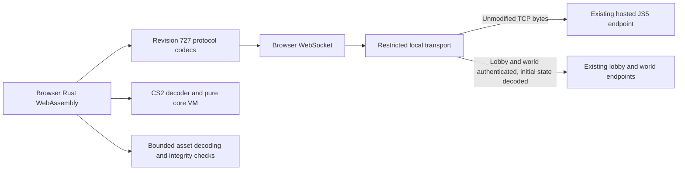

# Standalone Client Foundation

The hosted WebGPU game and the independent client foundation are separate implementations at this milestone. The hosted game still uses Kotlin for login, game state, CS2 and gameplay. The Rust browser runtime independently fetches and integrity-checks revision 727 JS5 assets, loads transitive static script dependencies and executes 77 bounded pure CS2 operations; the VM additionally supports four variable operations when given an explicit host. Typed browser sessions connect original lobby login, private token handoff, fresh world login, bounded initial player/map decoding, live VARP state and opt-in inventory containers. Actual Chromium previously authenticated with the unchanged lobby/world 22 and applied real variable packets; eleven sampled active values matched native before and after handoff. Surface terrain, standard-map heights, floor definitions, packed-HSL palettes and verified material metadata have bounded runtime/browser ownership. Default blended surface-ground topology now has a native-compatible implementation and checked WASM preparation/query APIs. Randomized-gamma RGB lookup preparation is also available. GroundGL lowering, texture pixels, independent world rendering, interfaces and gameplay remain unfinished. These foundations do not replace the native game engine.

## Components



- `code/protocol` is a dependency-free, transport-independent Rust crate. It implements revision 727/subrevision 1 JS5 codecs, structural version-table parsing, ISAAC, generic framing and exact original registries for 104 client and 161 server packet IDs.
- `code/cs2` generates opcode metadata from the existing Kotlin enum and implements script decoding, pure core execution and four explicit hosted variable operations. The current enum has **1,010** entries, including four extensions; wire IDs, declaration order, names, operand-width flags and family IDs are preserved.
- `code/assets` implements bounded native container decompression, CRC32/Whirlpool consistency checks, reference tables and multi-file archive splitting using maintained pure-Rust dependencies.
- `code/login` implements original lobby/world requests, typed version-6 machine information, incremental login responses, explicit confirmation, bounded lobby streams/world lists, first-packet framing, initial own-player/standard-or-dynamic-map decoding and transactional item-container packet state. Later gameplay and scene integration remain incomplete.
- `code/client-runtime` exposes JS5 bootstrap, verified asset fetching, transitive static script loading, bounded pure-core execution, an account-free handshake probe and typed original lobby/world sessions with opt-in VARP/inventory state through WebAssembly. Verified surface-ground preparation retains one plane for bounded queries. Its generated bindings are separate from the WebGPU renderer bindings.
- `code/scene` provides bounded surface-terrain decoding, standard-map height/raw-tile composition, floor definitions, packed-HSL underlay palettes, explicit randomized-gamma RGB lookup tables, material metadata and default blended surface-ground topology. Native arithmetic, clipping, neighbor ordering and cross-plane palette carry are preserved. GroundGL mesh/color lowering, texture pixel generation and independent browser-world rendering remain unimplemented.
- `code/relay` provides restricted local WebSocket-to-TCP routes for JS5 and optionally operator-selected lobby/world endpoints. It is not a lobby or world server and does not interpret account login.
- `code/web/static/js5-probe.js` manages browser transport, wasm lifetime, timeouts and bounded fixture loading. The harness bridge exposes `protocol-probe`, `asset-probe`, `asset-file`, `cs2-probe`, `script-graph-probe`, `script-graph-file` and `game-handshake-probe`.

## Protocol Contract

The JS5 probe sends the normal revision handshake, consumes the configured 27 prefetch integers, then sends acknowledgement, logged-out status and the high-priority version-table request. Native interim status 25 is supported. TCP and WebSocket message boundaries are not treated as protocol boundaries; the Rust decoder reassembles ten-byte reply headers and 512-byte blocks incrementally.

The fetched table exposes index CRCs and revisions. Whirlpool and signature bytes are parsed by the protocol crate, but **the signature is not authenticated**. Browser reports therefore explicitly contain `authenticated: false`. A successful diagnostic is not proof of asset authenticity, login success or cache equivalence.

The public JS5 revision token is supplied by the caller. The diagnostic needs no account credentials. Do not pass a player's password as a JS5 token or put account credentials in harness commands, source or documentation.

ISAAC and packet framing have independent Kotlin-derived vectors, including 520 outputs across multiple cipher refills. The typed registries preserve 265 native packet IDs, names, sizes and client tick flags. Client opcodes use one encrypted byte; server opcodes use ISAAC smart encoding. `RegistryEncoder` and `RegistryDecoder` select the correct direction through sealed opcode types. The native unknown identities remain explicitly unsupported but can carry opaque framed payloads; unregistered IDs fail terminally. The generic framing API remains available. The registry does not interpret packet payloads or construct game state. Native fixtures cover 1,060 synthetic frames and a high-byte alias regression. Bounded payload readers/writers additionally preserve transformed bytes, endian and middle-endian integers, smart values, MSB-first bit reads and native CP1252/Jag strings. Failed operations preserve the cursor/output; supplementary characters encode as two question-mark bytes, matching the native Java UTF-16-to-CP1252 writer rather than UTF-8. The payload oracle contains 3,079 fixture rows, exhaustive byte/short checksums and 1,792 bit-alignment vectors. All 65 protocol tests pass natively and in actual wasm.

## Asset Contract

`AssetProbe` performs one sequential exchange: the version table, the requested index's reference table, then the requested archive. Every response must have the exact outstanding index/archive identity and priority. The reference container is checked against the master table's CRC32 and Whirlpool; the archive is checked against the reference table's CRC32 and optional Whirlpool before decompression. An absent archive digest is reported as unverified, not successful verification. Zero-filled digests are not treated as absent. The unsigned root remains unauthenticated.

The asset crate supports raw containers, native headerless BZip2 and native fixed-header gzip. LZMA and unknown compression modes fail explicitly. Exact lengths, complete compressed streams and checksums are required; native on-disk revision trailers are not accepted as wire bytes. Reference protocols 5, 6 and 7 preserve sparse IDs in compact storage, optional names and optional digests. Multi-file splitting preserves native signed chunk-length deltas while rejecting invalid sizes and bounds. Remote reference loading does not incorrectly require its embedded revision to equal the master entry's revision.

Browser probe limits are 4 MiB per container, 8 MiB expanded data, 12 MiB total received wire data, 65,536 archives/files per archive, 262,144 total file metadata entries and IDs up to 1,000,000. The probe retains one completed archive; starting another clears the prior result. Failure, incomplete EOF and trailing data invalidate the result. The diagnostic file-export command is limited to 64 KiB. CS2 index 12 files are decoded for metadata, not executed as game scripts.

Synthetic existing-jar oracles cover all three compression modes including empty containers, a 210,137-byte multi-block BZip2 payload, twelve reference protocol/flag combinations and native multi-file splitting with negative deltas. Thirteen contracts pass natively and in actual Node wasm in debug and release, including 5,000 malformed inputs and allocation/expansion limits. Fixture hashes and a reproducible generator are included in `code/assets`.

## Offline Lobby And World Codecs

`encode_lobby_request` emits opcode 19, a bounded unsigned-short payload length, revision 727/subrevision 1, the native public raw-RSA block and the XTEA-encrypted lobby fields. The caller supplies all four seed words, randomness, nonces, identity, tokens, 35 preference bytes and 36 CRCs. There is no default RNG or deterministic production seed. The browser account builder now supplies fresh cryptographic seeds, measured browser capabilities and the current hosted JS5 CRCs; a real lobby account login succeeded in the tenth iteration.

The crate preserves Java signed-BigInteger RSA representation, native CP1252/NUL/jag strings, 32-round big-endian XTEA with untouched partial-block tails and direction-specific ISAAC initialization. Passwords are limited to 86 CP1252 bytes so the complete 128-byte RSA message remains recoverable; the lower-level raw RSA function separately preserves bounded native modular arithmetic behavior. Request/result types do not expose sensitive `Debug` output, and errors never include field values. Owned sensitive byte/string buffers are wiped on drop, but bigint arithmetic temporaries and the existing ISAAC internals do not guarantee memory erasure.

`encode_world_request` emits native opcode 16, revision/subrevision and the native reconnect flag, RSA and XTEA fields. Reconnect is not an invented opcode 18 path. The caller must supply the actual lobby-issued authentication token, dimensions, typed version-6 machine information, all random values, preferences, CRCs and flags. Empty or oversized recoverable tokens fail; no synthetic production token or RNG is supplied.

`LoginResponseDecoder` incrementally decodes typed lobby/world success and the supported native status payloads. It preserves signed 24-bit date-of-birth, signed gender, unsigned 40-bit timing, exact `== 1` booleans and the absent-world sentinel. Constructor bounds are 61 bytes for lobby or 14 for world through 255 bytes. Statuses 1, 15, 21, 23, 29, 42 and 45 are surfaced, with 42 resumable; unknown/social status paths fail explicitly. The decoder reports consumed bytes and stops at the success blob or reconnect status byte, leaving initial game/map/reconnect data unconsumed. Truncation poisons the decoder rather than returning partial success.

The original 37 request/response release contracts pass natively and as actual wasm, using only synthetic fixture credentials and the isolated existing native jar. Oracle generation does not probe the machine or contact a server. The following session components extend those codecs; their initial validation used synthetic fixtures, followed by a real lobby account attempt in the tenth iteration. A real world login must use the token actually issued by the original lobby, not a fabricated substitute.

## Session And First-Packet Boundaries

`LoginAttempt` owns the encoded request and derives both ISAAC directions from the same caller-supplied seed. It sends only raw `[14]` until raw `[0]` is accepted, then releases the request. Raw responses never consume ISAAC words. Confirmation is explicit: `confirm()` permits exactly one encrypted outgoing opcode 26 before a fresh response decoder resumes. At most 64 response events are accepted per attempt. Success transfers the original ciphers once; malformed input, abort and incomplete EOF clear pending material. Retry, queue and reconnect are explicit outcomes, not automatic retries or a completed reconnect implementation.

`LobbyStream` consumes the transferred ciphers directly. Each `feed()` returns one registry packet and exact consumed bytes, so coalesced login success and encrypted packets remain separable. Native keepalive timing is caller-driven: the first 50 idle ticks do not emit a ping; tick 51 emits client opcode 0 once, pending until the caller reports an actual flush with `mark_flushed()`. No unverified tick duration is invented. The server keepalive reply has wire ID 29 and retains its native registry name `PING`. Signed-i32 world-list requests use client opcode 47.

`WorldListDecoder` consumes WORLD_LIST packet payloads, including the refresh byte, accumulating at most 20,000 bytes before allocation. Only refresh `== 1` publishes a snapshot. Native mode 2, smart values, Jag strings, sparse raw-ID indexing, optional signed ports/flags/version, nonzero starts, zero-length descriptor arrays and the offline player-count sentinel are preserved. Counts-only updates retain prior metadata; no-prior empty updates have `version: None`. Bad input discards both partial and prior state until explicit reset. Unlike the native zero-padded packet buffer, the library rejects truncation, trailing bytes, duplicates and invalid IDs/locations. Advertised hosts are data and do not select relay upstreams.

`WorldEntryDecoder` handles only the first packet after a fresh world success. The header uses an incoming ISAAC smart opcode followed by an unconditional plain big-endian u16 length, even for registry entries normally fixed-size or VarByte. It preserves native 3/4-byte staging and nonconsuming peek, bounded allocation, exact suffix boundaries and one-time cipher transfer. Subsequent registry packets use that advanced incoming cipher; outgoing is untouched. Reconnect status 15 has a different unported continuation. Returning an opaque first packet does not decode own-player or map state.

## Browser Sessions And Initial World State

`OriginalLobbySession` accepts a strict, bounded, caller-supplied JSON configuration. It owns the original `LoginAttempt`, then `LobbyStream` and `WorldListDecoder`; opaque packets are reported only as opcode/name/length, not applied state. The lobby-issued authentication token remains in zeroizing Rust storage. `startWorld` constructs `OriginalWorldSession` inside Rust without a JavaScript token getter. Passwords, seed words, display names, tokens, map keys and map-owner identifiers are excluded from public reports. Owned sensitive buffers are wiped, but immutable JavaScript strings and cipher/bigint internals do not provide complete erasure guarantees.

Fresh world sessions accept the original world success, preserve its ciphers through `WorldEntryDecoder`, and require valid own-player and map data before emitting `worldReady`. The player prefix contains a 30-bit own tile and 18-bit region hashes for the other nonzero player slots; valid player indices are 1 through 2,047 and the prefix occupies 4,608 bytes. Standard opcode 85 preserves map size, signed base/local coordinates, region ordering and corresponding XTEA arrays. Dynamic opcode 51 additionally preserves full 26-bit chunk descriptors and first-seen region order. Java truncating division and unknown dynamic-load-type fallback are preserved. Unlike the native code, malformed key remainders/counts, unsupported first opcodes, index zero and invalid standard archive coordinates are rejected explicitly. No scene, collision, appearance or cache data is invented. Reconnect remains unsupported.

The initial-world parser has 19 contracts, including exhaustive valid player indices, representative truncated prefixes and 17 reproducible existing-jar oracles. Oracle parity uses the actual native bit/byte primitives and map sizes with independently implemented pure geometry loops, not full native scene execution. The expanded login suite, including item containers, now passes 147 release tests natively and in actual Node WASM.

Browser socket ownership is in `lobby-session.js`. Incoming messages are bounded to 64 KiB and total received bytes to 1 MiB, with explicit authentication and diagnostic-lifetime deadlines. Readiness is announced only after the current coalesced message is successfully processed. The lobby closes only after valid initial world readiness. Close cancels pending private fetches, runtime loading, lobby allocation/readiness and world readiness; late resolutions cannot publish a session or initiate a later handoff. There are no automatic retries, confirmations or invented native tick durations. Sent and received typed arrays, including an oversized private-bootstrap chunk, are wiped; abnormal WebSocket close codes use static errors without disclosing peer reasons. Public socket reports retain the last decoded initial map after disconnection; `worldReady` in that historical snapshot is not proof of a currently accepted or connected session.

The opt-in web endpoint `/__openrs/dev-login` delivers one private JSON object once. Both `OPENRS_DEV_LOGIN_CONFIG` and `OPENRS_DEV_ORIGIN` are required. The file must be an absolute current-user-owned regular single-link 0600/0400 file outside static/shared roots, opened without following symlinks, at most 64 KiB. Exact same-origin POST, Host, Origin, Fetch Metadata, content type and intent headers are required. Ambiguous headers, cross-site requests and invalid bodies are rejected without consuming the configuration; the valid first transfer consumes it atomically and later requests return 410. Responses are noncacheable; the source file is not deleted or reopened. Trusted same-origin scripts remain part of the security boundary.

`standalone.html` is an explicitly non-playable protocol diagnostic. `standalone-login` consumes either a private `{lobby, world}` fixture envelope or `{browserAccount: {identity, password}}`, performs both logins and waits for initial world state. Account mode first measures browser capabilities, fetches the current JS5 master table and builds bounded configurations with fresh cryptographic seeds. The 36 CRC words follow native resource order: indices 0–31, selected font index 32 or 34, then 33, 35 and 36. Java version fields remain zero because the browser is not a JVM; optional native hardware fields use their unavailable representations. The browser instance UID is ephemeral, not hardware attestation. Missing measured heap/concurrency/architecture fails explicitly. `standalone-profile` reports this nonsecret provenance without consuming the private bootstrap. The lobby retains its default world privately and derives `differentWorld` from that server-issued value rather than trusting a caller Boolean. `standalone-session-state` returns safe reports and explicitly marks gameplay/rendered-world support false; `standalone-session-close` closes the diagnostic. The older `standalone-lobby-login` accepts a raw lobby configuration only. Do not put any credentials, tokens or seeds in harness command arguments: the harness records them. The page's optional `autologin=1` starts the same bounded diagnostic, not a full game.

Fake-only integration helpers are `code/web/tests/fixture-bootstrap.mjs` and `original-upstream.py`. The latter binds only loopback and checks original request bytes against existing native fixtures. These helpers must never be substituted for actual hosted authentication evidence.

Account mode additionally waits up to 15 seconds for the descriptor matching the built world ID, requesting the current world-list version at most once. For custom-cache flag `0x20`, it fetches a new master through the operator-fixed `worldJs5Relay` (default `ws://127.0.0.1:8111/js5`), preserves the selected font and native CRC order, and replaces only `world.indexCrcs`. Advertised hosts never choose relay upstreams. Missing descriptors or failed world-master fetches fail closed rather than falling back to the known-wrong lobby CRCs. Shared-cache worlds keep lobby CRCs; exact `{lobby, world}` fixture mode is unchanged. This is login CRC selection, not full asset-repository switching. `worldListTimeoutMs` is bounded to 1–30,000 ms, and the third `standalone-login` argument can select another explicitly configured world JS5 relay.

## Variable-State Foundation

`code/client-runtime/src/vars.rs` decodes only `VARP_SMALL` (115), `VARP_LARGE` (8) and `CLEAR_VARPS` (100). It preserves signed values, native byte transforms, active/pending banks, immediate sentinel deadline 1, local 500 ms protection, coalescing, server rearming and strict deadline comparisons. Publication follows native 128-bucket/insertion order, including unchanged assignments. A reset returns a typed host-invalidation effect; it does not pretend to execute the native UI pulse machinery. Unsupported packet kinds, malformed lengths, out-of-span IDs, clock rewind and timestamp overflow reject before mutation.

The definition span must be supplied from actual JS5 index 2/archive 16 metadata. Native `getArchiveFileCount` means maximum file ID plus one, not the number of populated files. Verified asset reports now expose this as `fileSlots`, with a sparse-ID regression and an existing-jar oracle. No default full-span variable bank is fabricated.

Twenty-one focused variable tests match nine native packet samples and nine provider scenarios comprising 63 steps. The oracle uses a copied unchanged jar, synthetic definitions and an injected clock in a network-disabled sandbox. Live integration applies these three packet types to an explicitly sized `WorldVariables` bank; other packets remain opaque. `feed` updates pending state, while explicit `tick` publishes eligible changes, including during network idle. The Rust `WorldVarHost` adapter reads active VARPs and performs local writes with the same scheduling rules. `WorldVarHost::new` remains VARP-only; `with_varbits` explicitly supplies the bounded repository described below. VARC and VARCLAN are not implemented.

`OriginalLobbySession.startWorldState(configJson, varpCount)` explicitly enables the bank. Legacy `startWorld` remains bank-free. Direct WASM counts and accessor IDs validate JavaScript values before integer coercion. Invalid reads do not destroy a valid bank; terminal failure or close drops and zeroizes it. Safe reports contain only count/scheduling/assignment/publication/clear/nonzero counters, not a dump of variable values. Existing operation, event, byte and lifetime budgets remain unchanged.

Account-mode browser preparation fetches integrity-checked index 2/archive 16 from the selected world's fixed JS5 route before handoff. `world-config.js` validates sparse IDs and `fileSlots`, bounds the entire operation to 30 seconds and wipes/releases definition buffers on success, failure or late cancellation. The actual selected-world query returned **2,743 slots and 2,724 populated files**, not the earlier local fixture's 2,719/2,700. CRC/Whirlpool consistency does not authenticate the root. Legacy exact fixture mode does not fetch or allocate this state. The stateful browser owner services publication and explicit game ticks every 20 ms after whole-message readiness. This is a bounded browser service, not the native engine's complete tick lifecycle. `standalone-varp <id>` reads one bounded active value after readiness; no mutation command is exposed.

The opt-in VARBIT repository follows the active native `VarpbitTypeList` layout: index **22**, archive `id >> 10`, file `id & 1023`, not the historical index-2/archive-14 mapping. It verifies reference CRC/Whirlpool/revision and archive CRC/optional Whirlpool, then transactionally installs strict opcode-0/1 definitions. A verified absent archive/file yields `Absent`; a declared but unloaded archive yields `Unavailable`. Default definitions are not invented as absence. Bounds are 26-bit IDs, 321 bytes per definition, 2 MiB reference data, 512 KiB per archive, 4 MiB retained repository data, 256 reference archives, 65,536 definitions and 64 loaded archives. Eleven added contracts match 293 native decoder vectors and 56 native provider cases. This repository is not connected to live browser script execution.

## Opt-In Inventory State

`code/login/src/item_containers.rs` transactionally applies `UPDATE_INV_PARTIAL` (4), `UPDATE_INV_FULL` (5) and `UPDATE_INV_STOP_TRANSMIT` (42). Keys preserve the unsigned-short container ID and ordinary/negative namespace. Signed quantities, distinct full/partial integer transforms, CP1252 tooltips, flag precedence and the native 32-entry recent-ID ring are retained. A shorter full update preserves capacity and clears its tail; an empty full or header-only partial does not create a previously absent container. Stop-transmit removes only the selected namespace. Successful no-ops still record the raw ID.

Default retained bounds are 128 containers, 65,535 slots per container, 262,144 aggregate slots and 1 MiB of UTF-8 tooltip bytes. Parsing stages a complete candidate and checks final aggregate quotas before commit, so duplicate assignments or a set-before-clear sequence do not fail merely because an intermediate retained state would exceed the final-state quota. Temporary packet allocations remain bounded by the unsigned-short packet length. Standalone failures leave prior state intact.

`WorldSession::enable_inventory` is explicit, valid only before the handshake and only once. Disabled sessions preserve opaque-packet behavior. Enabled malformed inventory packets fail the session closed and clear retained state; successful updates emit typed metadata and counters without publishing a container dump. WASM `enableInventory`, `container(id, negativeKey)` and `item(id, negativeKey, slot)` validate original JavaScript types before conversion. IDs are 0–65,535, slots 0–65,534 and the namespace is Boolean. Missing containers/slots return `null`; invalid queries preserve valid state.

`lobby-session.js` accepts the strict Boolean `inventory` option and returns fresh frozen snapshots. Activation failure closes/frees the constructed session once, terminal cleanup removes inventory access, and inventory-only sessions receive the existing keepalive service. Account-mode `original-session.js` opts in during world handoff; exact fixture mode remains unchanged. No inventory mutation or gameplay-send command is exposed, and inventory UI/CS2 hosting is not implemented.

The unchanged-native oracle covers 56 ordered stateful operations using the actual native packet readers, storage and tooltip helpers with verified sequencing, not the complete native packet/game loop. The full login suite passes 147 native and actual Node WASM tests. A separate 24-test generated-WASM suite exercises original cipher handoff, fragmentation, signed quantities, both namespaces, strict inputs, snapshots, quotas, malformed packets and terminal cleanup. These synthetic tests are not a new authenticated live-inventory capture.

## Explicit World Keepalive Lifecycle

`WorldSession::game_tick` / `OriginalWorldSession.gameTick` advances the native idle-flush counter separately from VARP publication. The 51st explicit game tick queues one ISAAC-encrypted client `PING`; queued or drained-but-unacknowledged pings coalesce without consuming another cipher word. `mark_flushed` / `markFlushed` is valid only after draining a nonempty ready-world send. Queueing, draining, empty flushes and incoming traffic do not reset the counter. Bad phase, premature/empty/duplicate acknowledgment and EOF with pending output fail terminally. Existing diagnostic lifetime, byte, event and operation bounds remain unchanged.

`lobby-session.js` sends pending world bytes and acknowledges them only once the socket's `bufferedAmount` reaches zero. A delayed login write cannot become a ready-world flush acknowledgment. This indicates browser-buffer handoff, not remote receipt, just as native asynchronous `Connection.write` is not proof of server receipt. Loading/render keepalives, optional verification packets, arbitrary gameplay sends, retry/reconnect and production session policy remain unported.

## CS2 Contract

The decoder handles the native big-endian header/footer, nullable script names, CP1252 literals, string branding substitutions, long constants, operand widths and switch tables. It decodes all known opcode identities; decoding support is not execution support.

The executable pure subset consists of 77 operations: typed constants, locals and stack discard; string joining; arrays including paired `ARRAY_SORT`; integer, long and Boolean branches; switches; calls and returns; 18 deterministic arithmetic/bit operations including `INVPOW`; four packed-coordinate operations; and 20 text/character operations. The numeric extension preserves JVM wrapping, signed division/remainder, widened intermediate values and masked single-bit indices. `POW` uses bounded exact integer evaluation with native saturation. Without a host, the other 933 identities still return an explicit unsupported-opcode error rather than silently becoming no-ops.

`Vm::run_with_host` additionally enables `PUSH_VAR`, `POP_VAR`, `PUSH_VARBIT` and `POP_VARBIT` through the explicit `VarHost` interface; 929 remaining identities are unsupported even with this host. Without a host, store operations preserve the prior unsupported behavior without consuming the operand. With a supplied host, stores pop before accessing it, including when it returns `Unavailable`. A missing repository is distinct from a proven absent definition. Varbits preserve inclusive spans, signed full-width masks and JVM shift masking: valid spans require `end >= start` and `end - start <= 31`, not `end <= 31`. Native full-width mask `-1` causes stores to clamp every supplied value to zero. Eleven variable-host tests include 5,863 independent vectors from the actual native executor in a copied unchanged jar. These four operations are not full interface/game hosting or a browser script scheduler.

The earlier numeric extension matches 5,255 native arithmetic result/exception cases. `INVPOW` now uses bounded integer evaluation plus 1,347 generated native rounding corrections, preserving native examples such as 64 with root 3 producing 3 rather than the mathematical 4. This freezes the pinned JAR/JDK/architecture's `Math.pow` behavior; it is not a universal `StrictMath` guarantee or a platform `powf` approximation. All 420 original vectors now execute. The additional oracle covers 48,036 complete perfect-power thresholds, 144,108 boundary/neighbor dispatches and 22,362 direct cases, byte-identical in cold, warmed-JIT, interpreted and compiled native modes. Exact instruction fuel, typed underflow and decoded caller/callee execution are tested. Random, locale/clock and other client-state operations remain unsupported.

Text operations preserve JVM UTF-16 lengths, indices and searches rather than using UTF-8 byte offsets. Native-valid lone-surrogate outputs that the existing `Arc<str>` API cannot represent fail explicitly as unsupported; they are not replaced. Null/bad operands preserve explicit errors. Simple character casing uses tables captured from the native JDK 25/Unicode 16 runtime. Whole-string lowercase, language-dependent comparison and host-dependent formatting remain unsupported. New allocating text operations share the per-string and cumulative allocation bounds; selection reuses its existing string without charging a new allocation. Validation includes 8,867 direct native text cases and all 65,536 UTF-16 units across six character operations. The original 40 pure-core CS2 contracts passed natively and as actual Node WASM in debug and release; eleven hosted-variable contracts extended that earlier suite to 51. Subsequent numeric/coordinate coverage brings the current complete suite to 72 native and actual release-WASM tests.

`ARRAY_SORT` retains wire ID 87, family 15 and its ignored one-byte operand. It pops count/key-slot/value-slot before native-ordered checks, sorts only the selected prefix, preserves paired values and reproduces the native unstable tie ordering and signed pivot arithmetic. Alias errors, negative/zero/one counts, `i32::MIN` wrapping, global-array persistence through calls and reset semantics are explicit. The implementation uses a bounded explicit work stack rather than recursive host calls. Four added tests match 349 native cases, including eight 5,000-pair stress vectors and decoded call fixtures. That iteration's 55 CS2 contracts passed natively and as actual release WASM; opcode identities, declaration order and flags remain unchanged in the current 72-test suite.

The core VM preserves typed stacks, call ordering, relative branches and five bounded arrays. Its reusable API preserves the native pooled array and long-stack lifecycle. Both browser execution paths deliberately create a fresh VM. `cs2-probe` supplies a single zero-argument fixture; the separate graph diagnostic can load callees and optionally accept explicit integer arguments. Neither path fabricates host state, required string/long arguments or missing scripts.

Browser diagnostic limits are 64 KiB script input, 8,192 decoded instructions, 20,000 executed instructions, 4,096 live local values, 64 KiB individual strings and 256 KiB cumulative joined-string bytes. Long values are reported as decimal strings so JavaScript does not round 64-bit integers. Fixtures must be fetched from the same origin's `/files/` namespace without redirects or credentials; streamed bodies are capped before wasm execution.

Malformed input is rejected with structured errors rather than reproducing native array/map exceptions. Empty switch tables can be decoded, but executing one produces an explicit error instead of reproducing the native zero-capacity-map failure. This does not suppress or repair the separately diagnosed empty-quest-data error in the hosted client.

## Surface Terrain Foundation

`code/scene` decodes four 64-by-64 surface planes in native plane/x/y order. Tag 0 selects procedural height; tag 1 preserves the raw explicit byte; tags 2–49 read a plain overlay byte and select shape/rotation; tags 50–81 set render flags; tags 82–255 set underlay IDs. Fixed-size tile storage, whole-input byte limits and per-tile tag limits bound decoding. Strict `Terrain::decode` rejects trailing bytes; `decode_prefix` returns the separate effects suffix untouched, with that suffix still charged to the whole-input limit.

`surface_height_native_units(absolute_tile_origin, plane, x, y)` takes an unshifted absolute world-tile origin and returns native negative-up heights. It preserves wrapping arithmetic, the native noise/cosine interpolation, truncating division, clamping and scaling. Higher procedural planes subtract 960 native units. Explicit byte 1 means zero delta; other explicit bytes subtract 32 times the byte. No transformed packet-byte encoding is invented.

The decoder's original eighteen contracts match 420 reproducible copied-jar oracle records, including 349 height samples, 60 tile vectors and six complete archive hashes. Standard-map composition adds twelve contracts, an 80-full-array-hash oracle and 6,400 native samples over all five native sizes (72, 104, 120, 136, 168). It validates the exact ordered region list and eight-tile-aligned base, clips regional placement, preserves the native extra zero row/column, and distinguishes present, proven absent and unavailable regions. Proven missing archives follow native ordered clearing only below center chunk Y 800; unknown dependencies propagate `None`, not guessed zero. The 63/64/65 seams, all four planes and native missing-region neighbor precedence are covered. Actual generated-WASM tests exercise composition, sampling, invalid numeric values and owner cleanup.

`WorldTerrainProbe` fetches the version table, maps-index reference and requested `m{regionX}_{regionY}` archives sequentially through the selected world's fixed JS5 route. Native lowercase ASCII name hashing is preserved. Surface terrain is unencrypted; private location XTEA keys never need to leave Rust. Reference CRC/Whirlpool and archive CRC/optional Whirlpool are checked before decoding file zero with `Terrain::decode_prefix`. Effects suffix bytes remain opaque and charged. A verified named table can prove a region absent; nameless metadata, missing file zero, requested-hash ambiguity, malformed data and exceeded limits fail closed.

World 22's real index-5 reference is a valid dense protocol-7 table with **262,144 archives and 262,144 files**, exceeding the generic probe's archive-count limit. A maps-only compact projection validates all archive/file IDs, counts, columns, lengths and trailing data, retaining only requested names. It caps full metadata at 262,144 archives, 262,144 files and 524,288 combined records, and retained metadata at 36 archives and 4,096 files. Unrelated hash collisions do not invalidate requested lookups; multiple matches for a requested hash do. All scanned metadata contributes to the cumulative operation budget. The generic parser and asset-probe limits are unchanged.

Terrain diagnostic limits are 36 regions, 4 MiB per container, 8 MiB expanded per container, 1 MiB per terrain file, 256 tags per tile, 32 MiB cumulative wire data, 24 MiB cumulative containers, 32 MiB cumulative expanded data and 128 Mi cumulative byte/metadata operations. The per-tile tag cap is explicitly diagnostic. Reports distinguish the full validated reference counts from retained archives, report optional archive digest absence honestly, and keep `authenticated: false`.

`world-terrain.js` owns the exchange, composition and retained WASM instance. It accepts only explicit standard maps and exact loopback `/js5` relay URLs, imposes a 30-second preparation deadline and a bounded retained lifetime, validates report fields and releases transport immediately after completion. Close/abort/timeout frees the instance once; stale callbacks and late loads cannot publish a result. Account-mode `original-session.js` prepares this terrain after initial world readiness and owns its cancellation; legacy exact fixtures are unchanged. Safe state marks `scope: "surface-only"`, `effectsDecoded: false` and `renderedWorld: false`. Harness commands are `terrain-probe`, `terrain-height`, `surface-height` and `terrain-close`, plus account-bound `standalone-terrain-height` and `standalone-scene-height`. Pending `terrain-close` cancels loading promptly, including ignored-signal injected loaders, and closes any late owner without publishing it.

Six captured CRC-verified real archives independently matched the unchanged native provider, decoder and height composer: **98,304 regional tiles**, including height and all five decoded attributes, and **44,100 composed heights** at base `(7904, 8456)`, size 104. All 100 plane/seam/padding samples matched; no height was unavailable. The composed array SHA-256 was `8d083abd5ba2c39e9beb741b31160b7cfe125ee873881470fbe439a6a3898b76`. Every terrain-prefix pointer matched native consumption; each file left 40 opaque suffix bytes. Evidence and reproduction are under `code/harness/target/loop/iteration12-validation/real-terrain-parity`. This verifies data/height parity, not world geometry or pixels. Effects, underwater/constructed maps, bridges, locations, meshes and scene rendering remain unfinished.

## Floor Definitions And Packed-HSL Palette Preparation

`code/scene/src/floor.rs` decodes native underlays from index 2/archive 1 and overlays from index 2/archive 4. A nonzero map tile byte selects definition `tileId - 1`; zero means no floor. A verified absent definition returns the native default, including an underlay hue multiplier of zero. This is distinct from a decoded black definition, whose multiplier is at least one. The decoder preserves RGB division by 256, native signed hue arithmetic, packed-HSL reduction, magenta overlay sentinel, texture/scale defaults and wrapping overlay-slot packing. Overlay opcode 8 is recorded as metadata; the native list's lazy-load `lastLoadedOverlayId` side effect is not invented during eager repository loading. Unknown/trailing data rejects explicitly. The accepted strict subset is narrower than the native parser, bounded to 4,096 bytes and 256 tags per definition.

`WorldFloorProbe` and `Js5WorldFloorProbe` fetch one version table, verify the index-2 reference against its CRC/Whirlpool entries, then verify and transactionally decode both archives. No repository publishes until both complete. Sparse IDs and file-slot spans are retained without preallocating all defaults. Missing definitions are distinct from unavailable repositories; invalid bounded reads preserve valid state, while terminal transport failures clear it. Limits include 65,536 definitions per archive, IDs through 65,535, 4 MiB containers, 8 MiB expanded containers, 20 MiB cumulative wire, 16 MiB cumulative containers, 24 MiB cumulative expansion and 128 Mi byte/metadata operations. Actual upstream floor archives have CRCs but no optional Whirlpool digests; their reports correctly retain `whirlpoolVerified: false`. The downloaded master remains unauthenticated.

`code/scene/src/palette.rs` reproduces `calculateUnderlayPalette` before ground construction. Its clipped sliding window is `x - 4 .. x + 5`, `y - 4 .. y + 5`, with JVM wrapping/truncating arithmetic. The palette buffer survives between planes, so a cell with nonpositive divisor/count retains its prior-plane value. Proven missing floor definitions contribute native defaults; unavailable terrain/definitions taint dependent cells instead of fabricating a color. `composePalette` stores the result only after valid surface composition and a complete floor repository. `paletteColor` validates original JavaScript coordinates before casts and returns signed packed HSL or `null`. Recomposition clears the old palette; invalid requests preserve valid state.

`world-floors.js` owns cancellable loading, exact loopback relay validation, a 30-second exchange deadline and bounded retained WASM lifetime. `world-terrain.js` optionally borrows that floor owner for composition without owning its cleanup. Account-mode `original-session.js` owns both and closes every owner even if one cleanup throws; exact synthetic fixture mode remains unchanged. Account-free commands are `floors-probe`, `floors-state`, `floor-underlay`, `floor-overlay`, `floors-close`, optional final `floors` on `terrain-probe`, and `surface-palette-color`. Authenticated read-only equivalents are `standalone-underlay`, `standalone-overlay` and `standalone-palette-color`. Replacing/closing diagnostic floors cancels only terrain bound to that owner. Reports explicitly retain `rgbPrepared: false` and `renderedWorld: false`.

Native oracles cover 14,144 floor fixture rows, exhaustive 16,777,216 RGB inputs and 60 palette cases across all five map sizes, totaling 3,701,760 cells. The palette method's bytecode is unchanged; only its downstream tile-consumer seam captures the prepared buffer. These are preparation tests, not mesh or pixel comparisons. Actual generated-WASM tests additionally exercise ownership, malformed numeric inputs and all 20,736 cells of the pinned empty-underlay fixture; that fixture alone does not prove nonzero color behavior.

Live account-free JS5 plus the unchanged native provider independently decoded all 171 underlays and 248 overlays, comparing all 5,507 definition fields. The real six-region scene matched all 43,264 placed underlay IDs and packed-HSL cells. The separately served Chromium WASM capture matched all 419 complete definition objects and the full palette byte-for-byte, including 220 edge/seam/plane samples. Palette SHA-256 is `ee2646a8d567831dfbc6fc77993b8568fa62b121a026bbdbc22a311591a2b295`. Real terrain uses only underlay bytes 37 and 62; empty upper planes retain plane-zero colors, so the four equal output planes are not four distinct inputs. Evidence is under `code/harness/target/loop/iteration13-validation/real-floor-parity` and `browser-native-parity.json`.

RGB LUT preparation now preserves native randomized gamma through an explicitly supplied sample, rather than a fixed-gamma substitute. The immutable primary RGB and byte-swapped companion tables are preparation dependencies; zero is retained and no alpha table is invented. Default blended topology is implemented below, but material RGBA lowering, texture pixels, shadows, underwater normal dependencies and independent scene rendering remain unfinished. No independent world pixels are claimed.

## Default Blended Surface-Ground Geometry

`code/scene/src/ground_geometry.rs` reproduces the default blended tile-consumer inputs, not a quad-grid or `addRegularTile` substitute. It preserves x-major traversal, neighboring material priorities, split edges, effective shapes 0–14 and rotations, ordered allocated vertex arrays, nullable blending-color arrays, texture IDs/scales and shadow flags. Arrays retain native trailing allocations rather than silently shortening to emitted vertices. Dimensions are bounded to 168 by 168, with at most 36 allocated vertices per tile and 1,016,064 per plane. The explicit vertex budget counts allocated vertices and rejects transactionally. Underwater/secondary-height modes are unsupported rather than approximated.

The native oracle records 713 cases. The 586 supported cases match 1,184 ordered tile calls and 16,296 allocated vertices, including 516 split calls, 359 blending calls and all 60 effective-shape/rotation combinations. The other 127 secondary-height cases remain explicitly unsupported. These are ground-construction inputs, not GroundGL's final canonical Terrain vertices, indices, material colors or shaded pixels.

`code/client-runtime/src/surface_ground.rs` accepts completed verified terrain, floor and material probes plus composed heights, raw tiles and palette. It checks layout equality and independently recomposes heights, tiles and palette against those verified inputs before building a plane. A same-layout but modified height array is rejected. Proven missing floor definitions retain native defaults. Overlay render-color selection preserves minimap precedence, details-only material fallback and signed material HSL; it does not mask the signed value through an unsigned short. Pre-GroundGL material IDs/scales remain unchanged.

The terrain WASM owner exposes `prepareGround(floors, materials, plane, maxVertices)` and `groundTile(plane, x, y)`. Strict original JavaScript values are checked before integer conversion. Successful preparation replaces only the one retained plane; failed preparation preserves it. Successful surface/palette recomposition invalidates it, failed recomposition does not, and terminal terrain errors clear it. Tile queries return the full ordered arrays or `null` when no call was emitted. Summaries explicitly report `terrainLowered: false`, `texturePixelsDecoded: false` and `renderedWorld: false`. Nine generated-WASM tests cover verified synthetic chains, 20,736 tile calls, bounds, replacement, invalidation and cleanup.

Real served-browser geometry at base `(7904, 8456)`, size 104 matched unchanged native output at 64 sampled centers: 16 nonempty plane-zero calls matched all recorded fields across 96 allocated vertices, while 48 upper-plane centers agreed that no call was emitted. The native oracle uses plane zero with captured plane-local inputs; higher-plane culling is not compared. `splitEdges` and `emittedVertices` are not directly exposed by that oracle. This sampled result is not a full-scene geometry, GroundGL or pixel-equivalence claim.

## Retained Browser Material Metadata

`world-materials.js` owns verified index 26/archive 0/file 0 metadata with exact loopback relay validation, 4 MiB message and 12 MiB received-data limits, a 30-second exchange deadline and a 300-second retained lifetime. Its frozen owner exposes `state()`, `material(id)` and `close()`. IDs must be numeric integers 0–65,535. Queries return fresh frozen 20-key objects with signed fields intact, or `null` for a verified missing/out-of-table slot. The WASM handle remains private. Abort, expiry, reentrant/late callbacks and cleanup failures cannot publish a stale owner or free it twice; transport buffers are wiped.

Account-mode preparation owns materials after terrain/floors and rolls back all owners on failure or cancellation; no new authenticated account-mode test was performed in iteration 15. Account-free harness commands are `materials-probe`, `materials-state`, `material` and `materials-close`; `standalone-material` reads the account-bound owner. An actual account-free browser exchange completed reference CRC/Whirlpool and archive CRC verification, returned material zero and closed the owner. The absent optional archive Whirlpool remains unverified and the root unauthenticated. Metadata availability does not imply decoded texture pixels or an independently rendered world.

## Transitive Script Repository

`ScriptGraphProbe` uses the original index-12 mapping, archive ID equal to script ID and file zero. It fetches one reference table, verifies each requested archive, decodes the root and all statically named `GOSUB_WITH_PARAMS` callees, and deduplicates cycles/shared dependencies. Static loading conservatively includes calls in branches that execution might not take. Missing archives, file zero, invalid call identities or unsupported host execution fail explicitly.

Limits are 64 unique loaded/pending scripts, 64 KiB per script, 1 MiB retained script bytes, 65,536 total decoded instructions, 8 MiB cumulative expanded reference/archive payloads, 16 MiB received wire data and script IDs 0 through 1,000,000. Advertised expanded lengths are checked before decompression; all expanded archive data counts, including files discarded after selecting file zero. Reports distinguish retained script bytes from total expanded bytes. Failure clears the repository, pending work, report and expansion counter.

The direct wasm constructor and file accessor validate the original JavaScript value before integer conversion, rejecting wrapping IDs, fractions, non-finite values and nonnumeric types. The browser wrapper separately validates arguments and enforces a 30-second transport deadline. Loading alone returns `execution: null`. Optional execution accepts explicitly supplied integer arguments, creates a fresh bounded VM and uses the loaded repository. Required string/long arguments and game state are not invented. The native API can accept all typed arguments.

The native-generated parent/child wire fixture exercises eight chunk sizes and matches all typed stacks, locals, arrays and 37 executed instructions. Other regressions cover cycles, missing/corrupt files, incomplete EOF, trailing bytes, identity/count/retained-byte/instruction limits and host-operation rejection. A three-archive multi-file graph passes exactly at 8 MiB expanded data and fails one byte above, including discarded files and the reference table. Compressed-header tests verify rejection before expansion.

## Relay Boundary

The relay resolves operator-supplied upstreams once at startup. Browser URLs cannot choose another upstream. It binds loopback and requires an exact configured loopback HTTP Origin. `/js5` without a query retains its first-complete-binary-message opcode-15 gate. Optional `--lobby-upstream` and `--world-upstream` enable fixed `/lobby` and `/world` routes; these require the first completed binary message to be exactly `[14]` before dialing TCP. Disabled routes, queries, ambiguous targets and invalid/duplicate Origins are rejected. These are transport gates, not complete protocol validation.

Bounds are eight sessions, 64 KiB messages/frames, separate absolute two-second HTTP and initial-message deadlines, two-second pending-write deadlines and a 30-second idle limit. JS5 retains 64 MiB per direction and a 120-second lifetime. Lobby/world default to one cumulative bidirectional 64 MiB budget, including the initial handshake, and a 120-second lifetime. Operator-only `--game-max-bytes` can select 64 MiB through 1 GiB; `--game-max-lifetime-secs` can select 1 through 86,400 seconds. Neither allows unlimited values or changes JS5 policy. Nonblocking forwarding makes progress in both directions under backpressure. Pending browser-to-TCP data is limited to one message; WebSocket output is capped at 128 KiB. Shutdown is checked during browser I/O and polling; an already-started upstream dial remains bounded by its two-second connect timeout.

Tests exercise exact-origin and route rejection, fixed-upstream dispatch, exact game-handshake gating, byte ordering, limits, unfinished fragmented messages, interleaved control frames, simultaneous directional backpressure, slot reuse and shutdown. The relay is a bounded development transport, not a production deployment/authentication policy. Its 120-second absolute session limit is not suitable for sustained gameplay without a separate reviewed lifecycle policy.

## Build And Test

Run from the repository root. Generated wasm and JavaScript bindings are ignored build products; build them before running wasm fixture tests or browser probes.

```bash
sh code/client-runtime/build-web.sh
```

The script obtains Cargo's effective target directory through `cargo metadata`, including configured target directories, rather than guessing where a possibly stale wasm artifact lives.

```bash
cargo test --manifest-path code/protocol/Cargo.toml --offline
```

```bash
cargo test --manifest-path code/cs2/Cargo.toml --offline
```

```bash
cargo test --manifest-path code/assets/Cargo.toml --offline
```

```bash
cargo test --manifest-path code/login/Cargo.toml --offline
```

```bash
cargo test --manifest-path code/client-runtime/Cargo.toml --offline
```

```bash
cargo test --manifest-path code/relay/Cargo.toml --offline
```

```bash
node --test code/client-runtime/tests/wasm.test.mjs
```

```bash
node --test code/web/tests/*.test.mjs
```

Use the harness's account-free private browser, not the controlling native browser, for diagnostics. Configure the relay Origin to the actual page port. The local preview configuration records the tested fixed upstream and Origin; it must match the browser being used. Native hosted testing continues to require `OPENRS_CACHE=off` and its explicit native control socket.

## Verified Browser Milestone

Evidence is under `code/harness/target/loop/iteration5-standalone-browser`.

- An account-free Chromium instance on private display `:105` used real NVIDIA WebGPU while the independent Rust wasm probe fetched **37 index records** from the unchanged hosted JS5 endpoint through the restricted relay.
- The table contained 128 opaque signature bytes and was explicitly reported as unauthenticated. No account was logged in by this probe.
- The same browser executed the Kotlin-derived `vm-flow.bin`, `vm-strings.bin` and `vm-longs.bin` fixtures in Rust wasm. All integer/string/long stack outputs and string locals matched the native oracle. Flow executed 158 instructions; the string fixture executed eight, including CP1252, branding and null joining. The long fixture executed five and preserved the exact decimal values of signed 64-bit minimum, signed 64-bit maximum, minus one and zero.
- A supplied `PUSH_VAR` script failed explicitly with `UnsupportedOpcode(PUSH_VAR)`. An infinite `BRANCH` script exhausted the diagnostic's instruction budget with `InstructionLimit`. Neither unsupported host effects nor runaway execution were silently accepted.
- The diagnostic browser had no native renderer stream connection. Its screenshot is the renderer test scene, not a new standalone RuneScape game session.
- These results establish actual browser execution of the foundations, not only cross-compilation or mocked JavaScript tests.

## Sixth-Iteration Browser Milestone

Evidence is under `code/harness/target/loop/iteration6-assets-browser`.

- The account-free private Chromium instance fetched hosted index 12/archive 2163 through the unchanged JS5 endpoint. The 274-byte container expanded to a 774-byte script file. Reference CRC32/Whirlpool and archive CRC32 checks passed; the absent archive Whirlpool was correctly reported as unverified, and `authenticated` remained false.
- The Rust wasm decoder reported 139 instructions, four integer arguments, nine integer locals, two string locals and no switch tables. The isolated existing jar decoded the downloaded bytes independently; every reported count and the full opcode histogram matched. The script was not executed because its game data, arguments, callees and host operations are not implemented by the diagnostic.
- After rebuilding the reviewed bindings, a fresh Chromium process executed the numeric fixture: 433 instructions and all 136 integer results matched the native oracle. It fetched the hosted script again and reproduced the native decode comparison.
- The browser used real NVIDIA WebGPU and had no native renderer stream. Its inspected screenshot is the renderer test scene, not standalone world gameplay.

## Sixth-Iteration Verification

The sixth integrated run passed 36 protocol, 13 asset, 32 CS2, 13 relay, 20 runtime and 19 offline-login release tests. The asset and CS2 contracts executed as actual Node wasm in both debug and release; the 19 login contracts also passed as actual release wasm. Four generated-runtime wasm integration tests cover bootstrap, the native-generated verified gzip asset chain, all four core-script fixtures and malformed/incomplete replies. The asset-chain test exercises eight chunk sizes, exact native file/report equality and corruption/EOF rejection.

All 22 browser tests, 40 renderer tests and 19 default native-host tests passed; three opt-in host tests remained ignored. Native/wasm release builds, formatting and strict lint checks passed. Logs are under `code/harness/target/loop/iteration6-validation`. The Kotlin production client was unchanged and its shared jar was not rebuilt beneath the running session.

Earlier foundation review corrected string-limit enforcement for VM entry arguments, constants and local loads, and changed the synthetic script encoder from UTF-8 to CP1252. The fifth-iteration bindings were rebuilt and retested in fresh Chromium after those fixes, including all three initial fixtures and both expected-negative cases. Its earlier integrated build had caught an unfinished concurrent source edit; the completed source rebuilt successfully. Sixth-iteration asset and runtime integration reviews found no actionable defects; login review corrected the recoverable RSA message bound.

The sixth-iteration diagnostic browser, its page server and the JS5 relay were stopped after process-identity checks. The existing native account session and its controlling WebGPU browser were preserved. A read-only health sample confirmed logged-in gameplay, ticks 6,895 to 6,901 and delivered frames 13,401 to 13,411, with no page, GPU or stream error. Host transport drops remained zero, but the native producer's skipped-capture counter increased from 33,492 to 33,520 under the shared workload; this is not a controlled performance or zero-drop claim.

A final metadata audit found all 7,649 server entries and all 410,390 supplied-cache entries unchanged, with none missing. This compares size and modification timestamp, not content hashes.

## Seventh-Iteration Browser Milestone

Evidence is under `code/harness/target/loop/iteration7-script-graph`.

- Fresh account-free Chromium on private display `:105` loaded the 15-script static dependency graph rooted at hosted script 2162: 18,748 retained script bytes, 166,882 total expanded reference/archive bytes and 3,078 decoded instructions. Every raw file, native instruction count, argument count and static call target matched the isolated existing jar. Root 2163 also decoded correctly and exposed its self-call. Neither hosted script was executed with invented quest/interface arguments or host state.
- Fresh Chromium executed `vm-text.bin`: 56 instructions, nine integer values, twelve strings and all typed stacks/locals/arrays matched the native oracle. The same run reproduced all 136 numeric results across 433 executed instructions.
- Real NVIDIA WebGPU was active, without a native renderer stream in the diagnostic browser. The inspected screenshot remains the renderer test scene, not standalone world gameplay.
- Unversioned HTML, JavaScript and wasm now use `Cache-Control: no-cache`; shared fixtures remain `no-store`. This fixes a stale-runtime issue after rebuilding. Already-cached old responses needed explicit refresh or a fresh profile during verification.
- The initial fixture 404 was resolved by sharing only the selected fixture files through the harness's existing runtime `files` directory. No server access policy was relaxed.

## Seventh-Iteration Verification

All 245 native release tests passed: 51 protocol, 13 assets, 40 CS2, 37 offline login, 30 runtime, 13 relay, two web, 40 renderer and 19 native-host. Three opt-in host tests remained ignored. All 27 browser-wrapper/input tests and six generated-runtime wasm integration tests passed. Protocol, asset, CS2 and login tests also executed as actual Node wasm; asset and CS2 tests passed in debug and release. Full release builds, native/wasm strict lint checks and foundation formatting checks passed. Logs are under `code/harness/target/loop/iteration7-validation`.

Scoped review corrected two runtime findings: direct wasm integer coercion and discarded-file expansion bypassing the graph's retained-byte budget. Regressions pass and focused read-only verification closed both findings. Registry review corrected the client single-byte versus server smart-opcode distinction. The offline-login and text-operation scoped reviews reported no surviving defects.

The Kotlin production client was not changed and its shared jar was not rebuilt beneath the running session. Its SHA-256 remained `78edce8b9dd6ef6cf712ebadb1ed3299aa3dec4c1e885dcebd99476aa5d76048`. Final health sampling preserved the existing logged-in account and controlling browser: native ticks 11,688 to 11,693, delivered/rendered frames 22,045 to 22,056, no page/GPU/stream/producer error and zero host transport drops. Producer skipped captures increased from 57,544 to 57,571 under the shared workload; this is not a performance improvement or zero-drop claim. No new account login or gameplay input was sent.

After process-identity checks, the account-free diagnostic browser and page server were stopped, the JS5 relay was stopped and the diagnostic Browser pane was closed. The existing native account session, native host and controlling browser were preserved.

All 7,649 recorded server baseline paths and 410,390 recorded supplied-cache baseline paths remained present with unchanged size and modification timestamp. This is not a content-hash audit and does not cover additional paths outside those baselines; a broader enumeration found unattributed additions and was not treated as a full-tree pass.

## Eighth-Iteration Transport And Session Milestone

Evidence is under `code/harness/target/loop/iteration8-transport` and `iteration8-validation`.

- The served Rust wasm runtime completed the original one-byte handshake with both hosted lobby and world endpoints through the fixed optional routes. Each connection sent only `[14]`, accepted `[0]` and closed before credentials or a login request. Both reports contain `authenticated: false` and scope `original-login-handshake-only`. This proves endpoint transport, not account login.
- The harness used an account-free Chromium instance on private display `:105`, separate from the existing native player/controller. Real NVIDIA WebGPU was active, without a native renderer stream. The inspected image is the diagnostic terrain/cubes/sprites scene, not standalone gameplay. The Browser pane repeated both handshakes after the final generated-runtime build.
- Synthetic integration feeds fragmented/coalesced raw time-sync and native login-success bytes into the original same-cipher lobby stream, decodes three world-list chunks and a counts-only update, receives wire-29 replies, sends a versioned world-list request and checks native tick-51 keepalive behavior. Explicit encrypted-26 confirmation is included without advancing incoming ISAAC. No production credentials or token values are used.
- First-world-packet tests preserve smart-opcode peek/refill behavior and the unconditional u16 length, then continue through the remaining 643 registry frames in the existing native-generated stream. They do not decode map/player state.
- Final native release tests: **344 passed**, three opt-in native-host checks ignored. Counts are 65 protocol, 13 assets, 40 CS2, 103 login, 34 runtime, 28 relay, two web, 40 renderer and 19 native-host. All 221 protocol/asset/CS2/login tests also passed as actual release Node wasm. All 34 browser-wrapper/input tests and seven generated-runtime wasm integration tests passed.
- All checked native and foundation wasm release builds passed. Strict native/wasm Clippy and formatting passed for the independent foundation crates; native relay/web strict lint also passed. The expanded renderer and native-host strict lint checks failed on existing warnings, recorded in `renderer-clippy.log` and `native-host-clippy.log`. Their builds/tests passed; their lint failures were not suppressed or counted as success.
- Scoped source review found no actionable defects in the session, handshake, lobby-stream, world-list and first-world-entry changes. Integration caught an incorrect test-only keepalive enum spelling and a transitional zero-length descriptor expectation; both were corrected before the final passing test matrix.
- Only the account-free diagnostic browser/server and its relay were stopped, after process-identity checks. The original native account and controller remained logged in; final sampling observed native ticks 15,863 to 15,867 and delivered/rendered frames 30,336 to 30,338, with no browser/GPU/stream error and zero host transport drops. This is not a controlled FPS, producer-skip or GPU-memory result. No new account login or gameplay input was sent.
- All 7,649 recorded server and 410,390 recorded supplied-cache baseline paths remained present with unchanged size/mtime. Additional paths and content hashes are outside this audit. The shared native jar hash remained unchanged, and it was not rebuilt beneath the running client. No lobby/world/cache source, configuration, assets or rendering thresholds were changed.

## Ninth-Iteration Browser Login And Initial-World Milestone

Evidence is under `code/harness/target/loop/iteration9-browser` and `iteration9-validation`.

- A fresh private Chromium on display `:105` ran the served generated Rust wasm through `standalone-login`, with no credentials, seeds or tokens in harness arguments. One private same-origin bootstrap supplied distinct synthetic lobby/world configurations. Real WebSocket and loopback TCP connections completed both original logins; the fixture verified exact `lobby-username.wire` and `world-normal.wire` request bytes. The world request used the fixture-issued token retained inside Rust, not a JavaScript getter or a caller-invented token.
- Initial decoding produced player index 1, plane 2, tile 3201/3210, map base 3152/3160, map size 104 and region IDs 12593, 12594, 12849 and 12850. Lobby/world input totals were 246/4,715 bytes including handshake replies; one later opaque packet was framed in each connection. The parent lobby closed after valid initial-world readiness. Advertised fake host names were not dialed.
- This is synthetic protocol-composition evidence, not hosted-account authentication. The later saved `accepted-state.json` correctly reports a failed, disconnected world socket after the fixture closed TCP, while retaining the decoded map as history. The successful login command is separately recorded in `trail.jsonl`; no sustained connection is claimed. `fixture-evidence.json` states the exact limits of these artifacts.
- Both diagnostic screenshots were inspected. The page explicitly says it is not playable or rendered, has no game canvas and reports `gameplay: false` and `renderedWorld: false`. There is no WebGPU rendering or visual-equivalence result from this protocol-only page. A subsequent same-origin bootstrap request returned 410 with `no-store, private, max-age=0`; the Browser pane did not repeat the full login.
- Review corrected premature readiness on a valid prefix with a corrupt coalesced suffix, an unwiped oversized bootstrap chunk, abnormal close codes treated as clean disconnects, and inability to cancel pending login from the bridge. All 53 browser-wrapper/input tests pass. Focused read-only review also exercised cancellation during bootstrap, late lobby allocation, lobby readiness, world readiness and runtime loading without finding a surviving concrete issue.
- All 49 native runtime tests and 20 generated-runtime wasm integration tests pass. The full login suite passes 122 tests, including 19 initial-world contracts, in native debug/release and actual Node wasm. World-state oracles use actual native bit/byte primitives and independently mirrored geometry loops, not execution of the native scene builder. Fresh native preference defaults were also captured reproducibly from the isolated unchanged jar; synthetic deterministic configuration remains test-only.
- The opt-in private bootstrap passed 14 new real-loopback tests in addition to two existing web tests. Relay policy passed 32 tests, including configurable bounded game lifetime and a cumulative bidirectional byte budget; JS5 bounds are unchanged. These development limits are not a production lifecycle policy.
- Integrated native release validation totals 396 passing tests: 65 protocol, 13 assets, 40 CS2, 122 login, 49 runtime, 32 relay, 16 web, 40 renderer and 19 native-host, with three opt-in host checks ignored. All checked release builds passed. The refresh initially failed to build renderer tests because its abort release artifacts collided with the unwind test harness. The full default renderer suite then passed with command-scoped `CARGO_PROFILE_RELEASE_PANIC=unwind`, followed by a successful normal abort-profile release build. No source/profile/expectation changes or test filters were used; the original exit 101 and logs remain preserved. Existing conditional test-body skips and the unset external-recording fixture mean those 40 reported passes do not establish every GPU path or external-dump replay. The prior broader renderer/native-host strict-lint warnings remain unresolved, not suppressed.
- Only the synthetic Chromium, fixture page server/relay, fixture terminal and diagnostic Browser tabs were stopped. Display `:105` and the existing native account/controller were preserved. Final native state was logged-in gameplay at tick 21,864; the controlling browser was ready with 42,243 delivered/shown frames, no page/GPU/stream error and zero host transport drops. This is point-in-time health, not an FPS, producer-skip or memory-stability measurement.
- All 7,649 recorded server and 410,390 recorded supplied-cache baseline paths remained unchanged by size and modification timestamp, with none missing. The native shared jar hash was unchanged and it was not rebuilt. This is not a full-tree/content-hash audit, and no new hosted-account login or gameplay input was sent.

## Tenth-Iteration Real World Entry And Variable-State Milestone

Evidence is under `code/harness/target/loop/iteration10-validation`.

- Actual private Chromium authenticated the supplied existing account with the unchanged hosted lobby, decoded its world list and framed 11 later opaque packets across 278 received bytes. Private bootstrap input stayed outside source, static files, screenshots and harness arguments. JS5 bootstrap and capability measurement are cancellable; late loads cannot allocate or publish a session after cancellation.
- The first world attempt used the old fixed relay default `lobby.devmakerstudio.com:43595` and was rejected. Its numeric code was not retained and cannot be recovered. Read-only native socket/source inspection established that advertised world 22 instead uses `localhost:43598`. A separate operator-fixed `standalone-account-relay` configuration now targets `127.0.0.1:43598`; browser-supplied world hosts still cannot redirect the relay.
- A single corrected-endpoint attempt authenticated the lobby again but received world rejection **6**, with two bytes including the handshake response and no initial player/map state. `world22-attempt.json` records the safe reports. Rejection diagnostics now preserve only the typed unsigned-byte response code, not rejection detail/extra information or arbitrary event fields. The original wrong-endpoint rejection and the corrected code-6 rejection are distinct observations. Read-only world-log inspection identified a CRC mismatch at index 5. World 22 advertises custom-cache flag `0x20`; the native client switches JS5 to that world's endpoint before login. An actual account-free Browser pane comparison fetched both 37-entry master tables and confirmed that only index 5 differs (`js5-endpoint-comparison.json`). These roots remain unauthenticated.
- After selecting the custom world master, one further actual Chromium attempt authenticated with world 22 and reached `worldReady`. Its initial state contained player index 1, tile `(7955, 8511, 0)`, base `(7904, 8456)`, map size 104 and six regions. The tile exactly matched native positions recorded both before handoff and after restoration (`world22-position-check.json`). The first successful snapshot had 7,808 world bytes and 415 opaque later packets; before explicit close it had 8,422 bytes and 445 opaque packets. These later packets were framed, not applied. `world22-cache-attempt.json` and `browser-milestone.json` preserve the result without secrets. This establishes real initial world entry, not sustained operation, scene rendering or gameplay.
- Each account attempt fully stopped the verified native process first, waited for release, closed the browser session and its identified Chromium afterward, waited again, and restored the exact private native launch without rebuilding its jar. No simultaneous account sessions or automatic retry storm was used. The final native process reached logged-in gameplay and its preserved controlling browser explicitly reconnected to the native host.
- All three screenshots were inspected. The first shows historical closed-lobby/world-list diagnostic state. The corrected-endpoint screenshot was captured before the page's 500 ms polling updated its text, so it is not evidence of the code-6 result. The successful custom-cache screenshot shows the diagnostic's successful command envelope, but world state is below the visible fold. The corresponding harness JSON establishes rejection/readiness, not these clipped screenshots. None is a standalone rendered game.
- Native variable-state and sparse file-slot contracts are described above. They are not yet integrated into live world application or CS2 host effects. No quest-array exception was clamped or suppressed.
- Full native release validation passed 418 tests: 65 protocol, 13 assets, 40 CS2, 122 login, 71 runtime, 32 relay, 16 web, 40 renderer and 19 native-host, with three opt-in host checks ignored. All checked release builds passed. The original parallel renderer run stalled after ten of thirteen library tests inside its GPU-using tests; its verified validation subtree was cancelled and the log preserved. The complete unfiltered suite then passed serially under a 300-second timeout and the test-only unwind override, followed by a successful normal abort-profile build. The exact driver cause is unproven. No backend, pixel expectation or threshold was changed; conditional test-body and external-recording coverage limitations remain. `release-verification.json` links the original and completion results.
- The final browser/generated-wasm rerun passed 120 tests (99 web and 21 actual wasm). The complete web Rust suite passed 16 tests serially, its normal release build passed, and formatting/strict all-targets Clippy passed. The implementation agent's initial concurrent web Rust run encountered an existing `dev_login` connection-reset/destructor failure; its output remains in the session transcript and no unrelated test was weakened. Final serialized logs and the browser log are linked from `release-verification.json`.
- Diagnostic browsers, their page/relay previews and Browser pane tabs were stopped. Existing Xwayland displays, native host and controller were preserved. The restored native process was 2,185,150. A final filtered health check found logged-in native gameplay and an open controller stream with 297 received/shown frames, no page/GPU/stream error and zero host transport drops. This is point-in-time health, not a throughput or memory-stability measurement.
- All 7,649 recorded server and 410,390 recorded supplied-cache baseline paths remained present and unchanged by size and modification timestamp. The shared jar SHA-256 remained `78edce8b9dd6ef6cf712ebadb1ed3299aa3dec4c1e885dcebd99476aa5d76048`. This is a baseline-path metadata audit, not a full-tree/content-hash audit. No lobby/world/cache edits, account creation, hardware-policy bypass or pixel-expectation changes were made.

## Eleventh-Iteration Live Variables And Terrain Milestone

Evidence is under `code/harness/target/loop/iteration11-validation`.

- One guarded real-account handoff authenticated with the unchanged lobby/world 22 and reached initial world readiness at tile `(7955, 8511, 0)`, base `(7904, 8456)`, map size 104 and the same six regions. Native was fully stopped first; the same account was never active in both clients. Selected-world definitions supplied 2,743 variable slots from 2,724 files.
- The first ready snapshot had 271 server assignments pending publication. At one second, Rust had received **275 assignments**, published **271 updates**, retained **264 nonzero active values**, and had no scheduled updates or clears. At six seconds these counters were unchanged, the world remained accepted/connected without error, and 207 other packets were opaque across 8,797 received world bytes. This is bounded live-variable evidence, not sustained gameplay or a complete world protocol.
- Eleven sampled active VARPs matched native snapshots before and after the handoff exactly, including values 11, 1 and 1,000 rather than only zeros. `world-varp-attempt.json` preserves the reports and comparisons. The browser session then closed and its identity-verified Chromium stopped before native restoration. The immediate tick-zero native position snapshot showed the map base; a later health check confirmed the actual tile `(7955, 8511, 0)`. No position was changed or fabricated to force agreement.
- Four hosted CS2 variable operations and the surface-terrain decoder passed their independent native oracles described above. The runtime exposes a real VARP host adapter, but it has no VARBIT repository or complete browser script/UI scheduler. Terrain decoding is not wired to asset loading, scene construction or rendering.
- All ten Rust crates passed full serial release suites and normal release builds: 65 protocol, 13 assets, 51 CS2, 122 login, 78 runtime, 32 relay, 16 web, 18 scene, 40 renderer and 19 native-host tests, **454 passed** with three opt-in host tests ignored. Release tests used the command-scoped unwind override; normal builds retained their configured panic profile. Conditional GPU test-body and external-recording limitations remain; no backend, pixel expectation or threshold was weakened. The combined web/generated-WASM Node suite passed **162 tests** (138 web, 24 actual runtime WASM). CS2, runtime and scene formatting plus strict all-target native and library WASM Clippy checks passed. Prior broader renderer/native-host lint issues remain outside this milestone.
- Cancellation/ownership tests cover selected-world definition fetches, sparse spans, state handoff, whole-message readiness, idle publication, invalid accessors, late callbacks, constructor abort and terminal cleanup. A discovered asset collection error now wipes all already-materialized buffers, including the offending buffer, if a later file fails validation; duplicates reject before another materialization.
- The saved screenshot was inspected and shows only the existing renderer diagnostic scene, not the authenticated RuneScape world. Real-world login/variable evidence comes from typed harness reports, not that image. A pre-login diagnostic bridge loading stall cleared after one reload; its cause was not established and no account retry was used.
- This iteration's three page/relay previews, diagnostic Chromium and Browser pane tabs were stopped; diagnostic ports 8092/8110/8111 and fixture ports 18200/18201 no longer accepted connections. Existing displays, native host and controller were preserved. Native process 2,222,140 reached logged-in gameplay. Its controller had timed out during the deliberate native stop; explicit reconnection resumed an open stream with 219 received/shown frames, no page/GPU/stream error and zero host transport drops at the final check. This is point-in-time health, not an FPS or stability benchmark.
- All 7,649 recorded server paths and 410,390 recorded supplied-cache paths remained present and unchanged by size/mtime. Shared-jar SHA-256 remained `78edce8b9dd6ef6cf712ebadb1ed3299aa3dec4c1e885dcebd99476aa5d76048`; no production Kotlin rebuild occurred. This is a baseline-path metadata audit, not a full-tree/content-hash audit. No lobby/world/cache edits, account creation, policy bypass, quest-array suppression or rendering-expectation changes were made.

## Twelfth-Iteration Surface Preparation Milestone

Evidence is under `code/harness/target/loop/iteration12-validation`.

- The retained surface owner, standard-map native height composer, opt-in VARBIT repository and explicit world tick/flush lifecycle are described above. None is a replacement for full browser CS2 execution or independently rendered gameplay.
- The captured six real terrain files matched native on all 98,304 regional tiles, including height and five decoded attributes. Standard composition matched all 44,100 heights byte-for-byte; see `real-terrain-parity/parity-report.json`.
- The initial live terrain request failed because the valid maps reference exceeded the generic archive-count limit. The scoped compact projection now validates 262,144 archives and 262,144 files while retaining only the six requested archives. Generic limits remain unchanged. The projection also passed actual Node WASM tests, including all pinned protocols/flags, dense metadata, ambiguity, unselected malformed records and inclusive limits. Native allocation tests bound parsing to less than 32 KiB for 36 selections and zero allocations for an empty selection.
- Rebuilt generated bindings completed an account-free live world-22 terrain exchange, receiving 512,900 wire bytes and producing 44,100 known heights with zero unavailable cells. Reference CRC/Whirlpool and all six archive CRC checks passed; archive Whirlpool digests are absent in this reference and are not claimed verified. All 100 composed and 80 regional browser height samples matched the unchanged native oracle. An initial checker compared the returned height object with an integer; corrected field parsing validated the already-captured responses without a network retry or changed expectation.
- All ten full native Rust release suites and ordinary release builds passed: 65 protocol, 19 assets, 51 CS2, 122 login, 115 runtime, 32 relay, 16 web, 30 scene, 40 renderer and 19 native-host tests; **509 passed**, zero failed, with three existing opt-in host ignores retained. Assets separately passed **18 actual Node WASM tests**. Assets, runtime, CS2 and scene formatting, strict native/WASM all-target release Clippy and WASM release builds passed. Final source inventories remained unchanged. `validation-summary.json` records the exact commands, panic overrides for tests only, timestamps and source fingerprints.
- The renderer's initial release test compilation hit a panic-strategy artifact incompatibility; a subsequent default-parallel GPU run remained incomplete and was identity-stopped. The full unfiltered serial retry passed all 40 tests with no logged GPU skips, including all five water tests, on the same backend and expectations. Both earlier attempts remain recorded rather than being relabeled passes or attributed to an unproven driver fault. The normal release build passed without a panic override. Existing external-recording and general conditional-test limitations remain.
- The combined rebuilt-binding web/runtime Node suite passed 236 tests across 17 files with no failures or skips. Before/after source, fixture and generated-binding inventories were unchanged. The account-free diagnostic never authenticated or rendered a game world.
- A full Kotlin Gradle build passed in an isolated copied workspace rather than overwriting the jar used by the live native client. The production jar remained unchanged.
- One guarded real-account browser login integrated selected-world definitions and surface loading through the unchanged original lobby/world protocol. The world remained accepted, connected and error-free at 1, 6 and 30 seconds after readiness. At 30 seconds it had received 9,935 world bytes, with 377 non-variable packets still opaque; 275 server VARP assignments had produced 271 publications and 264 nonzero values with no scheduled updates or clears. All 100 composed and 96 regional authenticated-session height samples matched native, and all 11 sampled VARPs matched native snapshots both before and after the handoff. Native was fully stopped before the single browser login; the browser session closed and its exact Chromium/descendants were independently confirmed stopped before a full release wait and native restoration. Restored native process 2,294,757 reached logged-in gameplay at the original tile `(7955, 8511, 0)` with the original jar unchanged. The preserved hosted viewer timed out during the deliberate native stop; explicit reconnection restored its open stream. This is bounded session/data evidence, not full packet handling, sustained gameplay or a stream-performance benchmark.

The final post-restoration audit completed successfully at `2026-10-21T11:13:51Z`. Native remained logged in at the original tile; the preserved native host, controller, web process and three recorded displays retained their expected identities. The reconnected hosted stream had received and shown 71 frames, with zero host drops and no stream/GPU/controller errors at that observation. The diagnostic browser was stopped and ports 8092, 8110, 8111, 18200 and 18201 were not accepting connections. All 7,649 recorded server paths and 410,390 recorded cache paths retained their baseline size and modification time, and the shared jar retained its SHA-256. This checks recorded paths only, not file contents, newly added paths or the full trees. See `final-health-audit.json` and `result.json`; the latter marks this milestone complete, not the independent client.

## Thirteenth-Iteration Floor And Palette Milestone

Evidence is under `code/harness/target/loop/iteration13-validation`.

- Verified floor transport, native underlay/overlay decoding, packed-HSL palette composition, retained browser ownership and the paired CS2 `ARRAY_SORT` operation are described above. The pure VM subset is now 72 operations, with four further variable operations requiring an explicit host; the native opcode table remains unchanged.
- The real-data native oracle matched 171 underlays, 248 overlays, 5,507 scalar fields, 43,264 placed underlay IDs and every packed-HSL palette cell at base `(7904, 8456)`, size 104. The actual served browser independently matched all 419 complete definition objects and all 43,264 palette cells, including 220 sample points. Four invalid queries rejected without destroying valid state. `browser-native-parity.json` records final generated-binding hashes and the byte-exact palette hash. Only two nonzero underlay IDs occur in this real scene, and empty upper planes inherit prior-plane colors; broader synthetic oracles remain separate coverage.
- All ten unfiltered native Rust release suites and ordinary builds passed: 65 protocol, 19 assets, 55 CS2, 122 login, 137 runtime, 32 relay, 16 web, 52 scene, 40 renderer and 19 native-host tests; **557 passed**, zero failed, with three existing opt-in host ignores retained. The final-binding combined web/runtime Node suite passed **307 tests** without failures, skips or cancellations. All **55 CS2 tests also passed in actual release WASM**. Assets/runtime/CS2/scene formatting, strict native/WASM all-target Clippy and WASM builds passed. Final recursive source inventories match the selected successful command records.
- A full Kotlin Gradle build passed in a copied workspace, preserving the jar used by the live native process. Native-host's incompatible cached panic-strategy attempts remain failures in the evidence; its complete tests and ordinary build passed in an isolated target without changing production profiles or expectations. Scene's module-order formatting issue was corrected, followed by scene and dependent runtime validation, regenerated bindings and repeated web/Node validation. Because final WASM changed, the browser was refreshed and the complete real-data comparison repeated for that final artifact. The initial diagnostic page-bridge readiness timeout remains recorded with cause unestablished; subsequent inspection and harness reads succeeded without a process restart or backend change.
- This iteration did not authenticate or hand off an account. Account-mode floor ownership and cancellation are covered by injected lifecycle tests, not a new real-account integration test. The Browser pane screenshot showed only the renderer fixture, not an independently rendered RuneScape world.
- Closing the diagnostic floor owner also closed its dependent terrain owner without reported errors. The exact diagnostic Chromium and recorded descendants stopped, the two iteration-specific previews stopped through their preview owners, and the diagnostic Browser pane tab closed. All six existing Xwayland displays and the existing native/hosted sessions were preserved.

The final audit at `2026-10-21T12:08:48Z` confirmed native still logged in at `(7955, 8511, 0)` and all ten checked process/display identities matching. The hosted viewer remained open with 12,218 received/shown frames, no host drops and no reported page/GPU/stream error; this is point-in-time health, not a stream benchmark. All five diagnostic listener ports were closed. The shared jar hash was unchanged, as were size/mtime for all 7,649 recorded server paths and 410,390 recorded cache paths. This is not a content-hash, new-path or full-tree audit. `validation-summary.json` preserves command/source evidence, and `result.json` marks only this milestone complete with independent-client, RGB and independently-rendered-world flags false.

## Fourteenth-Iteration Ground-Input Milestone

Evidence is under `code/harness/target/loop/iteration14-validation`. This milestone prepares dependencies for the native default blended-ground path; it does not implement that geometry or independently render a game world.

- `SurfaceTiles` composes all five raw tile attributes—underlay, overlay, render flags, overlay shape and rotation—through the same validated regional mapping used by surface heights and palettes. Proven absence produces native default attributes; unavailable data stays unavailable. Raw bridge flags remain raw, before bridge/render-plane processing. Browser owners expose bounded, noncoercing `sceneTile` queries and the harness exposes `surface-tile` and `standalone-scene-tile`; close, abort, expiry and terminal errors invalidate retained ownership.
- The unchanged native decoder oracle covers 130 cases across all five map sizes, with 8,020,480 tiles and 40,102,400 attribute bytes hashed. Actual served WASM at base `(7904, 8456)`, size 104 matched all **43,264 tiles and 216,320 raw attribute bytes**, plus all 43,264 previously verified packed-HSL palette cells, with zero mismatches. Six invalid tile queries rejected without corrupting valid state. The real scene is narrower than the synthetic attribute/availability coverage.
- Immutable HSL-to-RGB tables preserve native binary64 gamma expression order, power/truncation behavior and legitimate zero values. Construction requires an explicit random sample; there is no fixed default gamma or claim that separate native/browser global random generators are synchronized. Eight unchanged-native cases, including both random-domain boundaries, matched all **1,048,576 primary/companion entries** in actual browser WASM by whole-table SHA-256. The companion is byte-swapped `0xBBGGRR`, not alpha.
- The material parser preserves the native aggregate's sparse column layout and all 19 signed/unsigned/Boolean fields. Its fail-closed JS5 adapter publishes only after verified index 26/archive 0/file 0 transport and exact decoding. Actual browser data matched unchanged `MaterialTypeList` on **2,594 material slots and 51,880 fields including IDs**, with zero mismatches. The file contains 62,258 bytes; SHA-256 is `72f17fcee8ccd37c45b6d01b8096fd2a2baf0624c20c13476d2498f09963dfa5`. Reference CRC/Whirlpool and archive CRC passed; no archive Whirlpool was supplied, and integrity is not root authentication. Texture pixels and material RGBA lowering remain unported. Extra archive files/trailing definition bytes are explicitly rejected by the Rust adapter rather than claimed as native permissiveness parity.
- Pure CS2 now includes `COORDX`, `COORDY`, `COORDZ` and `MOVECOORD`: **76 pure operations**, plus four existing explicit hosted variable operations. The unchanged native executor supplied 31,610 coordinate cases; all 64 VM contracts pass natively and in actual release WASM. Signed plane extraction, wrapping, operand order and cross-field carries are preserved. Malformed short stacks intentionally return typed Rust errors rather than reproducing native corrupted stack-pointer state. There are 934 unsupported identities without a host, or 930 with the variable host; interfaces and full script scheduling remain unfinished.
- All ten native Rust release suites and ordinary builds passed: **604 tests**, zero final failures, with three existing opt-in native-host ignores retained. The final served-binding Node suite passed **329 tests**, with no failures, skips or cancellations. Actual release WASM passed 25 scene and 64 CS2 tests. Scene/CS2/runtime formatting and strict native/WASM all-target Clippy passed. A complete Kotlin Gradle build passed in a copied workspace, leaving both the live and pinned oracle jars unchanged. The initial cached panic-strategy native-host failure and two Clippy test-style diagnostics remain recorded; the host passed in its isolated target, and equivalent `is_multiple_of` test expressions passed full final validation without altered production semantics or expectations.

The actual browser comparison used final binding SHA-256 values `a5b43cc21c1794a0f2928cd7c0e1aa6eaeea6fa475fafde428c50b2561daf5e9` (JavaScript) and `87601fcf6058f0e99a3f76ca092c6e3a53c502474f69f085ca60377aa95cbbff` (WASM). The inspected diagnostic screenshot shows synthetic `scene:all` on hardware WebGPU, not RuneScape world pixels. No account login or handoff occurred. Temporary terrain/floor owners, diagnostic Chromium and its ten recorded processes, both previews and their Browser tabs were closed; all six existing displays and the native/hosted sessions were preserved.

The final health audit at `2026-10-21T12:56:24Z` found native logged in at `(7955, 8511, 0)`, all ten preserved process/display identities matching, and the hosted stream open with 22,971 received/shown frames, zero host drops and no page/GPU/stream errors. This is point-in-time health, not a throughput benchmark. Diagnostic ports 8092 and 8111 were closed. Both jars retained their pinned SHA-256. All 7,649 recorded server paths and 410,390 recorded cache paths retained baseline size/mtime; this is not content hashing, new-path detection or a full-tree audit. `browser-native-parity.json`, `validation-summary.json` and `result.json` record the qualified outcome.

The next rendering dependency is exact default `addBlendedTile` topology and GroundGL lowering, not a simple quad-grid or `addRegularTile` substitute. Neighbor priorities, edge splits, shapes 13/14, normals, material ownership/alpha, ordered indices, sun/mask state and separate color offsets remain necessary. The playable hosted game's state, gameplay, interfaces and CS2 still belong to Kotlin; complete independent crossplay remains unfinished.

## Fifteenth-Iteration Inventory And Blended-Ground Milestone

Evidence is under `code/harness/target/loop/iteration15-validation`. Implementation and validation passed, but the shared-JAR preservation check failed; the milestone is not an all-boundaries success.

- Opt-in original inventory decoding, transactional storage, strict WASM/browser snapshots, retained material ownership and verified-input default blended surface topology are described above. The default geometry oracle matches 586 supported cases; secondary-height cases remain unsupported. The real served-browser comparison matched all 64 sampled centers, including 96 allocated vertices in 16 nonempty plane-zero calls. Higher-plane culling, full-scene output, GroundGL lowering and rendered pixels are not established.
- `INVPOW` adds one operation without changing opcode metadata or flags. The exact table has 1,010 identities: 77 pure operations, 81 with the four explicit variable-host operations, and respectively 933/929 unsupported identities. Its native rounding corrections preserve `INVPOW(64, 3) = 3` rather than replacing native floating-point behavior with a mathematical root. The earlier agent count used the stale total 1,006; corrected evidence derives counts from actual metadata.
- All ten unfiltered native Rust release suites passed **659 tests**, zero failed, with three preexisting opt-in native-host ignores. All ten ordinary release builds passed. Scene/CS2 actual release-WASM suites passed **33/72 tests**, and the login implementation separately passed **147 actual WASM tests**. The final combined web/generated-runtime Node suite passed **470 tests**, zero failures, skips or cancellations, including the new 24 inventory and nine ground generated-binding tests. Assets/scene/login/CS2/runtime formatting, strict native/WASM all-target Clippy and WASM builds passed. Renderer conditional-body/external-recording limitations and broader lint limitations remain; no backend or comparison threshold was weakened.
- `validation-summary.json` selects 44 successful commands whose before/after recursive inventories match current sources. The first combined Node run's 469 passes/one test-string assertion failure, earlier test-helper failures and a runtime check overlapping a test edit remain in the evidence. Correcting the test-only inverse-middle encoder and two expected static error strings did not alter production behavior. Frozen-source reruns passed. Final JavaScript/WASM hashes are `dbe97fc6b839fb1a3de482bbf60d9c5736417e63f00c85ce9a1eaa9cd67bd40d` / `fc7223b73582bf34b194a882541129d955a8828c89b528f03d9f29fadec9eb51`, byte-identical to the actual browser capture.
- A full Kotlin Gradle build passed in a copied workspace and preserved both original jars at that build's completion. **A different evidence subagent subsequently ran Gradle against the actual shared client project, violating the preservation constraint.** The shared jar changed from `78edce8b9dd6ef6cf712ebadb1ed3299aa3dec4c1e885dcebd99476aa5d76048` to `6b38870f916966c8ab8720f619c9506d5103e23c8cb3918fb15bdd8b7890f0b9`. ZIP comparison found only `META-INF/MANIFEST.MF` changed; all 45,562 other entries are byte-identical and neither jar has unique entries. The pinned oracle jar remains unchanged. No restoration, overwrite or live-session restart was attempted. `unexpected-shared-jar-rebuild.json` and the failed health-audit result preserve the incident; manifest-only differences do not turn preservation into a pass.
- No account login or handoff occurred. Actual Chromium used verified live JS5 data, strict ground queries and the material bridge on private display `:105`. The inspected screenshot shows synthetic `scene:all` on hardware WebGPU, not RuneScape world pixels. Its ten diagnostic browser processes were identity-checked and stopped through pidfds; both previews and their Browser tabs closed. Existing displays/native/hosted sessions were preserved.

The post-cleanup audit at `2026-10-21T13:39:34Z` found native logged in at `(7955, 8511, 0)`, all ten preserved process/display identities matching, and the hosted stream open with 31,710 received/shown frames, zero host drops and no reported page/GPU/stream errors. This is point-in-time health, not a benchmark. Ports 8092 and 8111 were closed. All 7,649 recorded server and 410,390 recorded cache paths retained baseline size/mtime; content hashes, new paths and full trees are outside that audit. The oracle jar passed preservation; the shared jar did not. `result.json` records the qualified milestone with independent-client/rendered-world/GroundGL completion flags false.

## Iteration 16 Additions

Retained floors, materials and terrain owners are branded in private WeakMaps; unregistered owners fail the retained checks, and preparation runs through a private dispatch chain so forged owners never receive probes or callbacks. The opt-in `playerStats` layer (UPDATE_STAT, RUN_ENERGY, PLAYER_WEIGHT; 25 skills; 32-entry ring) is exposed as `playerStats` and `skill` delegates and through the harness `world-stats` and `world-skill` commands. The harness `ground-tile` result is an envelope with `renderedWorld`, `terrainLowered`, `texturePixelsDecoded` and `tile`; all three flags are false. The regenerated `protocol-runtime.js` and `protocol-runtime_bg.wasm` include these exports. After changing client-runtime, run `validate.py checks client-runtime` before `bindings`, because bindings generation does not rebuild the WASM. The 64-center live capture matches iteration 15 and makes no GroundGL, draw or pixel claim.

## Remaining Work

The typed browser bindings, original lobby-token/world transition, real lobby/world authentication, initial-state decoding, live VARP application, opt-in inventory state, explicit game keepalives, standard surface preparation, floor/material definitions, native packed-HSL palettes, RGB lookup preparation and default blended surface topology now exist. The former world-22 code-6 rejection was resolved by selecting its custom-cache master. Sustained independent gameplay and a production transport lifecycle remain unverified. Explicit confirmation exists, but automatic retry/queue/reconnect orchestration and reconnect payloads remain incomplete. The served handshake probe deliberately does not authenticate. Most later world packet types remain opaque. JS5 still needs an authenticated trust policy, full asset repositories, scheduling/caching and any required LZMA support. GroundGL canonical Terrain mesh/color/normal/material lowering, texture pixels, independent frame production/rendering, dynamic/underwater/bridge/effect processing, entities, private-XTEA locations, collision, interfaces, full CS2 host effects/scheduling, input-driven gameplay and audio remain unported. Geometry-input parity must not be reported as full rendering or complete crossplay.

The existing hosted rendering comparison passed its small sampled scene at mean/minimum SSIM 0.9968, but that result is not general rendering equivalence. Independent offscreen rendering additionally requires explicit target identity, target-local rectangles, ordered partial clears and valid initialization/history dependencies. The nine recorded offscreen skips must not be removed by guessing a whole-target clear or placing the final target readback beneath replayed geometry. Scene MSAA and resolve semantics remain separate gaps.

Lobby/world code and configuration, supplied cache assets, strict rendering thresholds and recorded pixel expectations are not changed by this foundation.
