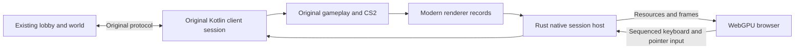

# Transpilation Status

The current loop targets a playable WebGPU browser session while leaving the lobby, world server and supplied cache unchanged. Rendering equivalence and complete crossplay remain acceptance goals, not completed claims.

# First Playable Milestone

- Gameplay and CS2 stay in the existing client for the hosted milestone. This is not a standalone browser CS2 interpreter.
- The browser consumes renderer data, not a video or screenshot stream.
- A native session host owns one controlling browser connection. Different players need different client sessions and existing accounts.
- The development account is loaded from owner-only ignored runtime configuration. Its password must never be written into source, screenshots or documentation.

# Current Work

| Area | Work |
| --- | --- |
| Native producer | Bounded two-slot ORF spool, atomic metadata publication, frame and consumed-input sequence numbers |
| Rust host | Resource deltas, WebSocket flow control, local-only control connection, frame-integrity verification |
| Browser input | Physical keys separate from explicit typed text, pointer coordinates mapped to the native canvas |
| Automatic login | Select an advertised available world rather than treating the JS5 endpoint as the game world |
| Water | Trace missing capture resources and repair supported renderer paths without concealing skipped geometry |

# Cache Compatibility

The repository cache differs from the hosted lobby on twelve index CRCs. For a hosted development session, use the client's standard JS5 path with `OPENRS_CACHE=off` so it requests the assets the lobby serves. Do not solve this by changing the lobby's cache or by advertising different CRCs as proof that local content matches.

# Read Only Boundary

- Do not edit `code/server`, lobby or world configuration, or `assets/cache` during this loop.
- Read-only baselines for server sources and cache file metadata are stored under `code/harness/target/loop`.
- Normal login and gameplay may update the remote dummy player's state through the original game protocol. That is different from changing server code or cache assets.
- No hosted accounts are created. Parallel sessions require distinct existing account credentials supplied for that purpose.

# Acceptance

1. The native dummy account reaches an advertised world through the unchanged login protocol.
2. The WebGPU browser receives changing renderer frames from that session.
3. Browser clicks and keyboard events reach the native client's existing input and CS2 paths, with acknowledgements tied to consumed input.
4. Browser and native state observations confirm the action, rather than merely showing that an input message was sent.
5. Frame and resource queues remain bounded and disconnect cleanup releases input and recording.
6. Rendering differences, missing passes, latency and frame rate are reported explicitly.

# First Live Results

The hosted milestone was exercised on the supplied existing dummy account, connected through the unchanged hosted lobby to advertised world 22.

| Check | Result |
| --- | --- |
| Normal JS5 path | Successful lobby and world responses; first cold reference load took about 98 s |
| Displays | Native session on private display `:103`; browser on private display `:104` |
| Live WebGPU | The native scene, avatar, UI, inventory, chat and skills panel rendered in Chromium on NVIDIA WebGPU |
| CS2-driven UI | A browser click selected the native skills panel; the streamed image showed the actual native state change |
| Gameplay | A browser ground click moved the native player from 7953,8513 to 7954,8512 |
| Keyboard | Typing produced `webcheck` once in the native chat entry; it was erased without being sent |
| Sustained frame delivery | 2.5 new frames per second in an eight-second sample |
| Input-to-visible update | Approximately one second in this capture-based transport |
| Boundary verification | Server source/configuration and supplied cache metadata unchanged against the recorded baseline |
| Tests | Seven native-host tests, 122 harness tests, 21 JVM tests and three browser-input tests passed |

## Bugs Found During Integration

- Sharing one nested display let the browser cover the native window and stall native capture. Separate virtual displays restored it. Keep them separate during live-host testing.
- Native ORF draw records included four unused zero bytes. The writer now emits the documented record size; the host accepts only canonical records or that exact legacy zero padding, rejecting all other malformed tails.
- A native-sized frame initially occupied only the corner of a larger canvas, misaligning pointer input. The page now fixes its drawing buffer to the native hello dimensions and echoes the correct viewport size.
- Physical key events and typed text are distinct. Only a printable keypress or composition completion produces `Text:`; text payloads are bounded to 128 UTF-8 bytes and unsupported native characters are rejected explicitly.

## Remaining Blockers

- The hosted session logs the diagnosed empty-quest-data CS2 array-load exception described below. It has not been suppressed, and no interpreter bounds change is justified by the evidence.
- Normalized HD-water patches, volumes, cubes and base-level RGB16F/RGBA16F 2D textures are recorded. Skipped offscreen geometry, typed mip chains and other unsupported texture formats remain precision/parity gaps.
- Full-resource readback, hashing and spool serialization limit delivery well below the browser renderer's own throughput. Compression reuse and single-pass decoding do not remove the producer bottleneck.
- Negotiated clients rotate bounded resource epochs without reconnecting. The session inspected during the fourth iteration had reached epoch 43 without reconnecting or host errors. Chromium GPU-process memory was not measured over that interval.
- No full feature-complete, pixel-equivalent or standalone browser-game claim is made by this milestone.

# Second Iteration

| Area | Result |
| --- | --- |
| Merged client build | 43 JVM tests passed through the shared `tools/build-check.sh` lock |
| Capture scheduling | Removed extra publication-slot waits after slow captures; live writer finalization no longer blocks the game thread |
| Measured delivery | 3.3 new frames per second in a ten-second sample, compared with the earlier 2.5 FPS sample |
| Measured consumed-input acknowledgement | Three UI clicks acknowledged in about 0.72 to 1.03 seconds |
| Last capture profile | About 202 ms complete capture; about 151 ms compression, 62 ms resource hashing and 10 ms texture readback; overlapping stages are not additive |
| Water transport | Fresh live frames now include an HD-water draw instead of `hdWater@mode14` |
| Precision gap | A floating-point texture is explicitly rejected as requiring typed recording; no lossy conversion is concealed |
| Same-frame comparison | Three hosted-world frames reserialized identically; mean SSIM 0.9587 and strict rendering verdict FAIL |
| Resource epochs | Negotiated reset after ACK drain, complete redeclaration and GPU-cache replacement; synthetic and real-WebSocket tests passed |
| Runtime logs | Native stop archives the client log under `code/harness/target/session-logs` before removing runtime state |

## CS2 Evidence

Live diagnostics and the actually fetched script bytes establish the immediate failure: script 2162 allocates arrays of length zero, then script 2163 reads index zero while sorting the empty range. A fetched quest enum is empty, unlike the repository fixtures. There is no demonstrated GOSUB, array-scope, argument-order or bounds-check defect in the interpreter. The remaining numeric definition link and intended empty-data behavior must be checked before selecting a fix.

Do not clamp indices, skip arbitrary script IDs or invent quest data to hide the exception. Lobby, server and supplied cache remain unchanged.

## Completed Production Epoch Experiment

The natural-epoch observation completed successfully. During a 645-second observation window the existing session crossed from epoch zero to epoch one at the production 4096-sent-frame limit. The host remained connected with zero errors. A post-reset browser input was consumed and echoed as sequence 30. Evidence is in `code/harness/target/loop/iteration2-live-epochs.json`.

The experiment preserved the native session through the reset; that test session has since been stopped deliberately for later builds. Always stop or preserve an existing session before rebuilding its jar or logging the same account in elsewhere. This single reset proves live continuity, not hours-long Chromium GPU-memory stability.

# Third Iteration

| Area | Verified result |
| --- | --- |
| HDR transport | Native RGB16F and RGBA16F 2D textures travel as explicit ORF4 RGBA16Float records with sampler metadata; normalized-only captures remain ORF3 |
| Live HDR evidence | A real 64 by 64 texture retained values up to 4.01953125; the formerly skipped floating-point model draw rendered in the browser |
| Typed limits | One mip level; typed sprites, cubes, volumes and other float formats remain unsupported rather than silently clamped |
| Compression reuse | Immutable encoded records cached only after fresh readback/hash/serialization, bounded to 32 MiB and 512 entries per stream |
| Warm live profile | About 54.7 MiB of resource bytes reused; last compression phase about 1.76 ms, while hashing remained about 62 ms |
| Delivered frames | Still about 3.3 FPS; reduced compression does not by itself remove the end-to-end bottleneck |
| Native disk persistence | Removed destructive overflow behavior; data limit 4 GiB, sparse index limit 96 MiB, archives bounded to their 24-bit length field; reference table storage is now connected |
| Restart evidence | One successful login reached world state in 11.2 s; a later restart reached first world frame in 8.3 s. An intervening discard stage stalled about 100 s and remains unexplained |
| CS2 closeout | Actual native struct 508 parameter 61 equals 2252, and decoded cached enum 2252 has zero entries. The empty-sort mechanism is confirmed; no VM bounds change is justified |
| Same-frame HDR comparison | Three serialized frame pairs identical; mean SSIM 0.962, strict rendering FAIL |
| Ordered clears | Capture now includes real scissored color-clear operations. Current hosted frames contain no full clear, so previous back-buffer state remains a visible gap |

## Capture And Decoder Integration

Sparse retained-state capture and direct chunk decoding are integrated and tested. Capture copies only pixels conservatively proven untouched, with a ten-percent pixel-area limit and 4,096-region limit. Unknown operations and unaudited rasterization exclude their possible destination area rather than substitute a screenshot of omitted rendering. Capture dimensions come from the actual native drawable; a nondefault initial framebuffer, replacement canvas or resize is rejected explicitly.

Sprite coverage additionally honors the audited fragment clip only when the native attribute is a noninteger per-vertex `FLOAT vec4` with divisor zero and every triangle vertex has the same finite, ordered bounds. Native framebuffer-absolute bottom-left clips are converted with outward rounding. Varying or malformed clips retain conservative viewport/scissor coverage; zero alpha is not inferred to be a no-op.

The host validates and decodes each chunk through the shared Rust decoder without constructing a second complete expanded frame. Record appends are transactional. Compressed records must have the exact output size, valid checksum and no unconsumed compressed tail. Existing size/count limits and the exact legacy four-zero draw padding remain enforced.

## Disk Persistence Boundary

Only client file-handling code changed. The supplied `assets/cache`, lobby and world sources remain read-only. No tool deleted or rewrote the downloaded cache to make tests pass; the client's normal operation now preserves previously oversized files and stores its fetched reference tables.

# Fourth Iteration

The existing hosted session was still logged in after approximately 7.1 hours. It had reached resource epoch 43 without reconnecting and reported zero host errors; an eight-second sample delivered about 6.1 new frames per second. This establishes connection and epoch continuity, not measured Chromium GPU-memory stability.

## Decoder And Input

Two alternating, 30-sample release-mode benchmarks of the same 1,542,033-byte recording measured direct decode medians of 33.7–34.4 ms versus 58.8–59.6 ms for the staging reference. Direct decoding avoided constructing a 54,872,161-byte expanded-frame buffer. It still allocates decoded records and bounded temporary chunk buffers; this is not zero-copy or a measured process-memory reduction.

Native browser streams now preserve repeated physical key-down events. A real browser test typed unsent `abcde`, sent one initial Backspace down plus two repeated downs, and observed `ab` in the native entry. Two further taps cleared the entry without sending chat. The repeated-input sequence was consumed in approximately 654 ms. A separate browser ground click changed the observed native player position from 7954,8512 to 7955,8512.

The isolated web harness passed all 18 steps, including real NVIDIA WebGPU replay, input, three-browser isolation, capture, crash/resume and cleanup. The renderer's 40 tests and five browser-input tests passed without changing stored pixel hashes. Native-host tests passed 19 cases with three opt-in checks ignored by default (two benchmarks and an environment-supplied recording check); the harness passed 124 tests, game hosts passed ten, and RenderDoc Python tests passed 81.

## Capture Baseline

After the first capture-safety build, a ten-second hosted sample delivered approximately 4.5 new frames per second. Hashing remained about 61 ms and texture readback about 33 ms in the last capture profile. Scene and session conditions differ from the earlier 6.1-FPS sample, so the faster decoder benchmark does not establish improved live delivery.

Three same-frame pairs reserialized identically but failed strict visual acceptance: mean SSIM 0.9606, minimum 0.9606, against required mean 0.99 and minimum 0.98. Nine offscreen draws were explicitly skipped. Evidence is preserved in `code/harness/target/loop/iteration4-comparison`.

The baseline produced no sparse-history regions. Its first sprite covered the full canvas geometrically, while the native fragment shader clipped it to the scene rectangle. Ignoring that proven fragment clip conservatively excluded every canvas pixel from history. This was overcoverage, not evidence that the strict MSAA identity-copy checks should be weakened.

## Sprite Clip Follow-Up

The serialized full client build and shadow jar completed successfully with 105 JVM tests, zero failures, errors or skips. Eleven focused tests cover clip orientation, fractional edges, different clips on separate triangles, malformed or varying bounds, off-clip geometry and attribute-layout gating. Read-only review found no surviving safety defects.

The rebuilt client reached its first world frame in 8.9 seconds. Its separate WebGPU browser became ready in 2.7 seconds on the first attempt. Browser typing and held Backspace were verified again against native screenshots; the repeated-input sequence was consumed in approximately 988 ms and the unsent entry was cleared.

The post-build hosted sample delivered 3.47 new frames per second over 12.09 seconds, with zero host drops or errors and no browser stream/GPU errors. Its final profile measured about 69 ms hashing, 35 ms texture readback and 1.7 ms compression, with overlapping stages and 197 ms capture wall time. Both producer and delivered-frame rates agreed; requested capture remained 10 FPS.

A new three-frame comparison still failed strict acceptance: mean SSIM 0.9654 and minimum 0.9653, with all three serialized frame pairs identical and nine offscreen draws explicitly skipped. This is a different scene sample, not a controlled measurement of improvement from the clip change. No sparse-history regions were emitted, and the chat-border difference remains visible. The new evidence is preserved separately in `code/harness/target/loop/iteration4-clip-comparison`.

The final metadata audit found all 7,649 server baseline entries and all 410,390 supplied-cache baseline entries unchanged, with none missing. This compares file sizes and modification timestamps, not cryptographic content hashes. Renderer and browser-input regressions were rerun after the new JVM fixtures: 40 and five tests passed. The 19-case host suite passed again, and its opt-in recording check separately validated a fresh captured frame.

## Producer Optimization Boundary

A read-only mutation audit found no complete resource-generation contract for capture. GL names can be reused, static buffer usage does not prevent later updates, and direct upload, copy, mapped-write and deletion paths exist outside `GLWrapper`. Owner-local dirty flags are not sufficient to skip fresh readback or hashing across captures. No cache based solely on GL names or those flags was introduced.

The existing encoded-record cache is safe to reuse only after fresh content identity is established. Its immutable payload ownership could support lookup before allocating and copying a full serialization record, but that optimization is not implemented and would not eliminate texture readback or hashing.

A scratch-only digest benchmark also rejected an assumed hashing speedup. Two alternating runs of the same 82 resource inputs, about 54.7 MB including separators, measured MD5 medians of 60.7–61.2 ms and SHA-256 medians of 113.9–114.8 ms. Each used 16 warm-up pairs and 48 measured pairs on launcher-resolved OpenJDK 25 with the client's GC/heap flags. This i7-9700F lacks SHA-NI; enabled and exercised JVM SHA intrinsics did not make SHA-256 faster. MD5 remains unchanged. These are digest-boundary measurements, not live FPS or serialization-parity results. Scratch source and evidence are `code/harness/target/loop/DigestBench.java` and `digest-bench-run{1,2}.jsonl` in the same directory.

## Core Raster Query And Retained Borders

Bounded capture diagnostics isolated the remaining history exclusion. The first full-coverage transition was a sprite raster fallback, not a framebuffer blit: the query reported `GL_FILL` in element zero while unused query-array storage remained zero. This client creates a core-profile context, where `GL_POLYGON_MODE` is one scalar shared by front and back, not the compatibility-profile pair. The gate now consumes the actual scalar and still requires exact `GL_FILL`; line, point, zero and unknown modes remain conservative. Native query storage remains four integers. The telemetry reports `coverageFirstFullPolygonMode` rather than fictitious front/back values. See the [OpenGL 4.3 Core specification](https://registry.khronos.org/OpenGL/specs/gl/glspec43.core.pdf), section 14.6.4 and table 23.10.

The full serialized build and shadow jar passed with 123 JVM tests, zero failures, errors or skips, and no surviving scoped-review findings. Three added tests cover unused query slots, actual non-fill/unknown rejection and shader-proven sparse borders. Earlier diagnostics review corrections also removed repeated prefix scans, duplicate fallback counts, mixed rectangle coordinate conventions and fabricated arguments for uninstrumented draws. Coverage proofs, identity aliases, history caps and explicit skips were not weakened.

The rebuilt native session reached its first world frame in 8.191 seconds. The browser's first connection timed out before receiving a capture. A direct capture probe succeeded, and an explicit browser reconnect then received frames. The initial timeout remains unexplained; this is not a claim of reliable first-attempt startup.

The corrected live sample delivered 4.77 FPS over 12.15 seconds, matching the producer's sampled rate, with zero host errors or drops and no browser stream/GPU errors. The last profile accepted 13 sprite draws and three mask draws through the tight proof, retained four identity copies, and emitted 5,224 untouched pixels in four history regions: about 1.36 percent of the 765 by 503 canvas. These are proven untouched borders, not a full-frame screenshot substitution or a repair of skipped geometry. The profile measured about 60 ms hashing, 30 ms texture readback and 191 ms capture wall time; overlapping stages are not additive, and different scene conditions prevent a controlled FPS comparison.

Three fresh same-frame pairs passed the unchanged strict thresholds: mean and minimum SSIM 0.9968, versus required mean 0.99 and minimum 0.98, with all three serialized pairs identical. Mean PSNR was 38.24 dB and differing pixels averaged 0.579 percent. Nine offscreen draws remained explicitly skipped: four ground-textured and five instanced draws. Native/browser/difference images were inspected. Residual scene and UI edge differences remain; passing this small scene sample does not establish complete pixel equivalence or feature coverage. Evidence is preserved separately in `code/harness/target/loop/iteration4-scalar-comparison`.

Browser inventory-tab selection, the copper-ore right-click menu and pointer-away dismissal were verified against native and browser screenshots. No menu operation was selected, and inventory and player position remained unchanged. Consumed-input acknowledgement waits were approximately 795, 423 and 1,017 ms. These are capture-based acknowledgement measurements, not instantaneous browser input latency. Evidence is in `code/harness/target/loop/iteration4-scalar-menu`.

Post-change regressions passed 40 renderer tests, five browser-input tests and 19 default host tests, with three opt-in host checks ignored by default. The environment-supplied recording check separately passed on a fresh sparse-history frame. Stored pixel hashes were not replaced. The fresh metadata audit again found all 7,649 server entries and all 410,390 supplied-cache entries unchanged, with none missing; the audit compares size and modification timestamp, not content hashes.

The single native account session and controlling WebGPU browser remain running on separate private displays. The account-free comparison browser and its page server were stopped after process-identity checks. Gameplay, networking and CS2 still execute in Kotlin; this remains hosted WebGPU gameplay, not the requested complete standalone web client. The empty-quest-data CS2 exception, unsupported rendering paths, native audio and broader gameplay coverage remain unresolved.

# Fifth Iteration: Independent Runtime Foundation

New Rust crates under `code/protocol`, `code/cs2`, `code/client-runtime` and `code/relay` begin replacing the native engine dependency rather than extending the hosted renderer alone. See [Standalone Client Foundation](STANDALONE-CLIENT.md) for contracts, commands, bounds and remaining work.

The protocol crate implements incremental revision-727 JS5 bootstrap and reply reassembly, ISAAC and generic packet framing. The CS2 crate generates metadata from all 1,010 current Kotlin opcode entries, decodes native scripts and executes 34 bounded pure core operations. Unsupported host operations fail explicitly; game/UI/variable effects are not implemented.

An account-free browser on private display `:105` actually executed the Rust wasm runtime. It fetched 37 hosted JS5 index CRC/revision records through a fixed-upstream, exact-origin loopback relay, without Kotlin decoding that exchange or any account login. The 128 signature bytes remain unauthenticated and the report explicitly says so. The same browser ran native Kotlin-derived flow, string and long fixtures: every tested stack value and string local matched, including 158 executed flow instructions, eight string instructions, CP1252, branding and null joining. Five long instructions preserved exact signed 64-bit extrema, minus one and zero as decimal strings. Negative browser checks rejected `PUSH_VAR` explicitly and exhausted an infinite branch's instruction fuel. Its renderer showed the independent test scene, not a standalone world session. Evidence is in `code/harness/target/loop/iteration5-standalone-browser`.

Review corrected native interim handshake status 25 handling, three relay deadline/control-frame/backpressure defects, an unbounded bridge import, Cargo target-directory artifact selection and fixture redirect handling. CS2 review additionally extended VM string-limit enforcement to arguments, constants and local loads, and corrected the synthetic test encoder to CP1252. Tests cover the fixes rather than relaxing boundaries. The relay remains a development JS5 transport, not a replacement lobby/world or arbitrary browser-chosen TCP proxy.

Final integrated validation passed 36 protocol, 25 CS2, 13 relay and 12 runtime release tests, three generated-wasm integration tests, 17 browser tests, 40 renderer tests and 19 default native-host tests; three opt-in host tests remained ignored. The same 25 CS2 contracts also executed as wasm in Node. Native/wasm lint checks and release builds passed. An earlier integrated wasm build observed an unfinished agent edit and failed; rebuilding the completed reviewed source passed. Evidence is in `code/harness/target/loop/iteration5-validation-final`.

The fresh read-only metadata audit found all 7,649 server entries and 410,390 supplied-cache entries unchanged, with none missing. No server/cache changes, account creation, login bypass, native jar rebuild or stored pixel-hash replacement were made in this iteration.

A read-only renderer assessment identified the nine offscreen skips as strongly correlated with the single-sample half-resolution water-reflection path, but existing records do not establish target identity or starting contents. Native scissoring makes the reflection clear partial. Faithful independent replay needs target-local rectangles, ordered clear operations and initialization/history proof; simply clearing the whole target or placing its final readback beneath replayed geometry would be incorrect. Scene MSAA is a separate unresolved contract.

After rebuilding the reviewed bindings, a fresh isolated Chromium process repeated all three native-fixture comparisons and both expected-negative checks successfully. The account-free diagnostic browser, page server and relay were then stopped after identity checks. The original native account session and controlling browser remain running: the final read-only health sample showed logged-in gameplay and advancing delivered frames without page/GPU/stream errors. Host transport drops remained zero; native producer skipped captures increased under the shared build workload, so this is not a zero-drop or controlled-performance result.

Standalone account login, asset decompression/repositories, game-packet payloads, game state, scene construction, CS2 host integration and audio remain unimplemented. The working native-hosted gameplay session is still separate from these independent foundations.

# Sixth Iteration: Verified Assets, Numeric CS2 And Offline Login

The independent runtime now fetches a requested archive through the original hosted JS5 endpoint: master table, exact index reference table, then exact archive identity. New `code/assets` validates CRC32/optional Whirlpool, decompresses raw, native headerless BZip2 and fixed-header gzip containers, parses bounded sparse reference tables and splits multi-file archives. Missing digests are reported as unverified; master signatures remain unauthenticated. Unknown compression and LZMA fail explicitly. Neither server/cache changes nor local-cache substitution are used.

An actual account-free Chromium instance fetched index 12/archive 2163 using Rust wasm. The 274-byte container expanded to a 774-byte CS2 script with 139 instructions, four integer arguments, nine integer locals and two string locals. The unchanged existing native jar independently decoded the downloaded bytes: every reported count and the full opcode histogram matched. Reference CRC32/Whirlpool and archive CRC32 checks passed; archive Whirlpool was absent and correctly reported false. The script was decoded, not executed with invented arguments or missing host data. Evidence is under `code/harness/target/loop/iteration6-assets-browser`.

The CS2 VM now executes 51 pure operations, adding 17 deterministic arithmetic/bit operations while preserving all 1,010 opcode identities and existing bounds. Native wrapping, division/remainder, widened intermediates, masked bit counts and saturating integer powers match 5,255 native result/exception cases. `INVPOW` remains unsupported because native floating-point rounding changes truncated roots; 420 native boundary cases document the limitation. A fresh private Chromium process matched every one of the numeric fixture's 136 integer outputs across 433 executed instructions, then repeated the hosted script fetch with the reviewed final bindings.

New `code/login` provides an offline original lobby-request encoder, public raw RSA with Java signed representation, bounded XTEA, strict CP1252/jag strings, handshake helpers and direction-specific ISAAC initialization. Seeds, nonces, randomness, preferences, tokens and 36 CRCs are caller-supplied; no account credentials or default deterministic seed are embedded. One review corrected the high-level password capacity to 86 CP1252 bytes. Owned sensitive buffers are wiped, but bigint/ISAAC internals do not guarantee heap erasure. This crate has no live transport, login-response parser, session state or world encoder and has not logged the account into another session.

Validation passed 36 protocol, 13 asset, 32 CS2, 13 relay, 20 runtime and 19 offline-login release tests. Asset and CS2 contracts also passed as actual Node wasm in debug and release; login's 19 contracts passed as actual release wasm. Four generated-runtime wasm tests include an independently native-generated gzip asset chain, exact report/file comparisons across eight chunk sizes, corrupt/incomplete rejection, and all four core-script fixtures. All 22 browser tests, 40 renderer tests and 19 default native-host tests passed; three opt-in host tests remained ignored. Native/wasm release builds, strict lint and formatting passed. Synthetic native fixture hashes and reproducible generators are included. Scoped asset and integration reviews found no actionable defects. Logs are under `code/harness/target/loop/iteration6-validation`.

The read-only metadata audit again found all 7,649 server and 410,390 supplied-cache entries unchanged, with none missing; this compares size and modification time, not content hashes. The production Kotlin client and shared jar were unchanged. The account-free diagnostic browser, page server and relay were stopped after identity checks. The original account session/controller were preserved: native ticks and delivered frames advanced, page/GPU/stream errors were absent and host transport drops remained zero, although producer skipped captures increased. No controlled performance or zero-drop claim is made. Standalone world login/gameplay, asset repositories, scene construction, complete CS2 host integration, audio and broad rendering equivalence remain unfinished; hosted gameplay still depends on the native client.

# Seventh Iteration: Packet Registries, Offline World Login And Transitive CS2

The independent protocol crate now preserves all 104 client and 161 server packet IDs, names, sizes and client tick flags. Typed encoders/decoders select the original direction: one encrypted opcode byte for client packets, ISAAC smart opcodes for server packets. A scoped review corrected that distinction and added a high-byte alias regression. Native unknown packet identities remain explicitly unsupported, with opaque framing only; payload interpretation and game state are not implemented.

The offline login crate now encodes original world requests with opcode 16, the native reconnect flag, RSA/XTEA fields and typed version-6 machine information. It also incrementally decodes typed lobby/world success and supported status payloads, preserving exact consumed-byte boundaries before initial game data. All randomness, flags, preferences, CRCs and the actual lobby-issued world token remain caller-supplied. There is no live account login, browser game transport, continuation sender or session orchestration in this work.

CS2 pure execution increased from 51 to 71 of the 1,010 opcode identities. The 20 added text/character operations preserve native UTF-16 lengths/indices/searches and simple casing. Native-valid lone-surrogate outputs that the existing string API cannot represent fail explicitly; unsupported whole-string casing, language comparison and host-dependent formatting are not approximated. Native evidence covers 8,867 direct text cases and all 65,536 UTF-16 units across six character operations. All 40 CS2 tests pass natively and as actual Node wasm in debug and release.

The runtime can fetch a root script and all statically named callees through original JS5, verify each container, deduplicate cycles and execute a loaded pure-core repository with explicit arguments. It does not invent interface state or missing arguments. Bounds include 64 scripts, 1 MiB retained script bytes, 65,536 decoded instructions, 8 MiB cumulative expansion and 16 MiB wire data. Review corrected direct JavaScript-to-wasm integer coercion and expansion accounting for discarded archive files. Exact-limit, one-byte-over, pre-decompression and coercion regressions pass, and focused verification closed both findings.

Fresh account-free Chromium fetched the 15-script graph rooted at hosted script 2162: 18,748 retained bytes, 166,882 expanded reference/archive bytes and 3,078 instructions. All raw files, instruction counts, typed argument counts and static call targets matched the isolated unchanged native jar. No hosted quest script was executed with fabricated host state. The same fresh browser matched every typed stack/local/array output for the 56-instruction text fixture, including nine integers and twelve strings, and repeated the numeric fixture's 433 instructions and 136 integer results. Its inspected WebGPU image is the renderer test scene, not standalone world gameplay. Evidence is under `code/harness/target/loop/iteration7-script-graph`.

The web server now revalidates unversioned HTML/JavaScript/wasm rather than caching old runtimes for an hour. Shared fixtures remain uncached. A fixture 404 was resolved through the existing harness runtime sharing directory, without relaxing server access policy.

Final integrated release validation passed 245 Rust tests: 51 protocol, 13 assets, 40 CS2, 37 offline login, 30 runtime, 13 relay, two web, 40 renderer and 19 native-host; three opt-in host tests remained ignored. All 27 browser-wrapper/input tests and six generated-runtime wasm tests passed. Protocol, asset, CS2 and login tests also executed as actual Node wasm, with asset and CS2 debug/release coverage. Full release builds, native/wasm strict lint and foundation formatting checks passed. Logs are under `code/harness/target/loop/iteration7-validation`.

The Kotlin production client and shared jar were unchanged. No new account login or gameplay input was sent. The original native account and controlling browser remained healthy: ticks 11,688 to 11,693 and delivered frames 22,045 to 22,056, no page/GPU/stream/producer error, zero host transport drops. Producer skipped captures increased from 57,544 to 57,571 under shared load, so this is not a controlled performance or zero-drop result. After identity checks, only the account-free diagnostic browser/server, its relay and diagnostic Browser pane were stopped; the native session/controller were preserved.

All 7,649 recorded server and 410,390 recorded supplied-cache baseline paths remained present with unchanged size and modification timestamp. This is a baseline-path metadata comparison, not a content-hash or full-tree audit; additional unattributed paths outside the baseline are not covered. No server/cache source changes or pixel-expectation changes were made.

The requested complete standalone crossplay client remains unfinished. Live lobby/world orchestration, initial map/player and other game payloads, game state, scene construction, complete CS2 host integration, input-driven standalone gameplay, audio and broad rendering equivalence remain missing. Working hosted gameplay still depends on Kotlin.

# Eighth Iteration: Original Game Transport And Session Boundaries

The browser now reaches the unchanged original lobby and world TCP endpoints through optional fixed-upstream loopback relay routes. Actual served Rust wasm sent only the native raw `[14]` handshake on each connection, accepted raw `[0]` and disconnected before any login request. The harness used a separate account-free Chromium on private display `:105`; the Browser pane repeated both checks after the final generated build. Reports explicitly remain unauthenticated. Its inspected WebGPU image is the diagnostic scene, not a standalone game world. Evidence is under `code/harness/target/loop/iteration8-transport`.

The independent login library now gates requests behind handshake acceptance, performs explicit encrypted-opcode-26 confirmation and transfers the original ISAAC state once after success. Retry, queue and reconnect are surfaced rather than silently retried. A bounded lobby stream preserves native framing, world-list requests and caller-driven tick-51 keepalive behavior; only an actual flush resets its idle state. World-list decoding handles bounded multi-packet chunks, metadata/counts-only snapshots, sparse IDs, signed fields and native zero-length descriptor arrays, while rejecting malformed/truncated input rather than reproducing zero-padding or array exceptions. Advertised hosts do not choose relay endpoints.

Fresh-world entry now decodes the incoming ISAAC smart opcode and unconditional plain u16 length, leaving a coalesced suffix untouched. It transfers the advanced incoming and unchanged outgoing ciphers into normal registry processing. Tests continue through 643 remaining native-generated registry frames, including cipher refills. Map/player payload interpretation and reconnect status-15 continuation are still absent. The protocol library also adds native payload transforms, integer orders, smart values, bit reads and CP1252 strings, verified against 3,079 native oracle rows.

Synthetic integration now checks the login-to-lobby boundary through raw time sync, success, split world lists, counts updates, server keepalive replies and client requests/pings with the same ciphers, both with and without confirmation. Final release tests passed **344 Rust cases**, with three opt-in host checks ignored: 65 protocol, 13 assets, 40 CS2, 103 login, 34 runtime, 28 relay, two web, 40 renderer and 19 native-host. All 221 protocol/asset/CS2/login tests passed as actual release Node wasm, alongside 34 browser-wrapper/input tests and seven generated-runtime wasm tests. Native/foundation-wasm release builds passed, as did strict foundation native/wasm lint and formatting plus relay/web lint. Expanded renderer/native-host strict lint failed on existing warnings; those failures remain recorded, not suppressed, in `code/harness/target/loop/iteration8-validation`. Their builds and tests passed.

Scoped source reviews found no actionable defects in the completed session/handshake/stream/list/entry changes. A transitional zero-length descriptor test expectation and an incorrect keepalive enum spelling were corrected before the final passing test matrix. The native registry name for server wire ID 29 is `PING`, although it serves as the keepalive reply.

The Kotlin production client and shared jar were unchanged; the jar was not rebuilt beneath the live player. No account login or gameplay input was sent by this iteration. The original account/controller remained logged in, with sampled ticks 15,863 to 15,867 and delivered/rendered frames 30,336 to 30,338, no browser/GPU/stream error and zero host transport drops. These observations are not a controlled FPS or producer-skip result. Only the identity-checked diagnostic browser/server/relay were stopped. All 7,649 recorded server and 410,390 recorded cache baseline paths remained unchanged by size/mtime, without claiming a full-tree/content-hash audit.

The complete independent crossplay client is still unfinished. Credential-safe browser account integration, sustained transport policy, live lobby/world transition, initial map/player state, scene construction, CS2 host effects, gameplay, audio and broad rendering equivalence remain outstanding. The working playable session still uses Kotlin for networking/gameplay/CS2; a successful account-free handshake does not change that.

# Ninth Iteration: Browser Login And Initial World State

The served independent Rust wasm now owns typed lobby/world sessions, preserves the actual lobby-issued token inside Rust and decodes the initial own-player plus standard/dynamic map payload. Browser configuration and incoming values are bounded and typed; reports exclude credentials, seeds, tokens and map keys. A loopback-only, same-origin private bootstrap transfers one configuration once without placing secrets in harness arguments. Existing native preference defaults and initial map transforms have reproducible isolated-jar oracles; no production randomness or missing game data is fabricated.

A fresh private Chromium completed both original logins against synthetic TCP fixtures through the real restricted WebSocket relay. The fixture checked exact native lobby/world request bytes. Initial state matched player 1, plane 2, tile 3201/3210, base 3152/3160, map size 104 and region IDs 12593, 12594, 12849 and 12850. The world login used the fixture-issued token retained in Rust. One later opaque packet was framed per connection. This is an actual browser/wasm/socket integration result, not hosted-account authentication, gameplay or rendering. Evidence is in `code/harness/target/loop/iteration9-browser`.

The successful harness login command is recorded in `trail.jsonl`. The later `accepted-state.json` was captured after the fixture closed TCP; it correctly reports a disconnected/failed world socket while retaining initial map history. Historical `worldReady` does not mean the socket remains accepted. Both screenshots were inspected: this is a readable diagnostic that explicitly says it is not a playable or rendered world, with no game canvas. No WebGPU parity or sustained-session claim follows from it. A later same-origin bootstrap request returned 410 with noncacheable headers.

Review fixed readiness before validating a coalesced suffix, an unwiped oversized private-bootstrap chunk, abnormal close-code classification and cancellation of in-progress bridge login. All 53 browser-wrapper/input tests pass. Focused read-only cancellation checks also covered pending bootstrap/runtime load, late lobby allocation, lobby readiness and world readiness, without a surviving concrete issue. The runtime passes 49 native tests and 20 generated-wasm integration tests; the full login suite passes 122 native/actual-wasm tests, including 19 initial-world contracts. The web server passes 16 tests and the relay 32. Game relay lifetime/byte limits are now operator-configurable but remain finite; JS5 policy is unchanged. See [Standalone Client Foundation](STANDALONE-CLIENT.md) for contract and oracle qualifications.

Integrated native release validation totals 396 passing tests: 65 protocol, 13 assets, 40 CS2, 122 login, 49 runtime, 32 relay, 16 web, 40 renderer and 19 native-host, with three opt-in host checks ignored. All checked release builds passed. One refresh initially failed to build renderer tests because abort-profile artifacts collided with the unwind test harness. The complete default renderer suite passed with a command-scoped `CARGO_PROFILE_RELEASE_PANIC=unwind` override, and the normal abort-profile release build passed afterward. The original exit 101/logs are preserved; no source/profile changes, test filters or expectation regeneration were used. Conditional renderer test-body early returns and the unset external-dump input remain coverage limitations. Broader preexisting renderer/native-host strict-lint warnings remain unresolved. Evidence is in `code/harness/target/loop/iteration9-validation`.

Only the synthetic Chromium, fixture page server/relay, terminal and diagnostic Browser tabs were stopped; display `:105` was preserved. The native account remained logged in at tick 21,864, and the controlling browser was ready with 42,243 delivered/shown frames, no page/GPU/stream error and zero host transport drops. These are point-in-time health observations, not performance or memory-stability measurements. No new hosted-account login or gameplay input was sent, and the shared native jar was unchanged and not rebuilt.

The final baseline-path audit found all 7,649 recorded server and 410,390 recorded cache entries unchanged by size/mtime, with none missing. This does not cover additional paths or content hashes. Lobby/world/cache source, configuration and assets, rendering thresholds and pixel expectations were not changed.

Independent hosted-account authentication and sustained world operation remain unverified. Later world packets are still opaque; scene construction, entities, full CS2 host/interface effects, standalone gameplay/controls, audio and broad rendering equivalence remain unfinished. The playable hosted client still runs networking, game logic and CS2 in Kotlin.

# Tenth Iteration: Real World Entry And Native Variable State

The independent browser now builds account login configuration from an owner-only private bootstrap, fresh cryptographic seeds, measured browser capabilities and current JS5 master metadata. It preserves native CRC order, explicit font selection and native preference serialization without pretending that browser Java version, ephemeral instance identity or heap limits are JVM/hardware attestation. Cancellation covers capability measurement, JS5 loading and later socket allocation. The lobby keeps its server-issued default world private and derives the native `differentWorld` flag itself.

Actual isolated Chromium authenticated with the unchanged hosted lobby and decoded its world list, framing eleven later opaque packets across 278 received bytes. An initial world attempt incorrectly targeted the old default world endpoint; read-only inspection established that advertised world 22 is instead `localhost:43598`, matching the native connection. The operator-fixed relay now targets that endpoint without allowing browser-advertised hosts to redirect it. A single corrected-endpoint attempt returned world rejection code 6 before initial state. Typed diagnostics retain only the bounded numeric code, not arbitrary rejection fields.

The world log identified the code-6 failure as a maps-index CRC mismatch. World 22 advertises custom-cache flag `0x20`, so the native client switches JS5 to that world before login. An account-free actual browser comparison independently fetched both 37-entry master tables and found only index 5 different. The lobby root therefore cannot supply world 22's login CRCs. Account mode now waits boundedly for the selected built world ID and, for custom-cache worlds, fetches the world master through an operator-fixed JS5 relay before replacing only the world-login CRC array. It preserves font selection and native ordering, requests the world list at most once, ignores advertised routing hosts and fails closed if preparation fails. Shared-cache and exact fixture modes are unchanged. This is not full asset-repository switching. No server/cache CRC or asset was changed to make them agree. Evidence is under `code/harness/target/loop/iteration10-validation`.

With custom world CRC selection implemented, one further isolated Chromium attempt authenticated with world 22 and decoded its initial player/map state: player index 1, tile `(7955, 8511, 0)`, base `(7904, 8456)`, map size 104 and six regions. The tile matched native positions recorded both before handoff and after restoration exactly. The successful snapshot contained 7,808 world bytes and 415 opaque later packets; explicit close followed at 8,422 bytes and 445 opaque packets. These packets were not applied to gameplay. The browser was stopped and native gameplay restored. This is real initial world entry, not sustained standalone operation, rendering or complete crossplay.

New Rust variable-state infrastructure implements exact `VARP_SMALL`, `VARP_LARGE` and `CLEAR_VARPS` transforms and native active/pending scheduling, including local 500 ms protection, immediate sentinel timing, strict deadlines and publication order. Twenty-one focused contracts match nine packet samples and nine native provider scenarios with 63 steps. Allocation requires the actual definition span from JS5 index 2/archive 16. Verified asset reports expose native sparse `fileSlots` (maximum file ID plus one), not a fabricated populated-file count. This module is not yet live world application, CS2 hosting or gameplay; other variable families remain unsupported.

Full release validation passed 418 Rust tests and all checked release builds, with three opt-in native-host tests ignored. The initial parallel renderer suite stalled in GPU tests; its verified subtree was stopped and the original log retained. The complete unfiltered forty-test suite passed serially under a 300-second timeout and test-only unwind override, followed by a normal abort-profile release build. No backend, shader/pixel expectation or threshold was changed. Exact driver causation and preexisting coverage/lint limitations remain unproven or unresolved rather than suppressed.

The final browser/generated-wasm suite passed 120 tests: 99 web and 21 actual wasm. A full serialized web Rust rerun passed 16 tests, with a normal release build and strict formatting/all-targets Clippy also passing. The agent's initial parallel web Rust run hit an existing `dev_login` connection-reset/destructor failure; its transcript output was retained, not converted into a passing claim or fixed by weakening tests.

Each actual account attempt stopped the identity-verified native client first and restored its exact private launch afterward, with no account-session overlap or shared-jar rebuild. The native host/controller and Xwayland displays were preserved; explicit controller reconnection resumed hosted WebGPU frames. Recorded server/cache baseline paths remained unchanged by size/mtime. These checks do not establish a full-tree/content-hash audit or complete standalone crossplay. See [Standalone Client Foundation](STANDALONE-CLIENT.md) for detailed evidence and remaining limitations.

# Eleventh Iteration: Live VARPs, Hosted CS2 Variables And Surface Terrain

The opt-in Rust world session now applies `VARP_SMALL`, `VARP_LARGE` and `CLEAR_VARPS` to explicitly sized active/pending banks. Incoming bytes update pending state; explicit ticks publish eligible updates, including during network idle. Existing bank-free session APIs and diagnostic budgets remain unchanged. Account-mode preparation obtains native sparse `fileSlots` from integrity-checked JS5 index 2/archive 16 using the selected world's fixed route. The actual world returned 2,743 slots and 2,724 files, rather than the earlier local fixture's 2,719/2,700. Bounded cancellation, late-result buffer wiping, whole-message readiness and terminal bank/timer cleanup have browser and actual generated-WASM coverage. The diagnostic exposes a bounded read-only VARP accessor, not gameplay controls.

One isolated real-account attempt authenticated with the unchanged lobby/world 22 and reached initial state at `(7955, 8511, 0)`. At one and six seconds after readiness, Rust reported 275 server assignments, 271 publications, 264 nonzero active values, no scheduled entries and no clears. Eleven sampled values matched native both before and after handoff exactly. The six-second world snapshot remained accepted/connected without error; 207 other packets were opaque across 8,797 bytes. Native was fully stopped before browser login; the browser account session and identity-verified Chromium were closed before native restoration. Evidence is under `code/harness/target/loop/iteration11-validation`. This verifies live VARP application, not sustained world operation or standalone gameplay.

The CS2 VM retains 71 pure operations and adds four operations through an explicit host: `PUSH_VAR`, `POP_VAR`, `PUSH_VARBIT` and `POP_VARBIT`. It preserves no-host unsupported behavior, store-pop ordering, missing-repository versus absent-definition semantics, inclusive bit spans, JVM-masked high shift counts and the native signed full-width-mask behavior. Eleven added contracts use 5,863 independent vectors from the actual native executor. The runtime host adapter supports active VARP reads/local writes but reports VARBIT definitions unavailable. A full game/UI host and browser script scheduler do not exist yet; 935 other identities remain unsupported even with a variable host.

The new dependency-free `code/scene` crate decodes four 64-by-64 surface terrain planes, preserving native tags, heights, noise and interpolation. Strict and prefix decoders enforce byte/tag limits; effects remain an untouched suffix. Eighteen contracts match 420 copied-jar oracle records. Native/WASM build and lint checks pass, but actual terrain WASM execution has not been tested. The crate is not integrated into browser asset loading or rendering; underwater/effects data, constructed-map placement, border stitching, locations, meshes and full scenes remain incomplete.

All ten Rust crates passed full serial release tests and normal release builds: **454 tests passed**, with three opt-in native-host tests ignored. The combined browser/generated-runtime suite passed **162 tests** (138 web and 24 actual WASM). Formatting and strict native all-targets/WASM library Clippy passed for CS2, runtime and scene. Existing broader renderer/native-host lint and conditional/external GPU coverage limitations remain; no backend, pixel expectation or comparison threshold was weakened. A buffer-ownership regression found during testing was fixed so partial asset collection wipes every materialized array on error.

The account diagnostic screenshot shows only the existing renderer test scene, not a standalone rendered world. Native's immediate tick-zero position report contained the map base; a subsequent final health check confirmed its actual original tile. Native process 2,222,140 was logged in, and explicit controller reconnection after the deliberate stop restored an open WebGPU stream with 219 received/shown frames, no page/GPU/stream errors and zero host transport drops at the check. Only this iteration's diagnostic Chromium, previews and Browser tabs were stopped; existing displays/native host/controller were preserved. Recorded 7,649 server and 410,390 cache paths remained unchanged by size/mtime; the shared jar hash was unchanged and no production Kotlin build occurred. This is a baseline-path metadata audit and point-in-time health check, not a full-tree/content-hash audit or throughput benchmark.

The complete independent crossplay client remains unfinished. The playable hosted browser still delegates login, game state, gameplay, interfaces and CS2 to Kotlin. Live VARPs and surface terrain decoding do not replace entities, collision, scene construction, full CS2 hosting, interfaces, controls or audio. See [Standalone Client Foundation](STANDALONE-CLIENT.md) for current contracts and detailed evidence.

# Twelfth Iteration: Verified Surface Preparation And Explicit World Ticks

The independent runtime now fetches verified surface terrain from index 5 and composes standard-map heights. Account-mode browser ownership prepares the decoded initial map through the selected world's fixed JS5 route; it retains the WASM terrain owner for bounded read-only height queries, closes transport after preparation and releases state on close/abort/lifetime expiry. The account-free harness has separate terrain preparation/sampling/close commands. A confirmed pending-close race was fixed: cancellation settles promptly even when an injected loader ignores its signal, and late owners close once without replacing newer state. Explicit `mapKind` distinguishes standard and dynamic maps, including dynamic maps with zero chunk descriptors; unsupported dynamic terrain is not misclassified as standard.

Actual world 22 serves a valid dense protocol-7 maps reference with 262,144 archives and 262,144 files. Its first terrain attempt failed the generic 65,536-archive diagnostic limit; this was not protocol corruption or a reason to modify the server/cache. A map-specific compact projection validates the full table while retaining only requested metadata, with caps of 524,288 combined records, 36 retained archives and 4,096 retained files. Requested-hash ambiguity fails closed; unrelated collisions do not block unrelated valid lookups. Generic asset limits, wire/decompression limits and authenticity qualifications remain unchanged. Reports distinguish the full validated reference from the small retained selection.

The six captured real surface files matched the unchanged native provider and decoder exactly: 98,304 tiles, each including height and all five decoded attributes. Standard composition at base `(7904, 8456)`, size 104 matched all **44,100 heights byte-for-byte**, including 100 plane/seam/padding samples. The full-array SHA-256 was `8d083abd5ba2c39e9beb741b31160b7cfe125ee873881470fbe439a6a3898b76`. Each native terrain pointer matched Rust prefix consumption and left 40 opaque suffix bytes. No suffix semantics, world geometry or pixels were compared. Broader composition oracles cover all five native map sizes, clipping, missing-region order, native zero padding and the 799/800 clear boundary. Evidence is under `code/harness/target/loop/iteration12-validation/real-terrain-parity`.

An opt-in native-compatible VARBIT repository now follows index 22, archive `id >> 10`, file `id & 1023`. It verifies reference/archive integrity, distinguishes proven absence from unloaded data, bounds retained metadata/definitions and installs archives transactionally. Eleven contracts match 293 native decoder vectors and 56 native provider cases. It extends the explicit Rust variable host, not live browser script scheduling or full CS2 interface execution.

World game ticks are explicit and separate from variable publication. Tick 51 queues one ISAAC `PING`; queued or drained-but-unacknowledged pings coalesce. Only an acknowledged nonempty ready-world transport flush resets idle state. The browser services ticks/publication every 20 ms and acknowledges after `bufferedAmount` reaches zero, not on queueing, drain, incoming traffic or a delayed login write. Buffer handoff is not proof of server receipt. Diagnostic operation/lifetime limits remain unchanged; optional verification packets, loading keepalives and production lifecycle/reconnect remain unfinished.

The rebuilt browser completed a fresh account-free live terrain exchange with world 22's original JS5 endpoint: 512,900 wire bytes, full reference CRC/Whirlpool verification, six archive CRC checks, 44,100 known composed heights and no unavailable cells. All 100 composed and 80 regional browser samples matched the unchanged native oracle, including all planes, archive seams and zero padding. The initial sample-check script incorrectly compared a returned `{height}` object with an integer; parsing the recorded `height` field made every existing response match without another network exchange or changed expectations. `world-terrain-projection-live.json` and `world-terrain-live-samples-report.json` preserve the evidence. The rebuilt web/runtime Node suite passed 236 tests across 17 files, with no failures or skips and unchanged source/binding inventories.

One exclusive real-account browser handoff then integrated original lobby/world authentication, selected-world VARP definitions and surface preparation. The world remained accepted, connected and error-free at 1, 6 and 30 seconds. At 30 seconds it had received 9,935 world bytes with 377 non-variable packets opaque; 275 VARP assignments produced 271 publications and 264 nonzero values without scheduled updates or clears. All 100 composed and 96 regional authenticated-session height samples matched native, and 11 sampled VARPs matched native snapshots before and after the handoff. Native was fully stopped before the sole browser login; the browser session closed and its identity-verified Chromium/descendants stopped before the release wait and restoration. Native process 2,294,757 was logged in at the original tile `(7955, 8511, 0)` with its jar unchanged. The hosted viewer timed out during the deliberate native stop and required explicit reconnection, which resumed its open stream. This is bounded live-data evidence, not complete world packet handling, gameplay or a stream-performance benchmark.

Final validation passed all ten native Rust release suites and ordinary release builds: **509 tests passed**, zero failed, with the three existing opt-in native-host ignores retained. Assets additionally passed 18 actual Node WASM tests. Assets/runtime/CS2/scene formatting, strict native/WASM all-target Clippy and WASM builds passed. A full Kotlin Gradle build passed in an isolated copied workspace without replacing the live jar. The renderer's initial panic-strategy compilation failure and interrupted incomplete parallel GPU run remain preserved; its complete unfiltered serial retry passed all 40 tests without logged GPU skips on unchanged backend/expectations, and its normal release build passed. `validation-summary.json` records current source fingerprints and the complete result history.

The final post-restoration audit passed at `2026-10-21T11:13:51Z`: native remained logged in at its original tile, all seven preserved process identities matched, the reconnected stream had received/shown 71 frames with zero host drops and no reported errors, and the diagnostic browser and five diagnostic listener ports were stopped. The shared jar hash remained unchanged. All 7,649 recorded server paths and 410,390 recorded cache paths retained baseline size and modification time; this is a recorded-path metadata check, not content hashing, new-path detection or a full-tree audit. `final-health-audit.json` records the observation and `result.json` marks this milestone complete.

This is surface-data preparation, not an independently rendered or playable game. The hosted WebGPU client still relies on Kotlin for gameplay, interfaces and CS2. Independent entities, locations/meshes, dynamic/underwater maps, collision, full script hosting, interfaces, controls and audio remain incomplete. See [Standalone Client Foundation](STANDALONE-CLIENT.md) for current contracts and evidence qualifications.

# Thirteenth Iteration: Floor Definitions And Native Packed-HSL Palettes

The independent runtime now loads verified floor definitions from index 2/archive 1 (underlays) and archive 4 (overlays), then prepares the standard surface's packed-HSL underlay palette. Native missing defaults remain distinct from decoded black and unavailable data. The implementation preserves the clipped ten-by-ten window, JVM integer arithmetic and cross-plane retained-buffer behavior. Overlay opcode 8 is recorded as metadata; its native lazy-list side effect is not fabricated. Browser account-mode ownership loads floors through the selected world's fixed asset relay and lends them to terrain preparation. Separate account-free harness commands cover definition access, palette preparation, sampling and cleanup. These are data preparation paths, not independent game rendering.

Actual world-22 JS5 data matched the unchanged native provider on all **171 underlays and 248 overlays**, including 5,507 definition scalar fields. All **43,264 scene underlay IDs and packed-HSL palette cells** matched native byte-for-byte. Actual served browser WASM then independently matched all 419 complete definition objects (6,345 fields including identity/presence), every palette cell, and 220 edge/seam/window samples, with zero mismatches and four invalid queries rejected. Final palette SHA-256: `ee2646a8d567831dfbc6fc77993b8568fa62b121a026bbdbc22a311591a2b295`. This real scene uses only underlay bytes 37 and 62; its empty upper planes retain plane-zero colors, producing four equal output planes rather than four distinct inputs. Broader synthetic native oracles separately cover other definitions, map sizes, defaults and cross-plane cases. Reference CRC/Whirlpool and floor archive CRC checks passed; optional archive Whirlpool digests are absent, and the downloaded root is not authenticated.

CS2 now implements paired `ARRAY_SORT`, increasing the bounded pure subset to 72 operations, plus four explicit hosted variable operations. It preserves native unstable ordering, validation/stack-pop order, prefix mutation, shared persistent arrays, signed extrema and overflow behavior. The native oracle contains 349 cases, including eight 5,000-pair stress vectors and decoded call fixtures. Opcode identities, names, order and flags remain unchanged. The complete VM suite passed 55 tests both natively and in actual release WASM.

Final validation passed all ten unfiltered native Rust release suites and ordinary release builds: **557 tests passed**, zero failed, with the three existing opt-in native-host ignores retained. The combined final-binding web/runtime Node suite passed **307 tests**, without failures, skips or cancellations. Assets/runtime/CS2/scene formatting, strict native/WASM all-target Clippy and WASM builds passed. A full Kotlin Gradle build passed in a copied workspace without replacing the live native jar. Final source inventories match the selected successful command records. The initial native-host panic-strategy artifact failures, scene formatting failure and diagnostic startup timeout remain recorded; successful retries are not substituted for those attempts. After final WASM regeneration changed its hash, the complete browser definition/palette comparison was repeated against that final artifact. Evidence is under `code/harness/target/loop/iteration13-validation`, including `validation-summary.json`, `browser-native-parity.json` and `result.json`.

No account login or handoff was performed this iteration. The account-mode floor lifecycle is covered by injected integration tests, not a new authenticated end-to-end run. Temporary floor/terrain owners, diagnostic Chromium and descendants, Browser pane tab, page preview and JS5 relay were closed. The final audit at `2026-10-21T12:08:48Z` found native still logged in at `(7955, 8511, 0)`, all ten checked preserved process/display identities matching, and the hosted stream open with 12,218 received/shown frames, zero host drops and no reported page/GPU/stream errors. This is point-in-time health, not a performance benchmark. Diagnostic ports 8092, 8110, 8111, 18200 and 18201 were closed. The shared jar hash was unchanged. All 7,649 recorded server paths and 410,390 recorded cache paths retained baseline size and modification time; this is not content hashing, new-path detection or a full-tree audit.

RGB preparation, native randomized gamma policy and default blended ground geometry/materials remain unfinished. The hosted game's gameplay, interfaces and CS2 still belong to Kotlin. The independent client remains incomplete; no independent game-world pixels or complete crossplay are claimed.

# Fourteenth Iteration: Exact Ground Inputs, RGB Tables And Material Metadata

The independent scene/runtime now compose all five raw scene-tile attributes, prepare native-compatible randomized-gamma RGB lookup tables from an explicit sample, and load verified material metadata from JS5 index 26/archive 0/file 0. These are dependencies for default blended ground, not independently rendered world geometry. Browser ownership and harness queries preserve bounds, availability and lifecycle semantics; raw flags have not undergone bridge/render-plane processing. Texture pixels, material RGBA lowering and ground meshes remain unported.

Actual served browser WASM matched the unchanged native decoder at base `(7904, 8456)`, size 104 on **43,264 tiles / 216,320 raw attribute bytes**, and all 43,264 previously verified packed-HSL palette cells, with zero mismatches. Eight explicit RGB random samples, including both domain boundaries, matched **1,048,576 primary/byte-swapped companion entries** by whole-table SHA-256 with exact gamma bits. This does not synchronize independent global random generators or invent alpha. Verified real material bytes matched unchanged `MaterialTypeList` on **2,594 slots and 51,880 fields including IDs**. Reference CRC/Whirlpool and archive CRC passed; the optional archive Whirlpool was absent, and the root remains unauthenticated. Broader synthetic native/WASM oracles cover attribute/availability cases absent from this real scene, 280 material tables, and maximum-size sparse/dense bounds.

CS2 adds `COORDX`, `COORDY`, `COORDZ` and `MOVECOORD`, reaching **76 pure operations plus four explicit hosted variable operations**. A 31,610-case unchanged-native oracle covers signed extraction, wrapping and operand ordering. The complete VM suite passed 64 tests natively and in actual release WASM. Malformed short stacks deliberately return typed Rust errors instead of reproducing native negative stack-pointer state. Full CS2 interfaces and browser scheduling remain unfinished; 930 identities remain unsupported even with the variable host.

All ten unfiltered native Rust release suites and ordinary builds passed: **604 tests**, zero final failures, with three existing opt-in native-host ignores retained. The final-binding web/runtime Node suite passed **329 tests** without failures, skips or cancellations. Actual scene/CS2 WASM suites passed 25/64 tests; scene/CS2/runtime formatting and strict native/WASM all-target Clippy passed. A full copied-workspace Kotlin Gradle build passed without replacing either the live jar or the pinned native oracle. The initial native-host cached abort/unwind incompatibility and two Clippy test-expression diagnostics remain recorded; the isolated host retry and final equivalent test-style corrections passed without changed thresholds, profiles or production semantics. Evidence is under `code/harness/target/loop/iteration14-validation`.

No account login or handoff occurred. The inspected hardware-WebGPU screenshot shows only synthetic `scene:all`; no independent game-world pixels are claimed. Temporary owners, diagnostic Chromium/descendants, both previews and Browser tabs were closed. At `2026-10-21T12:56:24Z`, native remained logged in at `(7955, 8511, 0)`, all ten preserved process/display identities matched, and the hosted stream was open with 22,971 received/shown frames, zero host drops and no reported errors. This is point-in-time health, not a benchmark. Both jars were unchanged; all 7,649 recorded server and 410,390 recorded cache paths retained baseline size/mtime, not a full-tree/content-hash audit.

Exact default `addBlendedTile` topology, GroundGL lowering and texture generation remain ahead; a quad-grid or nondefault regular-tile substitute would not establish parity. The hosted game still delegates gameplay, interfaces and CS2 to Kotlin. The independent crossplay client remains incomplete. See [Standalone Client Foundation](STANDALONE-CLIENT.md) for contracts, binding hashes and evidence qualifications.

# Fifteenth Iteration: Inventory State, Default Blended Ground And INVPOW

The independent runtime now supports opt-in original-protocol inventory state. Full, partial and stop-transmit updates preserve signed quantities, separate key namespaces, retained capacity, tooltip transforms/flags and the native recent-ID ring. Complete candidate parsing and final-state quotas make standalone errors transactional; enabled malformed world packets fail the session closed. Strict WASM/browser queries return fresh snapshots and cleanup removes access. Account-mode handoff opts in, while legacy exact fixtures remain unchanged. The native oracle covers 56 ordered stateful operations using actual native readers/storage/helpers, not the whole game loop. No new authenticated live-inventory test was performed.

Default blended surface-ground topology now preserves native neighboring priorities, shape/rotation selection, splits, ordered allocated arrays, nullable blending colors, texture IDs/scales and shadow flags. The native oracle contains 713 cases: 586 supported cases match 1,184 calls and 16,296 allocated vertices; 127 secondary-height cases remain explicitly unsupported. The runtime verifies terrain/floor/material completion and recomposes heights, raw tiles and palette to reject altered or unrelated inputs. Strict WASM preparation retains one plane, invalidates it on successful source recomposition and rejects over-budget preparation transactionally. This is not GroundGL canonical Terrain lowering, texture generation or independent world rendering.

Actual account-free served-browser WASM fetched unchanged world-22 JS5 terrain/floors/materials and matched native at **64 sampled centers**: 16 nonempty plane-zero calls matched 96 allocated vertices, and 48 upper-plane centers agreed no call was emitted. The native comparison uses plane-zero execution with captured plane-local inputs; higher-plane culling is not compared. Its oracle does not directly expose `splitEdges` or `emittedVertices`. The real plane-zero preparation reported 10,816 tile calls/64,896 vertices, but only the sampled centers received this native comparison. Retained material ownership also completed a live verified exchange, queried material zero and closed through the harness bridge. Optional absent archive Whirlpool digests remain unverified; the root is unauthenticated.

CS2 adds bounded `INVPOW` with 1,347 native rounding corrections, preserving cases such as `INVPOW(64, 3) = 3`. This freezes the pinned JAR/JDK/architecture's `Math.pow` behavior, not arbitrary-platform `powf` or universal `StrictMath` equivalence. Native coverage includes 48,036 complete perfect-power thresholds, 144,108 boundary/neighbor dispatches and 22,362 direct cases with byte-identical cold, warmed, interpreted and compiled results. All 420 old inverse-power vectors now execute. The unchanged opcode table has 1,010 identities: **77 pure supported operations**, **81 with the explicit variable host**, leaving **933/929 unsupported** respectively. An earlier agent report's stale 1,006-based arithmetic was corrected in evidence, not by changing metadata.

All ten unfiltered native Rust release suites passed **659 tests**, zero failed, with three preexisting opt-in native-host ignores. All ten ordinary release builds passed. Actual release WASM passed 33 scene/72 CS2 tests; the login implementation separately passed 147 actual WASM tests. The final combined browser/generated-runtime Node suite passed **470 tests**, zero failures, skips or cancellations, including 24 new inventory and nine new ground binding tests. Assets/scene/login/CS2/runtime formatting, strict native/WASM all-target Clippy and WASM builds passed. The selected 44 successful commands have stable recursive inventories matching final sources. Final generated bindings are byte-identical to the actual browser capture. The initial combined Node run's one test-string failure, test-only inverse-middle encoder/error-string corrections and an overlapping source-edit check remain recorded; frozen-source reruns passed without changed production semantics or thresholds. Existing conditional GPU/external-recording coverage and broader lint limitations remain.

**The shared-JAR preservation check failed.** The full Kotlin build first passed safely in a copied workspace, but a separate evidence subagent subsequently ran Gradle against the actual shared client project despite the preservation constraint. The shared jar changed from SHA-256 `78edce8b9dd6ef6cf712ebadb1ed3299aa3dec4c1e885dcebd99476aa5d76048` to `6b38870f916966c8ab8720f619c9506d5103e23c8cb3918fb15bdd8b7890f0b9`. Only `META-INF/MANIFEST.MF` differs; all 45,562 other entries are byte-identical, with no unique entries. The pinned oracle remains unchanged. No restoration, overwrite or live-session restart was attempted. The failed preservation check and exact ZIP/hash evidence remain explicit; this is not an all-boundaries success.

No account login or handoff occurred. The inspected hardware-WebGPU screenshot shows synthetic `scene:all`, not independently rendered RuneScape. The diagnostic browser's ten owned processes were freshly identity-checked and stopped through pidfds; both previews and their Browser tabs closed, while existing displays/native/hosted sessions were preserved. At `2026-10-21T13:39:34Z`, all ten preserved process/display identities matched, native remained logged in at `(7955, 8511, 0)`, and the hosted stream was open with 31,710 received/shown frames, zero host drops and no page/GPU/stream errors. This is point-in-time health, not a benchmark. Ports 8092/8111 were closed. All 7,649 recorded server and 410,390 recorded cache paths retained baseline size/mtime; this is not content hashing, new-path detection or a full-tree audit.

Evidence is under `code/harness/target/loop/iteration15-validation`, including `validation-summary.json`, `result.json`, `final-health-audit.json`, `unexpected-shared-jar-rebuild.json` and `ground/real-ground-55zp2jzf/result.json`. The hosted game's gameplay/interfaces/CS2 still belong to Kotlin. GroundGL lowering, texture pixels, independent world-frame production, most packets, entities/collision, full CS2 host/scheduler, interfaces, controls and audio remain unfinished. Neither complete independent crossplay nor 1-for-1 rendered-world parity is claimed.

# Sixteenth Iteration: Ground Owner Hardening, Player Stats And VARC

The browser ground pipeline now brands genuine floors, materials and terrain owners in private WeakMaps. Retained checks return false for unregistered owners and callers must receive exactly `true`; preparation flows through a private dispatch chain (floors, then materials, then terrain), so a forged owner can never capture a probe or reach a caller-supplied callback. The closed snapshot is published before teardown hooks run. Tests: 47 ground, 52 terrain, 36 floors and 65 materials, plus 16 ground WASM tests.

Opt-in player stats cover UPDATE_STAT, RUN_ENERGY and PLAYER_WEIGHT for 25 skills with a 32-entry ring, exposed through `playerStats`/`skill` delegates and the harness `world-stats`/`world-skill` commands (26 actual-WASM tests). CS2 gained the VARC operations (86 native / 86 WASM tests); the VARC counts still need reconciliation against the opcode table. No authenticated live stats comparison was run; the native skill reference is `native-player-stats-before.json`.

The live account-free capture `browser-ground-owners.json` matched all 64 reference centers from iteration 15 through the retained owners. Its first attempt failed because the `ground-tile` harness result is now an envelope (`renderedWorld`, `terrainLowered`, `texturePixelsDecoded`, `tile`); the script was updated to assert the three flags and compare the inner tile. The failure record is kept. This is not GroundGL lowering, texture generation or pixel parity.

Scene validation passed 94 native tests plus native and WASM clippy after parenthesizing shift expressions. Renderer 49 tests and release build pass, but `cargo fmt --check` fails on about 30 files that were unformatted before this work (not a regression). All 22 non-WASM web test files pass.

Recorded problems: the iteration 15 shared-JAR rebuild failure stands; the cause of the earlier native NoClassDefFoundError was not established; the oracle JVM cleanup failed; several agents hit 429 rate limits and were resumed rather than restarted; `validate.py bindings` does not rebuild the WASM, so `checks client-runtime` must run first (otherwise stale bindings fail 26/26).

Still unfinished: textured GroundGL and world producer, texture pixels, entities/locations/XTEA/collision, most world packets, full CS2 host and interfaces, dynamic/underwater/bridge/effects, input and audio, production transport/reconnect, complete crossplay and 1-for-1 pixels. Evidence is under `code/harness/target/loop/iteration16-validation`.

# Seventeenth And Eighteenth Iterations: Textured Ground, Material Table, ENUM Opcodes

Textured ground lowering in `code/scene` matches the real native `GroundGL`/`GroundMaterialGL` (pinned jar, stub material provider, no GL draw) bit for bit across 381 oracle cases: vertex counts, the shared 36-byte stream, 875 materials with per-vertex colors and tile masks, tile indices and 2,422 reference selections with 40-byte terrain vertices. Native 100 and WASM 48 tests passed; an initial clippy `type_complexity` failure was fixed by a type alias and rerun. Unsupported, with explicit errors: underwater, secondary heights, non-HD lighting, tile units other than 512, non-default surface water, and a colored vertex welded onto an earlier colorless one (Kotlin would throw). No rendered-world or pixel parity is claimed; texture pixels are still undecoded.

`code/assets` now decodes the material table (cache index 26): all 2,594 materials match a Kotlin oracle field for field. Texture pixel generation is not done: it needs the 40 texture operation classes, sprites, seeded noise and the mip chain. A first texture agent died twice from context overflow and was replaced by a narrower one.

CS2 gained nine ENUM opcodes through an explicit host method (default unavailable). All 23,943 oracle cases match the Kotlin executor, including three leftover-stack-value failure quirks. The earlier "86" VARC figure was a test-function count; the true counts are 85 supported opcodes before and **94 of 1,010 after, 916 unsupported**. There is no compiled-mode comparison because the Rust VM has one interpreter, and component (CC_/IF_) opcodes remain unported.

Evidence is under `code/harness/target/loop/iteration17-validation` and `iteration18-validation`. The hosted game still runs on Kotlin and the independent client remains incomplete.

# Nineteenth Iteration: Texture Pixels And Component Opcodes

`code/assets` now evaluates texture graphs: all 2,552 materials that have a recorded pixel oracle are byte-exact (0 mismatches, 0 unsupported). The other 42 of the 2,594 materials have no oracle and are unverified. Mandelbrot and TiledSprite are not implemented and return explicit errors; no cached material uses them. This is texture generation only, not rendered-world parity. Test-only hooks (`debug_kinds`, the `TEXTURE_EMB` environment variable) remain in the code, and the crate carries `#![allow]` style-lint attributes because the code mirrors the Java source. After the agent finished, code comments it had added were removed to follow the project rule, then format, native and WASM clippy and the six release test binaries were rerun green.

CS2 now supports **139 of 1,010 opcodes** (871 explicit `UnsupportedOpcode`): 45 `CC_`/`IF_` component opcodes (find/create/delete family, int getters, text getter, setters) over a host model whose methods default to unavailable. All 7,000 oracle cases match the Kotlin executor. In 139 cases the Rust side declines because the interface is not in the model; the test accepts this only where the oracle also threw and changed no state, an artifact of the oracle having no cache. Slot-limit and depth limits are not oracle-covered.

Evidence is under `code/harness/target/loop/iteration19-validation`. The hosted game still runs on Kotlin; the independent client remains incomplete.

# Twentieth Iteration: Browser Textures And Terrain Lowering, More CS2

The served account-free browser WASM now fetches the material table, texture graphs and sprites through the world-22 relay and renders textures: 27 sampled materials matched the native oracle hashes with no mismatches (native release tests cover every cached oracle material). Plane 0 lowers in the browser to the same hash as the native Rust build of the same code: 3 materials, 17,179 vertices, 65,094 indices, 21,698 triangles. This compares Rust with Rust on live data; it is not a Kotlin comparison on this world data. Live blend colors arrive as signed 16-bit values, so `lower_plane` masks values below -1 with `0xFFFF`; a genuine 65535 blend is indistinguishable from the -1 sentinel, so this is unverified against Kotlin. Baked shadows are zero, normals use position heights, no objects are applied, `lower_plane` has no native test, and nothing was run through the WebGPU terrain pass. No rendered-world parity is claimed. Client-runtime checks, 175 release tests and 594 web Node tests passed.

CS2 now supports **193 of 1,010 opcodes** (817 unsupported). Four pure opcodes (LOWERCASE, DATE_ISLEAPYEAR, DATE_MINUTES_FROMRUNEDAY, DATE_RUNEDAY_FROMDATE; 81,519 oracle cases) and 50 `CC_`/`IF_` component opcodes (25 setters in both forms; 18,000 oracle cases) match the Kotlin executor. Declined, still explicit: randomness, wall clock, local time zone, locale, TEXT_GENDER, font metrics, LOWERCASE on U+03A3, and the model/animation/handler/op/param/video/recolor component setters. A default target-verb bug (None instead of empty string) was fixed.

Evidence is under `code/harness/target/loop/iteration20-validation`. The hosted game still runs on Kotlin; the independent client remains incomplete.

# Twenty-First Iteration: Kotlin Parity For Live Terrain Lowering, More CS2

The plane 0 lowering of world 22 was compared with the real native `GroundGL` (pinned jar, copied workspace, no GL draw): 0 mismatches across 17,179 vertices, 3 materials and 65,094 indices (687,160 vertex bytes). The Rust output hash equals the browser hash from iteration 20 (`be73d1d0…a232`). The input has 2,382 blend values below -1; raw signed and `0xFFFF`-masked inputs give identical native output, so the mask in `lower_plane` is correct and no fix was needed. The six regions are not in `assets/cache`; they were read from the read-only `~/.darkanrs/caches/darkan/LIVE` cache. Two native unit tests were added. This establishes lowering parity for this plane only. Baked shadows, normals from lighting, objects, other planes of live data and the WebGPU terrain pass remain unverified; no rendered-world or pixel parity is claimed.

CS2 now supports **223 of 1,010 opcodes** (787 unsupported): 30 more `CC_`/`IF_` component opcodes (model angle, lighting, sun rotation, tint, SETMODEL, SETMODEL_ITEMCONTAINER, scroll size, aspect, and the model zoom/angle/offset/model getters). The oracle has 18,000 component cases with 5,614 delta records and each new opcode has at least 16 non-error cases. Native release tests, format and clippy (native and wasm32) passed; the WASM test suite was not run. Not done: hook setters (SETON*), option setters and getters, param setters and getters, pure string/array/long opcodes. Declined: SETMODELANIM (needs cache data) and NPC/player model setters (need player state).

Evidence is under `code/harness/target/loop/iteration21-validation`. The hosted game still runs on Kotlin; the independent client remains incomplete.

# Twenty-Second Iteration: First WebGPU Terrain Draw, Option And Param Opcodes

The served account-free page now draws the lowered world-22 plane 0 terrain through the Rust WebGPU renderer with the decoded textures: 3 `groundTextured` draws (state 391, 40-byte vertex, 5552-byte uniform block), materials 154, 128 and 669, 21,698 triangles, 1280x720, camera fixed over player tile [7955,8511,0], no GPU or renderer error. Changes are in `code/renderer/src/terrain.rs` (`Layer`, `LayerTexture`, `Camera`, `build_frame`), `web.rs` (`terrain_begin/layer/show`) and `bridge.js` (`terrain-scene`). Renderer release tests pass (9 new), the web Node suite passes (480, 4 new), wasm32 builds. There is no wasm test of the new `App` methods, and plain clippy `-D warnings` fails on 7 lints in files this work did not touch, plus 3 `needless_borrow` errors in the `renderer-app` bin. The screenshot shows sand-yellow ground with an unidentified dark-blue strip along the bottom edge. Baked shadows are zero, normals use position heights, there are no objects, and sky, fog and camera are placeholders. No pixel parity with the native client is claimed. `result.json` in the evidence folder was written by hand, not by the harness.

CS2 now supports **257 of 1,010 opcodes** (753 unsupported): 34 more `CC_`/`IF_` option and param opcodes (SETOP family, key/char/cursor setters, CLEAROPS, SETPARAM_INT/STRING, GETOP, GETOPBASE, GETTARGETMASK, `CC_SETPARAM`, `CC_PARAM`). The oracle has 18,000 cases, at least 296 non-error cases per opcode, 0 mismatches, and the error-path stack behaviour matches Kotlin. Rust format, clippy (native, wasm32), release tests and WASM tests passed. `generate_pure.py` printed a generation message rather than a check result, so whether it only verified is unconfirmed. Declined: TEXT_GENDER (needs player state), randomness, wall clock, time zone, locale, font metrics, client and scene state, and the SETON* hook setters (not done).

Evidence is under `code/harness/target/loop/iteration22-validation`. The hosted game still runs on Kotlin; the independent client remains incomplete.

# Twenty-Third Iteration: Native Terrain Lighting, Hook Opcodes

Native lighting inputs for world-22 plane 0 are ported and match a Kotlin oracle (real `MapLoader.decodeTilesClient`, `offsetTileHeights` and the `GroundGL` constructor from a private copy of the pinned jar): 0 mismatches in 11,025 surface heights, 11,025 normal heights and 132,300 lighting bytes. The lit lowering matches the real `GroundGL` exactly (17,179 vertices, 65,094 indices, 687,160 vertex bytes); the unlit path also still matches. Lit versus unlit changes the mesh hash (`795cdb3f…` against `be73d1d0…`): 16,103 vertices differ, only in the normal field. The six regions have no location data (`l` and `ul` decode empty), so the zero baked shadows are correct and verified for this world area; the general object `staticShadow` pipeline is not ported and `shadows_baked`/`objects_applied` stay false. Native callers get lit normals; the browser lowering path still passes no underwater grid, does not fetch `um`, and so still draws unlit normals. The new lighting functions are not yet exported through WASM. The agent could not find `checks client-runtime` or `validate.py bindings client-runtime` and reports running the web Node tests directly (118 of 118 in the set it ran, fewer than the earlier full suite), so the full web suite and bindings step need a rerun. Format, native and wasm32 clippy and release tests passed.

CS2 now supports **325 of 1,010 opcodes** (685 unsupported): 68 more `CC_`/`IF_` hook opcodes (33 `SETON*` setters plus `CLEARSCRIPTHOOKS` in each family). The oracle has 18,000 cases (8,860 ok, 8,839 error, 301 declined for interfaces not loaded) and 0 mismatches. The survey (`iteration23-validation/cs2/survey.json`) puts 32 of the remaining opcodes as portable and 653 as blocked on client state, from names plus spot checks, not proof.

Evidence is under `code/harness/target/loop/iteration23-validation`. The hosted game still runs on Kotlin; the independent client remains incomplete.

# Twenty-Fourth Iteration: Lit Terrain In The Browser, More CS2

The browser now lowers world-22 plane 0 with native lighting: it fetches the `um` files through the relay and its lit hash is `795cdb3f088dd010c4748234736bb0b6c40f044338d725248977313801d2e59e`, equal to the native lit hash that matches the Kotlin `GroundGL` oracle (17,179 vertices, 65,094 indices; the unlit hash is still `be73d1d0…a232`). New WASM exports: `underwater`, `composeUnderwater`, `hasUnderwaterSurface`, `lowerGroundLit`; new bridge command `underwater-probe` and `ground-lower <unit> lit`. The `terrain-scene` command timed out twice waiting for two rendered frames in the automated tab (0 frames, then 7), though the scene drew and a lit screenshot was captured; the command never returned its own success result. No Node tests cover the new underwater and lit paths. Validation: `checks client-runtime` and bindings passed, native release tests 179, scene WASM 48, client-runtime WASM 118, full web Node suite 480 of 480. Run through `iteration24-validation/validate.py <checks|bindings> client-runtime` (checks first). Still no object shadows, no pixel parity, placeholder sky, fog and camera.

CS2 now supports **341 of 1,010 opcodes** (669 unsupported): 16 more (`CC_`/`IF_` GET2DANGLE, GETLAYER, SETDRAGDEADTIME, SETDRAGGABLE, SETDRAGRENDERBEHAVIOUR, SETRECOL, SETRETEX, plus `CC_GETID` and `IF_GETNEXTSUBID`). The oracle has 18,000 cases (12,007 non-error), 0 mismatches. Declined and still unsupported: the varp getters, SENDTOFRONT/SENDTOBACK and the HASSUB family (not covered by the oracle driver), plus locale, random and date opcodes.

Evidence is under `code/harness/target/loop/iteration24-validation`. The hosted game still runs on Kotlin; the independent client remains incomplete.

# Twenty-Fifth Iteration: CS2 Opcode Sweep And Location Data

CS2 now supports **632 of 1,010 opcodes** (378 unsupported), counted by `code/cs2/tests/enums.rs`. Eight agents added ops in parallel, each compared against the real Kotlin classes run from a private copy of the pinned jar (sha-256 `78edce8b…6048`, checked before and after every run), with the fixtures replayed byte for byte in Rust. Each family has a `generate_<family>.py --check`.

Families added: fonts and pure math (`HSVTORGB`, `RANDOM*`, `DATE_*`, `STRINGWIDTH`, `PARA*`), 145 audio and client-settings ops, world map, interface interaction (15 ops), entity state, social/clan/chat/dialog, projection, world-map effects and minimenu, quick chat, appearance, bounds, quest and user detail, platform and MEC, clan variables, `ACTIVECHATPHRASE_*`, remaining `CC_`/`IF_` media ops, and 18 login, create and lobby ops. Case counts per family range from 240 to 18,000 and every family reports 0 mismatches. `WorldVarHost` now binds quest definitions, lobby state, quick chat, appearance, social, clan, clan variables, chat and outbox.

Fixes found on the way: config decoders now take the first value for duplicate param keys, as Kotlin does (18 items, 11 NPCs, 22 structs were wrong); an entity-info oracle swallowed its own exception and was corrected in both generators. Clan packet decoders (10) and friend/ignore decoders were added to `code/login`, and player-info, NPC-info and appearance decoders to `code/protocol`.

Verification limits:
- Network, window, clipboard, file-chooser, DNS and login behaviour is modelled as an effect log with injected state; no socket is opened.
- Inputs such as projection results, quest archives and lobby statics are injected; outputs are compared.
- Error rows are mostly compared by class and instruction index.
- Cases with null or non-cp1252 strings are skipped in the social, clan, chat and phrase families.
- The wasm32 replays mostly compile only; they were not executed for every family.
- `CC_GETGRAPHICDIMENSIONS`, `IF_GETGRAPHICDIMENSIONS` and the four `*_NPC_SETCUSTOM*` ops have almost no successful Java cases.
- NPC info mask flags 0x10, 0x1000000, 0x800, 0x2000000 and 0x20 are verified only for byte consumption.

Still unsupported by design or missing a model: `COMPARE`, `TOSTRING_LOCALISED`, `TEXT_GENDER`, `CHAT_SENDPUBLIC/PRIVATE`, `CHAT_PLAYERNAME`, `FORMATMINIMENU`, `MINIMENUOPEN`, `GET_ACTIVE_MINIMENU_INVSLOT`, drag pickup, sub-client open and close, `IF_CLOSE` with open interfaces, `AUTOSETUP_*`, `FULLSCREEN_*`, `OPENURL*`, `QUIT`, `OPPLAYER*`, `USERDETAIL_LOBBY_MEMBERSHIP` on `WorldVarHost` (no wall clock) and `cs2_host::run_in_world` does not yet bind appearance state.

Location data: world 22 has stub locations; the verification scene base is (8160, 8840) with 0 mismatches over 590 placements, 149,578 definition lines and 18 XTEA cases. The terrain demo failure was traced to its root cause and fixed in an earlier step.

Validation after the sweep: the full `code/cs2` test suite passes and `cargo clippy --all-targets -D warnings` is clean for `code/cs2` and `code/client-runtime`; the `client-runtime` suite passes (177 lib tests and every integration target). The census tests in `vm.rs`, `vars.rs` and `varcs.rs` were loosened because they asserted the old support list. The protocol and login suites were not rerun after the sweep.

The hosted game still runs on Kotlin; the independent client remains incomplete. Not started: object and model lowering and shadows, native-matching fog, sky and camera, pixel parity on isolated displays, entity rendering, collision, most world packets, input and audio, production transport.

# Page Wiring Of Scene Meshes And Menu Targets

The world driver (`code/web/static/world-driver.js`) now services the scene of the independent session. `openOriginalSession({scene: true})` calls `enableScene` before the world handshake and exposes `lendScene`; the standalone login enables it. At start the driver samples `sceneHeight` for four planes into the height grid (`sceneHeights`), and each frame it refreshes the draw (every 600 ms or after new archives), registers any new material through `terrain_scene_texture` and appends `terrain_scene` layers after the ground layers. `terrain_scene` groups triangles by material and converts packed HSL with the table from `HslRgbLookup.rgbTable`; the ground height used by `terrain_show_live` is read from the ground layers only. The camera tile falls back to the local player's mesh tile when no `playerTile` hook answers.

`code/web/static/world-scene.js` holds the pure parts: the archive fetch loop (`createSceneService`, over `assetProbe` with the public JS5 token, one retry, then the archive is reported absent), `hoverTargets` and the definition cache. Definitions come from the same resource store as the meshes through `sceneDefinition(kind, id)` (loc, item and NPC archives; `code/client-runtime/src/definitions.rs`); item and NPC option lists needed new opcode fields in `code/entity-model/src/config.rs`. The driver calls `enableMenu`, `setMenuContext`, `setMenuState` and `setHover`; the hovered tile comes from a `hoverTile` hook or `driver.setHoverTile(x, y)`.

Gaps: no pointer-to-tile picking yet (the page must supply the tile); player names, combat levels, player options and the loc hash use placeholders (name empty, hash packed from tile and id); multi-NPC and multi-loc transforms (`alternativeIds`) are returned but not resolved; NPC and item cursors are -1; model texture coordinates are planar projections with the texture side as the scale; an archive that fails twice is treated as absent for the session.

Private live check: `code/web/build-private.sh <dir>` builds the runtime and renderer bundles with their own cargo target directories (`<crate>/target/private-web` unless `CARGO_TARGET_DIR_RUNTIME` or `CARGO_TARGET_DIR_RENDERER` is set) and copies the page sources into `<dir>`; it refuses the shared `code/web/static`. Serve `<dir>` with `preview_start` or any static server.

# Further Work

- Replace repeated full-frame readback and disk serialization with retained-resource capture as performance measurements justify it.
- Complete offscreen targets, water, particles, reflections and bloom equivalence.
- Add end-to-end gameplay cases for walking, menus, inventory, banking, dialogue and CS2 interfaces.
- Scale isolated sessions only after one controlling session is stable. Do not reuse one account across simultaneous sessions.
