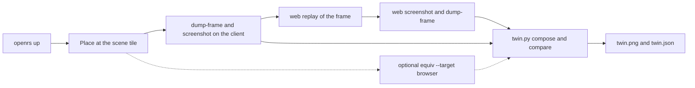

# Twin

`openrs twin` runs the OpenGL client and the WebGPU browser on the same frame, saves what each side holds, and puts them side by side. It is the autonomous check for the transpilation: one command, no manual steps, a verdict, an image and a report.



# Command

| Command | Effect |
| --- | --- |
| `openrs twin [scene]` | Runs the twin on a named scene, default `lumbridge` |
| `openrs twin --at X Y Z` | Runs it at a tile instead of a scene |
| `openrs twin --here` (alias `--no-teleport`) | Compares the frame at the player's current position without teleporting; the scene is named `here`, and it takes no scene and no `--at` |
| `openrs twin ... --frames N [--every K]` | Compares N rendered frames, from 1 to 600, taking every Kth frame, default 1; multi-frame output defaults to `<scene>-frames` |
| `openrs twin ... --renderdoc` | Also runs `openrs equiv --target browser` on the same place and adds its verdict and score |
| `openrs twin ... --keep` | Leaves the client running when `twin` started it |
| `openrs twin ... --out DIR` | Output folder, default `code/harness/target/twin/<scene>`, a relative path is resolved against where `openrs` runs |

- Scenes are the `openrs equiv scenes` list without `login`, because the twin needs a world.
- When a client is already in the world, `twin` uses it and leaves it running. Otherwise it runs `openrs up` and stops the client at the end.
- The browser is started with `openrs web up` and always stopped at the end, with its audio on the null sink like every browser launch.
- The exit code is 0 for PASS, 1 for FAIL and 2 for an error.

# Output Folder

| File | Content |
| --- | --- |
| `client/frame.orf` | The frame the client drew, streamed by `dump-frame` |
| `client/shot.png` | The client's frame readback, taken in the same batch as the dump |
| `client/state.json` and `client/describe.txt` | The control bridge `state` and `describe` of the client |
| `web/frame.orf` | The frame the browser page serializes after replaying `client/frame.orf` |
| `web/shot.png` | The canvas of the browser page |
| `web/state.json` and `web/describe.txt` | The page bridge `state` and `describe`, with the adapter and the replay summary |
| `diff.png` | The absolute difference of the two screenshots, multiplied by 4 |
| `twin.png` | Client, browser and difference next to each other with the verdict and numbers under them |
| `twin.json` | Everything above as data: verdict, pixel metrics, worst regions, serialized frame comparison, both states, both descriptions and the optional RenderDoc result |
| `renderdoc/` | With `--renderdoc`, the full `openrs equiv` folder, and `renderdoc.log` next to it |
| `../history.jsonl` | One line per run with the scene, frame count, verdict, SSIM and PSNR, so a run can print its trend against the previous run of the same scene |

# Verdict

| Check | Needs | Why |
| --- | --- | --- |
| Pixels | SSIM at least 0.99 | The two screenshots show the same frame |
| Serialized frames | `web/frame.orf` byte identical to `client/frame.orf` | The browser holds exactly the data the client drew, so a pixel difference comes from rendering, not from lost data |

- The serialized check separates the two possible causes of a difference. Identical frames and different pixels means the renderer is wrong. Different frames means data was lost or changed between the client and the page.
- `twin.json` lists the first differing byte when the frames differ.
- `openrs verify` runs the twin on `lumbridge` as its `twin` step. The step passes when the serialized frames are identical and the image exists, and records the SSIM, because the pixel threshold is the transpilation goal and not a harness fault.

# Reading A Report

```text
TWIN scene=varrock verdict=FAIL
pixels: ssim=0.9222 psnr=23.06dB mse=321.494 max=249 differing=13.731% bbox=[0, 4, 649, 500]
serialized frames: client 6133882 bytes, web 6133882 bytes, identical=True
worst regions (x0,y0,x1,y1):
  [144, 192, 191, 239] mean_diff=86.67 differing=100.0%
```

- The first Varrock run showed the fountain's water as a dark pit with a white dot in the browser while the client draws bright water. The worst regions pointed at that spot, which is the HD water pass.
- Particles such as the snow show up as small bright dots in the difference image. That is the particle pass, which the client and the browser draw differently.
- Start from the worst region, find the draw that covers it in `renderdoc/report.txt`, and fix the pass that owns the shader.

# Multi Frame Comparison

```bash
export OPENRS_WEB_STATE=$XDG_RUNTIME_DIR/openrs-web-multi
openrs twin lumbridge --frames 30
openrs twin varrock --frames 20 --every 2
```

The client streams each selected frame to disk and reads its back buffer before the same swap. The browser then loads each `.orf`, waits two rendered frames, takes its screenshot and writes the serialized frame back for a byte comparison. The capture keeps one frame in memory, not the whole sequence. The report reads neighbouring screenshots to estimate motion without loading the full sequence at once.

## Sequence Outputs

| File | Content |
| --- | --- |
| `client/frame-0000.orf`, `client/frame-0000.png` | The first recorded frame and its same-frame OpenGL readback, followed by numbered pairs |
| `client/frames.json` | Zero-based indices, absolute rendered-frame numbers, game ticks, monotonic nanosecond timestamps, game states and file names |
| `web/frame-0000.orf`, `web/frame-0000.png` | The browser's serialized frame and canvas readback for each pair |
| `frames/0000/` | `client.png`, `web.png`, `diff.png` and `twin.png` for that pair |
| `twin-frames.png` | A contact sheet of up to 12 evenly spaced frames, including the first and last |
| `twin.gif` | The whole sequence as client, browser and amplified difference panels, played at a fixed 120 ms per frame |
| `twin.json` | Per-frame SSIM, PSNR, differing percentage, byte comparison and worst regions; aggregate minimum, mean, maximum, worst frame and trend |
| `../history.jsonl` | One record per run including frame count and stride; sequence trends compare runs with the same scene, count and stride |

## Sequence Verdict

- Every serialized frame must be byte identical.
- Mean SSIM must be at least 0.99.
- The worst frame must have SSIM at least 0.98. A high mean cannot hide one broken frame.
- Identical images have infinite PSNR, represented by `null`; finite PSNR summary values exclude these frames.
- The single-frame command, outputs, threshold and verification step are unchanged. `--renderdoc` still adds one deep capture, not a RenderDoc capture of every sequence frame; use `equiv --frames` for that slower check.

## Reading The Sequence Trend

The report gives the SSIM slope per selected frame and means for the first and second halves. A fitted change under 0.005 over the whole sequence is labelled flat; otherwise it is improving or degrading. Look at the per-frame records as well: reconnect overlays, scene transitions and one isolated outlier can dominate a slope. An outlier is more than 0.1 SSIM below the sequence median.

The time-dependent-region check is a heuristic, not a shader classification. A pixel is moving when its colour changes by more than 8 between neighbouring captures on either side. The mask expands three pixels around motion. A frame is labelled `dynamic_only` when at least 90 percent of its differing pixels are in this mask and the mask covers at most 25 percent of the image. This area bound prevents a whole-screen transition from looking like a particle-only problem. No motion means the check cannot attribute a static water mismatch to animation.

Read the contact sheet for spatial consistency, then the GIF for moving water, snow, players and interface changes. The GIF is a diagnostic animation, not a real-time recording: dumping is slow, game ticks can advance by many steps between consecutive rendered frames, and the nanosecond timestamps give the actual elapsed time. The client sends its existing forced keepalive between dumps to avoid a loop-count-based keepalive timeout. Inspect `gameState` and the original screenshots before calling a sharp SSIM drop an animation regression. Frames with reconnect overlays can preserve old framebuffer contents that a standalone `.orf` replay cannot reconstruct.

## Per-region SSIM

`twin.json` and each frame record carry `region_ssim` beside the whole-frame SSIM: `terrain`, `models`, `minimap` and `chat`, each with its box and score. Boxes are fixed fractions of the 765x503 fixed layout (viewport 0,0 to 516,338; minimap from x 570 to the right edge, y 0 to 190; chat strip y 345 to 475). `models` is the padded bounding box of viewport pixels differing by more than 24 in any channel; `terrain` is the viewport with that box taken from the client image, so a model mismatch does not lower it. A frame with no such pixels reports `models` 1.0 with no box. The text report prints one `region ssim:` line.
