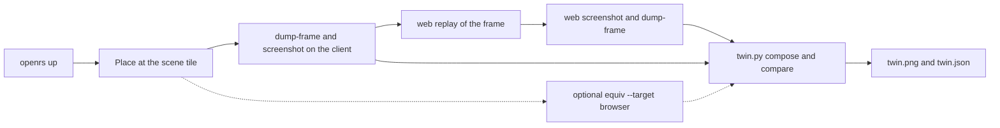

# Twin

`openrs twin` runs the OpenGL client and the WebGPU browser on the same frame, saves what each side holds, and puts them side by side. It is the autonomous check for the transpilation: one command, no manual steps, a verdict, an image and a report.



# Command

| Command | Effect |
| --- | --- |
| `openrs twin [scene]` | Runs the twin on a named scene, default `lumbridge` |
| `openrs twin --at X Y Z` | Runs it at a tile instead of a scene |
| `openrs twin ... --renderdoc` | Also runs `openrs equiv --target browser` on the same place and adds its verdict and score |
| `openrs twin ... --keep` | Leaves the client running when `twin` started it |
| `openrs twin ... --out DIR` | Output folder, default `code/harness/target/twin/<scene>`, a relative path is resolved against where `openrs` runs |

- Scenes are the `openrs equiv scenes` list without `login`, because the twin needs a world.
- When a client is already in the world, `twin` uses it and leaves it running. Otherwise it runs `openrs up` and stops the client at the end.
- The browser is started with `openrs web up` and always stopped at the end, with its audio on the null sink like every browser launch.
- The exit code is 0 for PASS, 1 for FAIL and 2 for an error.

# Output Folder

| File | Content |
| --- | --- |
| `client/frame.orf` | The frame the client drew, streamed by `dump-frame` |
| `client/shot.png` | The client's frame readback, taken in the same batch as the dump |
| `client/state.json` and `client/describe.txt` | The control bridge `state` and `describe` of the client |
| `web/frame.orf` | The frame the browser page serializes after replaying `client/frame.orf` |
| `web/shot.png` | The canvas of the browser page |
| `web/state.json` and `web/describe.txt` | The page bridge `state` and `describe`, with the adapter and the replay summary |
| `diff.png` | The absolute difference of the two screenshots, multiplied by 4 |
| `twin.png` | Client, browser and difference next to each other with the verdict and numbers under them |
| `twin.json` | Everything above as data: verdict, pixel metrics, worst regions, serialized frame comparison, both states, both descriptions and the optional RenderDoc result |
| `renderdoc/` | With `--renderdoc`, the full `openrs equiv` folder, and `renderdoc.log` next to it |
| `../history.jsonl` | One line per run with the scene, verdict, SSIM and PSNR, so a run can print its trend against the previous run of the same scene |

# Verdict

| Check | Needs | Why |
| --- | --- | --- |
| Pixels | SSIM at least 0.99 | The two screenshots show the same frame |
| Serialized frames | `web/frame.orf` byte identical to `client/frame.orf` | The browser holds exactly the data the client drew, so a pixel difference comes from rendering, not from lost data |

- The serialized check separates the two possible causes of a difference. Identical frames and different pixels means the renderer is wrong. Different frames means data was lost or changed between the client and the page.
- `twin.json` lists the first differing byte when the frames differ.
- `openrs verify` runs the twin on `lumbridge` as its `twin` step. The step passes when the serialized frames are identical and the image exists, and records the SSIM, because the pixel threshold is the transpilation goal and not a harness fault.

# Reading A Report

```text
TWIN scene=varrock verdict=FAIL
pixels: ssim=0.9222 psnr=23.06dB mse=321.494 max=249 differing=13.731% bbox=[0, 4, 649, 500]
serialized frames: client 6133882 bytes, web 6133882 bytes, identical=True
worst regions (x0,y0,x1,y1):
  [144, 192, 191, 239] mean_diff=86.67 differing=100.0%
```

- The first Varrock run showed the fountain's water as a dark pit with a white dot in the browser while the client draws bright water. The worst regions pointed at that spot, which is the HD water pass.
- Particles such as the snow show up as small bright dots in the difference image. That is the particle pass, which the client and the browser draw differently.
- Start from the worst region, find the draw that covers it in `renderdoc/report.txt`, and fix the pass that owns the shader.
