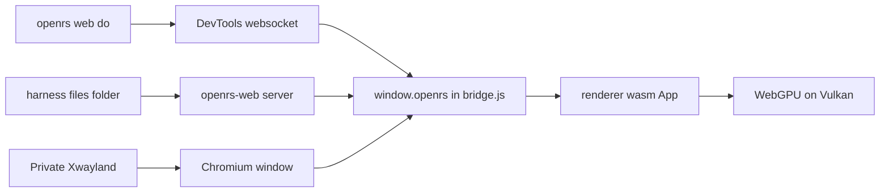

# Web Harness

`openrs web` drives the web client the same way `openrs up`, `do`, `look` and `trail` drive the native client. It starts the `openrs-web` server, opens the page in an isolated Chromium on the private Xwayland display, and talks to the page over the Chrome DevTools Protocol. The code is the `web` crate in `code/harness/crates/web`.



# Commands

| Command | Effect |
| --- | --- |
| `openrs web up [scene] [--game NAME] [--no-build] [--flags]` | Rebuilds a stale wasm or server, starts the server, starts Chromium on the private display, waits for the first frame and prints `ready` with the adapter. `--game` also builds and starts the `openrs-games` host as its own process and opens the page on that game, see `GAMES.md` |
| `openrs web down` | Stops the recorded Chromium, server and games host pids only |
| `openrs games list` | The games of the frame stream host |
| `openrs web do <cmd> [args] [; cmd ...]`, `-`, `@file` | Page commands and batches, the same rules as `openrs do` |
| `openrs web look [path]` | PNG of the canvas, then the text description |
| `openrs web trail [N \| since F \| path]` | Web footprints |
| `openrs web run [scene] [--flags]` | Server and Chromium without a build check or a ready wait |
| `openrs web show`, `hide`, `toggle` | Moves the private display, exactly as `openrs show`, `hide` and `toggle` |
| `openrs web fleet up [N] \| down \| status \| do \| look \| trail` | Up to nine browsers on one server, see the Fleet section |
| `openrs resume [web]` | Restarts a crashed web client and a crashed web fleet slot, see the Resume section |
| `openrs verify --group web` | The web steps only, see the Verify section |
| `openrs doctor [--deep]` | Includes the web prerequisites, `--deep` also starts the page once |

- Arguments of `up` and `run` that start with `--` go to Chromium, any other word is the scene, see `RENDERER.md`.
- `openrs down all` also stops the web client and the web fleet before the display.
- `up` prints `ready (already up)` when the page already answers.

```text
web client pid 1083536 on :100 server pid 1083523 at http://127.0.0.1:8092/ devtools 42643 log /run/user/1000/openrs-web/profile/chromium.log
ready frame 2 webgpu BrowserWebGpu adapter "" gpu "nvidia" "turing" fallback false
timings: page ready 0.8s, total 0.8s
```

# Page Commands

| Command | Arguments | Result |
| --- | --- | --- |
| `state` | none | Backend, wgpu backend, adapter, WebGPU adapter info, surface format, canvas size, frame count, loaded frame, replay summary, frame time, CPU time per frame, last error, last GPU error, URL |
| `tick`, `frame` | none | Frame count |
| `describe` | none | Compact text description |
| `wait-frames` | `[n] [timeout=ms]` | Waits for `n` more frames, default 1, timeout 30000, answers with the frame count and the time |
| `scene` | `name` | Switches to a built-in scene, disconnecting a game stream, and answers with its summary |
| `game` | `name [host:port]` | Reconnects the stream to that game on the running host, waits for its first frame and answers with the stream stats |
| `stream` | none | The stream stats of `FRAME-STREAM.md`: messages, bytes, frames received, rendered and dropped on both sides, host frame, echoed input sequence, round trip in ms |
| `replay` | `file.orf` | Loads a frame file, sizes the canvas to the frame and answers with the replay summary |
| `resize` | `WxH` | Fixes the canvas drawing buffer to that size |
| `screenshot` | `[path]` | Exact canvas pixels as a PNG, answers with the path |
| `dump-frame` | `[path]` | Writes the current frame description as `.orf`, answers with the path, the size and the summary |
| `console` | `[n]` | The last `n` console and error lines of the page, default 20 |
| `rect` | none | The canvas rectangle in CSS pixels and its drawing buffer size, used to map input coordinates |
| `input` | none | The page's input counts and its last 16 events |
| `input-reset` | none | Clears the input counts and events |
| `key`, `type`, `click`, `dblclick`, `move`, `drag`, `scroll`, `sleep` | see Input | Real input through the DevTools protocol |
| `bench` | `[N]` | Renders the loaded frame N times, default 60, with the page loop paused, and answers with the `renderer-app --bench` report: CPU phases, GPU time from timestamp queries, wall time to the fence, draws, commands and uploads per frame, first frame and percentiles |
| `help` | none | Every command |

- A single command prints strings bare and everything else as indented JSON. Batch results print one per line, a batch stops at the first failure and the exit code is 1 on any error.
- The replay summary has the same text as `renderer-app --replay`, such as `replay: 3297 draws, drawn 3297 [groundTextured=21,instanced=3107,particle=127,sprite=11,surfaceMask=31], skipped 0 []`, and `state` holds the same counts per shader as JSON.
- Default screenshot and dump paths are in the web footprints `shots` folder, named after the time and the frame.

```bash
openrs web do replay code/harness/target/verify/compare/s1/frame.orf \; wait-frames 5 \; state
printf 'scene model\nresize 640x480\nwait-frames 3\nscreenshot\n' | openrs web do -
openrs web look
```

# Input

The input commands send real events with `Input.dispatchKeyEvent` and `Input.dispatchMouseEvent`, so the page receives them exactly as it would from a person, including `keypress`, `click`, `dblclick`, `contextmenu` and `wheel`. They are page commands: they work in `;` batches and in `openrs web fleet do`.

| Command | Events |
| --- | --- |
| `key down \| up \| press <code>` | `keyDown`, `keyUp` or both for a `KeyboardEvent.code` such as `KeyA`, `Digit5`, `Enter`, `Space`, `ArrowLeft`, `F5`, `ShiftLeft` |
| `key press Shift+KeyA` | A `Shift`, `Ctrl`, `Alt` or `Meta` prefix sets the modifiers of the event |
| `type <text>` | A `keyDown` with text and a `keyUp` for every letter, digit, space and common punctuation mark, `Input.insertText` for anything else |
| `click <x> <y> [button]` | Move, press and release, button `left`, `middle` or `right` |
| `dblclick <x> <y> [button]` | Two presses with click counts 1 and 2 |
| `move <x> <y>` | A mouse move |
| `drag <x1> <y1> <x2> <y2> [button]` | Move, press, 8 moves with the button held 16 ms apart, release |
| `scroll <dx> <dy> [x y]` | A wheel event at the point, the canvas centre by default |
| `sleep <ms>` | Waits in a batch, no event |

- Coordinates are canvas pixels. The `rect` command gives the canvas rectangle and drawing buffer size, so `css = left + x * width / bufferWidth` holds after `resize` and `replay` as well, with device scale 1.
- The bridge counts every `keydown`, `keyup`, `keypress`, `mousedown`, `mouseup`, `mousemove`, `click`, `dblclick`, `contextmenu` and `wheel` in capture phase, and keeps the last 16 events with their canvas pixel position and the frame. `state` reports them as `input.counts` and `input.last`.
- Every command counts the events the page received before and after and fails when none arrived, so a lost input is an error. The answer names the events sent, the events delivered and the frame, such as `click 100 100 sent 3 delivered 4 frame 398`.
- The trail line of the command carries the same frame as `tick`, so `openrs web trail since F` selects input like any other command.

```bash
openrs web do input-reset \; click 100 100 \; key press KeyA \; type "hello" \; drag 10 10 200 120 \; scroll 0 120 \; state
```

# Browser

The browser is always `/usr/bin/chromium`, never the user's browser or profile.

| Setting | Value |
| --- | --- |
| Profile | `--user-data-dir=$XDG_RUNTIME_DIR/openrs-web/profile`, wiped on every start so no cached wasm survives a rebuild |
| Launcher flags | `XDG_CONFIG_HOME` points into the profile, so `~/.config/chromium-flags.conf` is not read |
| WebGPU | `--enable-unsafe-webgpu --enable-features=Vulkan,VulkanFromANGLE,DefaultANGLEVulkan --use-angle=vulkan --ignore-gpu-blocklist` |
| Display | `--ozone-platform=x11`, `DISPLAY` of the private Xwayland, `WAYLAND_DISPLAY` removed, an `--app` window at 0,0 sized 1280 by 900 |
| Hidden pacing | `--disable-gpu-vsync --disable-frame-rate-limit` and no background throttling, because the hidden Xwayland gives no vsync and frames fell to about 3 per second |
| Audio | `web::launch` sets `PULSE_SINK` and `PIPEWIRE_NODE` to the `openrs_null` sink for every launch, including the ones RenderDoc wraps. If the sink cannot be created, `--mute-audio` is added instead, so the browser can never reach the speakers |
| DevTools | `--remote-debugging-port=0`, the port and browser path are read from `DevToolsActivePort` in the profile |

- The page paces itself to 60 frames per second, `?fps=N` changes it. The loop advances its clock by the interval, not to the callback time, so animation frames that come faster than the interval on the hidden display are not halved to 40 frames per second.
- Audio was checked live by playing a WebAudio tone: PipeWire attached the Chromium stream to the `openrs_null` sink. `/proc/<pid>/environ` cannot be used for this check, because Chromium rewrites its own process title over it.
- `state` reports the WebGPU adapter as vendor `nvidia`, architecture `turing`, fallback `false`, and the Chromium GPU process holds about 240 MB on the GTX 1660 SUPER. A SwiftShader adapter would report architecture `swiftshader` and fallback `true`.

## Launch For Other Tools

`web::launch` starts Chromium with these flags on any display and returns the pid and the DevTools port, so RenderDoc can wrap it.

| Field of `web::Launch` | Meaning |
| --- | --- |
| `display` | X display such as `:100` |
| `url` | Page to open as the app window |
| `profile` | User data directory, created when missing |
| `args` | Extra Chromium flags, placed last so they win |
| `envs` | Extra environment |
| `wrapper` | Command prefix, such as a RenderDoc launcher, empty for none |

It returns `web::Browser` with `pid`, `port` and `ws`, the browser websocket URL. `web::Cdp::attach(ws)` attaches to the first page and `eval` runs an expression with `awaitPromise`.

# Page Bridge

`code/web/static/bridge.js` defines `window.openrs` and runs the frame loop. `boot.js` creates the wasm `App` and hands it to the bridge.

1. The console, `error` and `unhandledrejection` are captured into a ring of 200 lines.
2. Every animation frame calls `App.frame()` and counts it, with a smoothed frame time and CPU time.
3. `openrs.run(cmd, args)` answers `{ok, data}` or `{ok, error}` with the frame count, the same envelope as the control server.

| wasm `App` method | Task |
| --- | --- |
| `scene(name)` | Built-in scene |
| `replay(bytes, label)` | Parses an `.orf` and keeps its bytes for `dump` |
| `frame()` | Renders and presents one frame |
| `capture()` | Renders one frame, copies the swapchain texture to a buffer before presenting, returns a `Readback` |
| `Readback.read()` | Maps the buffer and returns RGBA rows with alpha 255, as the opaque canvas shows them |
| `dump()` | The replayed bytes, or the scene frame with its meshes and textures |
| `info()` | JSON state, including GPU errors caught by the uncaptured error handler |

- The canvas is configured with `COPY_SRC` on the web, so the screenshot is the presented swapchain image. The bridge encodes it as PNG through an `OffscreenCanvas`.
- Frame files reach the page through the server: `replay` symlinks the file into `$XDG_RUNTIME_DIR/openrs-web/files` under a safe name and the page fetches `/files/name` with `no-store`.

# DevTools Protocol

- One websocket per `openrs web` call, through `tungstenite`, with no message size limit so large dumps pass.
- `Target.getTargets` picks the first `http` page, `Target.attachToTarget` with `flatten` gives the session, and every `Runtime.evaluate` runs with `awaitPromise` and `returnByValue`.
- Events are skipped while waiting for the reply with the request id, and an exception becomes the error text.

# State Files

| File in `$XDG_RUNTIME_DIR/openrs-web` | Content |
| --- | --- |
| `server` | Server pid and port, the port is the first free one from 8091 or `OPENRS_WEB_PORT` |
| `browser` | Chromium pid, DevTools port and websocket URL |
| `args` | The arguments of the last start, used by `openrs resume` |
| `slots` | Fleet only: the slot count of the last `fleet up` |
| `server.log`, `profile/chromium.log` | Logs |
| `files` | Symlinks of replayed frame files |
| `games`, `games.log` | Games host pid, port and game name, and its log. `web up` without `--game` restarts a host that died with the recorded game and reconnects the page |

- A pid only counts when its command line holds the profile path or `openrs-web`, so `down` never stops another process.
- `OPENRS_WEB_STATE` moves the folder.

# Footprints

Lines go to `code/harness/target/footprints/web/trail.jsonl`, or `OPENRS_WEB_FOOTPRINTS`, in the native format. The `tick` field is the page frame count, so `openrs web trail since F` selects by frame.

| Kind | Written when | Extra fields |
| --- | --- | --- |
| `cmd` | A command finished, input commands included | `cmd`, `args`, `ok`, `error` |
| `shot` | A screenshot was written | `path`, `width`, `height`, `colors` (distinct colors among sampled pixels), or `via` `display` for the fallback |
| `dump` | A frame file was written | `path`, `bytes` |
| `up` | `web up` reached the first frame | `url`, `pid` |

# Freshness

`web up` rebuilds what is stale unless `--no-build` is given.

| Artifact | Stale when | Rebuilt with |
| --- | --- | --- |
| `code/web/static/renderer_bg.wasm` | Missing, or older than `code/renderer/src`, `shaders` or `Cargo.toml` | `code/renderer/build-web.sh` |
| `code/web/target/release/openrs-web` | Missing, or older than `code/web/src` or `Cargo.toml` | `cargo build --release` in `code/web` |

# Fleet

`openrs web fleet` runs up to nine browsers like `openrs fleet` runs nine clients. One `openrs-web` server serves all of them, and every slot is its own Chromium with its own profile, state folder, DevTools port, window and the null audio sink. The code is `fleet.rs`, `fleet_up.rs` and `fleet_status.rs` in the `web` crate.

| Command | Effect |
| --- | --- |
| `up [N] [--scene NAME]... [--no-build] [--flags]` | Starts `N` slots, default 9, one every 250 ms, and prints `slot n ready in Xs` as each page draws its first frame. A slot that is already up is skipped |
| `down` | Stops every recorded browser and the server by pid, then removes the folder |
| `status` | One row per slot with pid, state, frames, frame time, process count, RSS, PSS, CPU and GPU memory, then a totals line |
| `do <slot> <cmd...>` | The page commands and batches of `openrs web do` on that slot |
| `look <slot> [path]` | `openrs web look` on that slot |
| `trail <slot> [N \| since F \| path]` | The footprints of that slot, the same format as `openrs web trail` and `openrs trail` |

- `--scene NAME` is taken in order, the first for slot 1, the second for slot 2, and the last one repeats. Other `--` arguments go to every Chromium.
- Windows sit in a 3 by 3 grid of 480 by 340 pixels on the shared private Xwayland.
- Slot `n` keeps its state under `$XDG_RUNTIME_DIR/openrs-web-fleet/sn`, which `OPENRS_WEB_FLEET_STATE` moves, and its footprints in `sn/fp`. The server pid is in the folder itself. Slots share one `files` folder through a symlink, so `replay` works on every slot.
- `fleet down` and `openrs down all` only signal pids recorded in these folders, and wait for the browser to exit.
- `status` takes the processes of a browser from its process group, so the GPU, renderer and utility processes count with it. GPU memory per browser is the `nvidia-smi --query-compute-apps` figure of its processes, and `gpu_used_mb` is the whole card.

```text
slot pid state frames frame_ms procs rss_mb pss_mb cpu_pct gpu_mb
1 1258931 ready 578 54.93 10 1059 289 34 29
browsers 9 rss_mb 10068 pss_mb 2657 cpu_pct 572 gpu_mb 263 gpu_used_mb 1434 xwayland_rss_mb 142 total_pss_mb 2725
```

# Resume

`openrs resume` restarts what a crash left behind, the web side included. `openrs resume web` limits it to the web side, which the verify group uses so it never touches the native client.

1. A recorded web client whose browser pid is gone is started again with the arguments of its first start, kept in the `args` file, so its scene and `--game` survive.
2. A web fleet with a dead slot or server runs `web fleet up N` for the `N` in the `slots` file. Slots that are alive keep their pids, a dead slot returns with its own recorded scene.
3. Without anything to restart it prints `nothing to resume`.

```text
resuming the web client
web client pid 1266713 on :100 server pid 1266473 at http://127.0.0.1:8092/?scene=model devtools 39735 log /run/user/1000/openrs-web-harness/profile/chromium.log
ready frame 5 webgpu BrowserWebGpu adapter "" gpu "nvidia" "turing" fallback false
```

# Verify

`openrs verify --group web` runs only the web steps: no native client, no local server, no step that stops anything but its own browsers. `--group native` runs the existing steps without them and `--group all`, the default, runs everything. The full verify runs `equiv-browser` right after `equiv` and the web group right before `down-all`. `openrs verify list --group web` prints the order.

| Step | Checks |
| --- | --- |
| `web-up` | `web up` prints `ready` |
| `web-state` | Ready page on a hardware WebGPU adapter, not SwiftShader and not a fallback |
| `web-replay` | Generate an all-pass frame, render all 12 draws without skips, require a nonblank screenshot and byte-identical reserialization |
| `web-look` | The model scene screenshot is written and has more than one color |
| `web-input` | A click at 100 100 arrives at those canvas pixels, then clicks, double click, move, drag, wheel, key presses and typing are all counted by the page |
| `web-trail` | The trail holds the click with a frame number, a shot line, and `since F` returns only lines from that frame |
| `web-toggle` | `web show` then `web hide` |
| `web-bench` | `web do bench 20` prints its p50 line, skipped when the page has no `bench` |
| `web-fleet-up` | Three browsers on the model scene, none failed |
| `web-fleet-do` | Three parallel `fleet do` clicks, each slot counted exactly its own click, the slot trail has the click |
| `web-fleet-look` | Three parallel screenshots, none blank |
| `web-fleet-down` | `fleet status` shows no browsers |
| `capture-browser` | `openrs capture browser --scene model` writes `frame.rdc` |
| `web-resume` | Kills the recorded browser pid, `resume web` brings it back with a new pid, then kills slot 2 of a fleet of 3 and checks only slot 2 got a new pid and returned on its scene |
| `web-game-orbit`, `web-game-walker`, `web-game-buttons` | Start each real game host stream, require received and displayed frames, echoed input for interactive games and a nonblank screenshot |
| `web-down` | `web down`, after which `web do state` fails |
| `equiv-browser` | Full verify only: `equiv --live --cold --target browser`, which needs the native client |

- The group uses the state of the calling environment, so run it with `OPENRS_WEB_STATE` and `OPENRS_WEB_FOOTPRINTS` set when another browser is in use.
- The group needs a fresh wasm and server, `web-up` rebuilds a stale one, and that time is part of the step.

# Doctor

`openrs doctor` checks the web prerequisites with the other checks, in parallel, and the default run stays under 0.3 s.

| Check | PASS when |
| --- | --- |
| `chromium` | `/usr/bin/chromium` exists, its version is printed |
| `wasm-target` | `rustc --print sysroot` holds `lib/rustlib/wasm32-unknown-unknown` |
| `wasm-bindgen` | The CLI version equals the `wasm-bindgen` crate version in `code/renderer/Cargo.lock`, FAIL when missing or different, with the `cargo install --version` fix |
| `web-wasm`, `web-server` | `renderer_bg.wasm` and `openrs-web` are newer than their sources, WARN when stale or missing, `openrs web up` rebuilds them |
| `web-audio` | The `openrs_null` sink can be created, WARN otherwise, browsers then start with `--mute-audio` |

`openrs doctor --deep` also adds `web-gpu`: it starts the page once with a temporary state folder, reads `state`, stops it and fails on a missing adapter, a fallback adapter or SwiftShader. It takes about 1.5 s more.

# Measured

| Case | Value |
| --- | --- |
| `web up` to the first frame | 0.7 s to 1.1 s |
| One `openrs web do tick` | 4 ms |
| Model scene | 60 frames per second paced, 0.2 ms CPU per frame |
| Replay of the 6.5 MB `verify.orf` dump, 1882 drawn of 2999 draws | 0.58 s to load, render and wait 2 frames, then 1.0 ms CPU and 7 ms to the fence per frame, 60 frames per second paced |
| `openrs web do bench 60` on `verify.orf`, `lumbridge.orf`, `varrock.orf` | CPU 1.03, 0.66, 0.77 ms, wall 7.1, 5.8, 5.9 ms per frame, loads 580, 347, 409 ms, before 7.6, 4.9, 13.7 ms CPU and 3.7 s to 4.4 s loads, see `RENDERER.md` |
| Browser screenshot against `renderer-app --replay --out` of that dump | 510 of 455 112 pixels differ |
| `dump-frame` of a replay | Byte identical to the source file |

## Fleet Of Nine

Nine browsers on the model scene, GTX 1660 SUPER, 64 GB RAM, other agents using the same card.

| Case | Value |
| --- | --- |
| `fleet up 9` to all pages ready | 13.7 s, each page ready 4.9 s to 7.2 s after its launch, 2.0 s of that run is the stagger |
| `fleet up 3` | 4.4 s to 6.5 s |
| GPU memory of the nine GPU processes | 263 MB, 29 MB to 30 MB each, the card rose by 274 MB (1170 to 1444 MiB) |
| GPU memory with the larger `all` scene of an older wasm | 414 MB, 45 MB to 49 MB each |
| PSS, all nine browsers | 2657 MB, 286 MB to 309 MB each, about 10 processes per browser |
| RSS summed | 10 068 MB, which counts the shared pages nine times |
| Xwayland | 142 MB RSS |
| CPU | 572 percent of one core in total, 34 to 116 per browser |
| Page frame time | 19 ms to 81 ms per browser while nine run, 19 ms with fewer |
| Nine parallel `fleet do state` | 109 ms to 217 ms for all nine, one call alone 2 ms to 46 ms |
| `fleet down` of nine | 0.3 s |
| First `fleet look` of a slot | 3.6 s, later ones 0.3 s, the first PNG encode is slow |
| Resume of one dead slot | 4.1 s |

## Harness

| Case | Value |
| --- | --- |
| `openrs doctor` | 0.27 s |
| `openrs doctor --deep` | 1.8 s |
| `openrs web do click` | 10 ms |
| `openrs resume` of a killed web client | 1.9 s |
| `openrs verify --group web` | 15 steps in 66.5 s, of which `capture-browser` 20.0 s, `web-resume` 26.1 s, `web-fleet-up` 6.6 s, `web-fleet-look` 7.9 s and `web-up` 2.3 s |

# Known Limits

| Limit | Effect |
| --- | --- |
| HD water visual parity | The shader loads in Chromium after explicit sampling and translation fixes, but matching the original water remains transpilation work; a successfully rendered frame is not proof of equivalent pixels |
| Adapter name | Chrome hides the adapter name, `state` shows the vendor and architecture instead |
| Replay speed | A large dump renders at the paced 60 frames per second; `bench` shows 5 to 7 ms from submit to the fence through the GPU process, so about 140 frames per second is the ceiling unpaced |
| Frame stream | The page streams from the test games of `GAMES.md`; the Kotlin client is not a host yet, see `FRAME-STREAM.md` |

# Integrated Stream Checks

- The browser-only verification group now has 18 steps. The final three game steps start orbit, walker and buttons through the game host, require received and displayed frames, confirm echoed input for walker and buttons, and save nonblank screenshots.
- The strengthened replay test generates a complete all-pass frame instead of treating the parser fixture as a renderable game scene. It checks all 12 draws, no skips, a nonblank image and byte-identical serialization.
- A live isolated web-group run passed in 25.7 s, including capture, fleet isolation, crash resume and the three streaming games.
