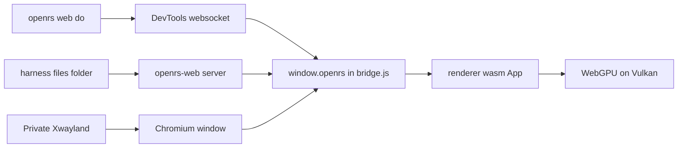

# Web Harness

`openrs web` drives the web client the same way `openrs up`, `do`, `look` and `trail` drive the native client. It starts the `openrs-web` server, opens the page in an isolated Chromium on the private Xwayland display, and talks to the page over the Chrome DevTools Protocol. The code is the `web` crate in `code/harness/crates/web`.



# Commands

| Command | Effect |
| --- | --- |
| `openrs web up [scene] [--no-build] [--flags]` | Rebuilds a stale wasm or server, starts the server, starts Chromium on the private display, waits for the first frame and prints `ready` with the adapter |
| `openrs web down` | Stops the recorded Chromium and server pids only |
| `openrs web do <cmd> [args] [; cmd ...]`, `-`, `@file` | Page commands and batches, the same rules as `openrs do` |
| `openrs web look [path]` | PNG of the canvas, then the text description |
| `openrs web trail [N \| since F \| path]` | Web footprints |
| `openrs web run [scene] [--flags]` | Server and Chromium without a build check or a ready wait |
| `openrs web show`, `hide`, `toggle` | Moves the private display, exactly as `openrs show`, `hide` and `toggle` |

- Arguments of `up` and `run` that start with `--` go to Chromium, any other word is the scene, see `RENDERER.md`.
- `openrs down all` also stops the web client before the display, and `openrs resume` restarts a web client whose browser died.
- `up` prints `ready (already up)` when the page already answers.

```text
web client pid 1083536 on :100 server pid 1083523 at http://127.0.0.1:8092/ devtools 42643 log /run/user/1000/openrs-web/profile/chromium.log
ready frame 2 webgpu BrowserWebGpu adapter "" gpu "nvidia" "turing" fallback false
timings: page ready 0.8s, total 0.8s
```

# Page Commands

| Command | Arguments | Result |
| --- | --- | --- |
| `state` | none | Backend, wgpu backend, adapter, WebGPU adapter info, surface format, canvas size, frame count, loaded frame, replay summary, frame time, CPU time per frame, last error, last GPU error, URL |
| `tick`, `frame` | none | Frame count |
| `describe` | none | Compact text description |
| `wait-frames` | `[n] [timeout=ms]` | Waits for `n` more frames, default 1, timeout 30000, answers with the frame count and the time |
| `scene` | `name` | Switches to a built-in scene and answers with its summary |
| `replay` | `file.orf` | Loads a frame file, sizes the canvas to the frame and answers with the replay summary |
| `resize` | `WxH` | Fixes the canvas drawing buffer to that size |
| `screenshot` | `[path]` | Exact canvas pixels as a PNG, answers with the path |
| `dump-frame` | `[path]` | Writes the current frame description as `.orf`, answers with the path, the size and the summary |
| `console` | `[n]` | The last `n` console and error lines of the page, default 20 |
| `help` | none | Every command |

- A single command prints strings bare and everything else as indented JSON. Batch results print one per line, a batch stops at the first failure and the exit code is 1 on any error.
- The replay summary has the same text as `renderer-app --replay`, such as `replay: 3297 draws, drawn 3297 [groundTextured=21,instanced=3107,particle=127,sprite=11,surfaceMask=31], skipped 0 []`, and `state` holds the same counts per shader as JSON.
- Default screenshot and dump paths are in the web footprints `shots` folder, named after the time and the frame.

```bash
openrs web do replay code/harness/target/verify/compare/s1/frame.orf \; wait-frames 5 \; state
printf 'scene model\nresize 640x480\nwait-frames 3\nscreenshot\n' | openrs web do -
openrs web look
```

# Browser

The browser is always `/usr/bin/chromium`, never the user's browser or profile.

| Setting | Value |
| --- | --- |
| Profile | `--user-data-dir=$XDG_RUNTIME_DIR/openrs-web/profile`, wiped on every start so no cached wasm survives a rebuild |
| Launcher flags | `XDG_CONFIG_HOME` points into the profile, so `~/.config/chromium-flags.conf` is not read |
| WebGPU | `--enable-unsafe-webgpu --enable-features=Vulkan,VulkanFromANGLE,DefaultANGLEVulkan --use-angle=vulkan --ignore-gpu-blocklist` |
| Display | `--ozone-platform=x11`, `DISPLAY` of the private Xwayland, `WAYLAND_DISPLAY` removed, an `--app` window at 0,0 sized 1280 by 900 |
| Hidden pacing | `--disable-gpu-vsync --disable-frame-rate-limit` and no background throttling, because the hidden Xwayland gives no vsync and frames fell to about 3 per second |
| Audio | `web::launch` sets `PULSE_SINK` and `PIPEWIRE_NODE` to the `openrs_null` sink for every launch, including the ones RenderDoc wraps. If the sink cannot be created, `--mute-audio` is added instead, so the browser can never reach the speakers |
| DevTools | `--remote-debugging-port=0`, the port and browser path are read from `DevToolsActivePort` in the profile |

- The page paces itself to 60 frames per second, `?fps=N` changes it.
- Audio was checked live by playing a WebAudio tone: PipeWire attached the Chromium stream to the `openrs_null` sink. `/proc/<pid>/environ` cannot be used for this check, because Chromium rewrites its own process title over it.
- `state` reports the WebGPU adapter as vendor `nvidia`, architecture `turing`, fallback `false`, and the Chromium GPU process holds about 240 MB on the GTX 1660 SUPER. A SwiftShader adapter would report architecture `swiftshader` and fallback `true`.

## Launch For Other Tools

`web::launch` starts Chromium with these flags on any display and returns the pid and the DevTools port, so RenderDoc can wrap it.

| Field of `web::Launch` | Meaning |
| --- | --- |
| `display` | X display such as `:100` |
| `url` | Page to open as the app window |
| `profile` | User data directory, created when missing |
| `args` | Extra Chromium flags, placed last so they win |
| `envs` | Extra environment |
| `wrapper` | Command prefix, such as a RenderDoc launcher, empty for none |

It returns `web::Browser` with `pid`, `port` and `ws`, the browser websocket URL. `web::Cdp::attach(ws)` attaches to the first page and `eval` runs an expression with `awaitPromise`.

# Page Bridge

`code/web/static/bridge.js` defines `window.openrs` and runs the frame loop. `boot.js` creates the wasm `App` and hands it to the bridge.

1. The console, `error` and `unhandledrejection` are captured into a ring of 200 lines.
2. Every animation frame calls `App.frame()` and counts it, with a smoothed frame time and CPU time.
3. `openrs.run(cmd, args)` answers `{ok, data}` or `{ok, error}` with the frame count, the same envelope as the control server.

| wasm `App` method | Task |
| --- | --- |
| `scene(name)` | Built-in scene |
| `replay(bytes, label)` | Parses an `.orf` and keeps its bytes for `dump` |
| `frame()` | Renders and presents one frame |
| `capture()` | Renders one frame, copies the swapchain texture to a buffer before presenting, returns a `Readback` |
| `Readback.read()` | Maps the buffer and returns RGBA rows with alpha 255, as the opaque canvas shows them |
| `dump()` | The replayed bytes, or the scene frame with its meshes and textures |
| `info()` | JSON state, including GPU errors caught by the uncaptured error handler |

- The canvas is configured with `COPY_SRC` on the web, so the screenshot is the presented swapchain image. The bridge encodes it as PNG through an `OffscreenCanvas`.
- Frame files reach the page through the server: `replay` symlinks the file into `$XDG_RUNTIME_DIR/openrs-web/files` under a safe name and the page fetches `/files/name` with `no-store`.

# DevTools Protocol

- One websocket per `openrs web` call, through `tungstenite`, with no message size limit so large dumps pass.
- `Target.getTargets` picks the first `http` page, `Target.attachToTarget` with `flatten` gives the session, and every `Runtime.evaluate` runs with `awaitPromise` and `returnByValue`.
- Events are skipped while waiting for the reply with the request id, and an exception becomes the error text.

# State Files

| File in `$XDG_RUNTIME_DIR/openrs-web` | Content |
| --- | --- |
| `server` | Server pid and port, the port is the first free one from 8091 or `OPENRS_WEB_PORT` |
| `browser` | Chromium pid, DevTools port and websocket URL |
| `server.log`, `profile/chromium.log` | Logs |
| `files` | Symlinks of replayed frame files |

- A pid only counts when its command line holds the profile path or `openrs-web`, so `down` never stops another process.
- `OPENRS_WEB_STATE` moves the folder.

# Footprints

Lines go to `code/harness/target/footprints/web/trail.jsonl`, or `OPENRS_WEB_FOOTPRINTS`, in the native format. The `tick` field is the page frame count, so `openrs web trail since F` selects by frame.

| Kind | Written when | Extra fields |
| --- | --- | --- |
| `cmd` | A command finished | `cmd`, `args`, `ok`, `error` |
| `shot` | A screenshot was written | `path`, `width`, `height`, or `via` `display` for the fallback |
| `dump` | A frame file was written | `path`, `bytes` |
| `up` | `web up` reached the first frame | `url`, `pid` |

# Freshness

`web up` rebuilds what is stale unless `--no-build` is given.

| Artifact | Stale when | Rebuilt with |
| --- | --- | --- |
| `code/web/static/renderer_bg.wasm` | Missing, or older than `code/renderer/src`, `shaders` or `Cargo.toml` | `code/renderer/build-web.sh` |
| `code/web/target/release/openrs-web` | Missing, or older than `code/web/src` or `Cargo.toml` | `cargo build --release` in `code/web` |

# Measured

| Case | Value |
| --- | --- |
| `web up` to the first frame | 0.7 s to 1.1 s |
| One `openrs web do tick` | 4 ms |
| Model scene | 60 frames per second paced, 0.2 ms CPU per frame |
| Replay of a 9.3 MB client dump with 3297 draws | 4.0 s to load, render and wait 5 frames, then about 110 ms per frame |
| Browser screenshot against `renderer-app --replay --out` of that dump | 510 of 455 112 pixels differ |
| `dump-frame` of a replay | Byte identical to the source file |

# Known Limits

| Limit | Effect |
| --- | --- |
| `hdWater.frag` and Chrome | Chrome's WGSL compiler rejects the `textureSample` in `caustic` as non uniform control flow, naga accepts it. The whole command buffer fails, so the `all` and `water` scenes and any frame with HD water draw nothing, and `state` shows the GPU error |
| Adapter name | Chrome hides the adapter name, `state` shows the vendor and architecture instead |
| Replay speed | Every frame re-records all draws, so large dumps render at about 9 frames per second |
| Frame stream | The page only shows scenes and frame files until the client streams frames, see `MODERN-RENDERER-WEB-TRANSFER.md` |
