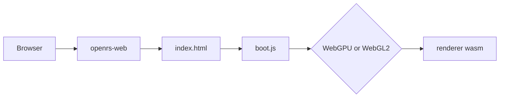

# Web

`code/web` is a standalone Cargo project, outside the `code/harness` workspace. It serves the static page that will host the transpiled modern renderer.

## Layout

| Path | Task |
| --- | --- |
| `code/web/src/main.rs` | Configuration, worker threads, graceful shutdown |
| `code/web/src/files.rs` | Path resolution, precompressed lookup, response headers |
| `code/web/src/mime.rs` | Extension to MIME type, including `.wasm` |
| `code/web/static/index.html` | Full viewport canvas |
| `code/web/static/boot.js` | WebGPU and WebGL2 check, renderer module slot |

## Run

```
cd code/web
cargo build --release
PORT=8080 ./target/release/openrs-web
```

## Configuration

| Variable | Default | Meaning |
| --- | --- | --- |
| `PORT` | `8080` | Listening port |
| `HOST` | `127.0.0.1` | Bind address |
| `STATIC_DIR` | `static` | Directory served |

## Serving

- Every response carries COOP `same-origin` and COEP `require-corp` so wasm threads and shared memory can be enabled later.
- A file `name.ext.br` or `name.ext.gz` next to `name.ext` is sent with the matching `Content-Encoding` when the browser accepts it, brotli first.
- HTML is sent `no-cache`, every other file is cached for an hour.
- Paths containing `..` are rejected.
- `SIGINT` and `SIGTERM` stop all workers and exit.

## Renderer Slot

- `boot.js` loads `renderer.js` and `renderer_bg.wasm` from `static` when they exist.
- The module default export receives the wasm URL and an object with the canvas and the detected backend.



## Entry Point

- The `web` entry point is `code/web`, started by `openrs-web`. The harness integration is added later.
